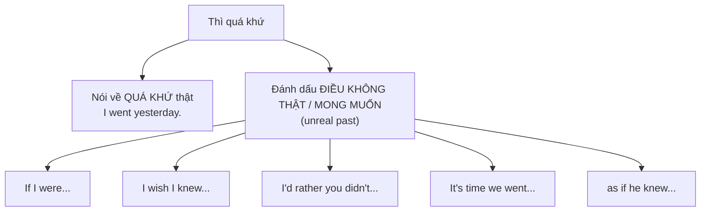

# B2-G016 · Unreal Past: Would Rather, It's Time, As If — Quá khứ giả định

## Mục lục

- [A. Lesson Information](#a-lesson-information)
- [B. Warm-up](#b-warm-up)
- [C. WHAT](#c-what)
- [D. WHY](#d-why)
- [E. FORM](#e-form)
- [F. HOW](#f-how)
- [G. VISUAL](#g-visual)
- [H. COMPARISON](#h-comparison)
- [I. COMMON MISTAKES](#i-common-mistakes)
- [J. MEMORY TRICKS](#j-memory-tricks)
- [K. REAL-LIFE APPLICATION](#k-real-life-application)
- [L. PRACTICE EXERCISES](#l-practice-exercises)
- [M. KNOWLEDGE CHECK](#m-knowledge-check)
- [N. ANSWER KEY](#n-answer-key)

---

## A. Lesson Information

| Mục | Nội dung |
|---|---|
| **Lesson ID** | B2-G016 |
| **Topic** | Unreal past after: would rather / would sooner (+ subject + past); it's (high/about) time + subject + past; as if / as though (real vs unreal); suppose / supposing; wish (review) |
| **Tên tiếng Việt** | Quá khứ giả định sau *would rather, it's time, as if/as though, suppose* |
| **CEFR Level** | B2 |
| **Prerequisites** | [B1-G009 — Wish / If only](../../04-B1-INTERMEDIATE/grammar/B1-G009-wish-if-only.md), [B1-G007 — Second Conditional](../../04-B1-INTERMEDIATE/grammar/B1-G007-second-conditional.md) |
| **Estimated Time** | 75 phút |

**Learning Objectives:**

1. Hiểu **quá khứ giả định** (unreal past): dùng **dạng quá khứ** để nói về **hiện tại/tương lai không có thật**.
2. Dùng ***would rather + V*** (cùng chủ ngữ) và ***would rather + S + V2*** (khác chủ ngữ).
3. Dùng ***It's (high/about) time + S + V2*** và ***It's time + to V***.
4. Phân biệt ***as if / as though*** + hiện tại (có thể thật) và + quá khứ (không thật).
5. Ôn tập và hệ thống *wish, if only, suppose* trong cùng một "họ" cấu trúc.

---

## B. Warm-up

> *It's 11 p.m. **It's time** you **went** to bed.*
> *I**'d rather** you **didn't** smoke in here.*
> *He talks **as if** he **knew** everything.*

🤔 **Hãy suy nghĩ:** Cả ba câu nói về **bây giờ**, nhưng động từ lại ở **quá khứ** (*went, didn't, knew*). Bạn đã gặp hiện tượng "quá khứ cho hiện tại" ở cấu trúc nào trước đây?

---

## C. WHAT

**Quá khứ giả định** = dùng **thì quá khứ** không phải để nói về quá khứ, mà để đánh dấu điều gì đó là **không có thật / mong muốn / chưa xảy ra**. Bạn đã gặp ở:

- Câu điều kiện loại 2: *If I **had** money...*
- *Wish*: *I wish I **knew** the answer.*

Bài này thêm ba "người anh em":

| Cấu trúc | Ý nghĩa | Ví dụ |
|---|---|---|
| ***would rather + S + V2*** | muốn người khác làm gì (lịch sự) | *I'd rather you **stayed**.* |
| ***It's time + S + V2*** | đã đến lúc (lẽ ra phải làm rồi) | *It's time we **left**.* |
| ***as if / as though + V2*** | như thể (không thật) | *She acts as if she **were** the boss.* |

---

## D. WHY



Những cấu trúc này giúp bạn **yêu cầu lịch sự**, **phàn nàn khéo**, **mô tả ấn tượng** — rất phổ biến trong hội thoại tự nhiên và văn kể chuyện.

---

## E. FORM

### E1. *would rather / would sooner*

| Chủ ngữ | Thời gian | Cấu trúc | Ví dụ |
|---|---|---|---|
| **Cùng** chủ ngữ | Hiện tại/tương lai | **would rather + V** | *I'd rather **stay** home tonight.* |
| **Cùng** chủ ngữ | Quá khứ | **would rather + have V3** | *I'd rather **have stayed** home last night.* |
| **Khác** chủ ngữ | Hiện tại/tương lai | **would rather + S + V2** | *I'd rather you **didn't tell** anyone.* |
| **Khác** chủ ngữ | Quá khứ | **would rather + S + had V3** | *I'd rather you **hadn't told** anyone.* |
| So sánh | | **would rather + V + than + V** | *I'd rather **walk than take** a taxi.* |

### E2. *It's time*

| Cấu trúc | Ý nghĩa | Ví dụ |
|---|---|---|
| **It's time + to V** | đến lúc (trung tính) | *It's time **to go**.* |
| **It's time + for O + to V** | đến lúc ai đó... | *It's time **for us to go**.* |
| **It's (high/about) time + S + V2** | đáng lẽ phải... rồi (phàn nàn, thúc giục) | *It's **high time** you **found** a job.* |

### E3. *as if / as though*

| Cấu trúc | Ý nghĩa | Ví dụ |
|---|---|---|
| **as if + hiện tại** | có thể là thật | *It looks **as if** it **is going to** rain.* (mây đen — có thể mưa thật) |
| **as if + quá khứ (were)** | không thật (hiện tại) | *He talks **as if** he **were** a millionaire.* (không phải) |
| **as if + had V3** | không thật (quá khứ) | *She looked **as if** she **had seen** a ghost.* |

> Sau *look, seem, sound, feel, act, behave, talk* thường dùng *as if / as though*. Trong văn nói, *like* cũng được dùng: *It looks **like** it's going to rain.*

### E4. *suppose / supposing / what if*

*Suppose* / *Supposing* / *What if* + **quá khứ** cho giả định ít khả năng:
*Suppose you **won** the lottery — what **would** you do?*

---

## F. HOW

| # | English | Tiếng Việt | Phân tích |
|---|---|---|---|
| 1 | *I**'d rather** eat at home than go out tonight.* | Tôi thích ăn ở nhà hơn là ra ngoài tối nay. | Cùng chủ ngữ + V |
| 2 | *I**'d rather** you **didn't** use my laptop without asking.* | Tôi mong bạn đừng dùng laptop của tôi mà không hỏi. | Khác chủ ngữ + V2 — lời yêu cầu lịch sự |
| 3 | *She**'d rather** her son **studied** medicine.* | Bà ấy muốn con trai học y hơn. | Mong muốn cho người khác |
| 4 | *I**'d rather** you **hadn't said** that in front of my boss.* | Tôi ước bạn đã không nói vậy trước mặt sếp tôi. | Quá khứ — tiếc |
| 5 | *It**'s time to** start the meeting.* | Đến lúc bắt đầu họp. | It's time + to V |
| 6 | *It**'s high time** the government **did** something about pollution.* | Đã đến lúc chính phủ phải làm gì đó về ô nhiễm. | Phàn nàn |
| 7 | *You're 30! It**'s about time** you **learned** to cook.* | Đã đến lúc bạn học nấu ăn rồi. | about time |
| 8 | *It looks **as if** the shop **is** closed.* | Có vẻ như cửa hàng đóng cửa. | Có thể thật |
| 9 | *He spends money **as if** he **were** a millionaire.* | Anh ta tiêu tiền như thể là triệu phú. | Không thật |
| 10 | *She looked **as though** she **hadn't slept** for days.* | Cô ấy trông như thể nhiều ngày chưa ngủ. | Không thật — quá khứ |
| 11 | ***Suppose** you **lost** your job tomorrow. What **would** you do?* | Giả sử mai bạn mất việc... | Suppose + V2 |
| 12 | *I'd sooner **walk** than wait an hour for the bus.* | Tôi thà đi bộ còn hơn đợi xe buýt một tiếng. | would sooner = would rather |

---

## G. VISUAL

### "Họ" quá khứ giả định

```text
                   HIỆN TẠI / TƯƠNG LAI        QUÁ KHỨ
If ...             If I knew                   If I had known
I wish ...         I wish I knew               I wish I had known
I'd rather you ... I'd rather you knew         I'd rather you had known
as if ...          as if he knew               as if he had known
It's time ...      It's time we knew           —
```

---

## H. COMPARISON

### *would rather* vs *prefer*

| *would rather* | *prefer* |
|---|---|
| *I'd rather **stay** home.* (không *to*) | *I prefer **to stay** / **staying** home.* |
| *I'd rather tea **than** coffee.* | *I prefer tea **to** coffee.* |
| *I'd rather you **stayed**.* | *I'd prefer you **to stay**.* |

### *It's time to* vs *It's time + S + V2*

| *It's time to go.* | *It's time we went.* |
|---|---|
| Trung tính, chỉ thời điểm | Nhấn mạnh **đáng lẽ phải làm rồi** (hơi trễ, thúc giục) |

### *as if* + hiện tại vs quá khứ

| *It looks as if it **is** going to rain.* | *He acts as if he **were** the boss.* |
|---|---|
| Có thể mưa thật | Anh ta **không phải** sếp |

---

## I. COMMON MISTAKES

| # | ❌ Sai | ✅ Đúng | Nguyên nhân | Cách tránh |
|---|---|---|---|---|
| 1 | I'd rather **to stay** at home. | I'd rather **stay** at home. | Thêm *to* | *would rather* + V |
| 2 | I'd rather you **don't** smoke here. | I'd rather you **didn't** smoke here. | Không lùi thì | Khác chủ ngữ → V2 |
| 3 | It's time we **go** home. | It's time we **went** home. | | *It's time + S + V2* |
| 4 | It's high time **to** you got a job. | It's high time **you got** a job. | Trộn hai cấu trúc | |
| 5 | He talks as if he **is** a doctor. (anh ta không phải) | ... as if he **were** a doctor. | Không đánh dấu "không thật" | Không thật → quá khứ |
| 6 | I'd rather **walk than to take** a taxi. | I'd rather **walk than take** a taxi. | | Cả hai vế nguyên mẫu |
| 7 | She looked as if she **saw** a ghost. | ... as if she **had seen** a ghost. | | Việc trước → *had V3* |

---

## J. MEMORY TRICKS

1. **"Lùi một bước = xa thực tế"** 🔙: lùi thì từ hiện tại về quá khứ = "điều này không có thật / chưa xảy ra".
2. **"Rather — không TO"**: *would rather* giống modal: + V nguyên mẫu.
3. **"High time = trễ rồi đó!"**: thêm *high/about* → giọng phàn nàn.

---

## K. REAL-LIFE APPLICATION

### Hội thoại: Mother and son

> **Mum:** *It's 2 a.m., Nam. **It's high time** you **turned** off that computer.*
> **Nam:** *Just ten more minutes, Mum. I'm in the middle of a game.*
> **Mum:** *You always say that. You act **as if** you **didn't** have school tomorrow.*
> **Nam:** *I know, I know. But I**'d rather** finish this level now than lose all my progress.*
> **Mum:** *And I**'d rather** you **got** some sleep. Look at you — you look **as though** you **haven't slept** for a week!*
> **Nam:** *Fine… **Suppose** I **stopped** now — could I play for an hour after school tomorrow?*
> **Mum:** *Only if you finish your homework first. Now, bed!*

**Dịch tóm tắt:** Mẹ nhắc 2 giờ sáng rồi, đã đến lúc tắt máy. Nam xin thêm 10 phút. Mẹ nói Nam cư xử như thể mai không đi học. Nam muốn xong màn chơi hơn là mất tiến độ; mẹ muốn Nam đi ngủ, nhìn như cả tuần chưa ngủ. Nam đề nghị: nếu dừng bây giờ thì mai được chơi một tiếng sau giờ học không? Mẹ: chỉ khi làm xong bài tập.

> 💡 *as though you **haven't slept*** (hiện tại hoàn thành) — người mẹ nghĩ điều đó **có thể thật**; nếu muốn nhấn mạnh là "không thật", có thể dùng *hadn't slept*.

---

## L. PRACTICE EXERCISES

> ✍️ Đáp án: [B2-G016-ANSWERS](../../12-ANSWERS-AND-EXPLANATIONS/B2/B2-G016-ANSWERS.md)

### Level 1 — Recognition

**L1.1.** I'd rather ___ at home tonight.  A. to stay  B. stay  C. stayed
**L1.2.** I'd rather you ___ my diary.  A. don't read  B. didn't read  C. not to read
**L1.3.** It's high time you ___ a job.  A. get  B. got  C. to get
**L1.4.** He talks as if he ___ the president. (anh ta không phải)  A. is  B. were  C. be
**L1.5.** She looked as if she ___ a ghost.  A. saw  B. had seen  C. sees
**L1.6.** It's time ___ to bed, children.  A. to go  B. going  C. go

### Level 2 — Controlled Practice

Viết lại câu bằng từ trong ngoặc.

**L2.1.** I prefer to walk rather than drive. (would rather)
**L2.2.** Please don't call me after 10 p.m. (I'd rather you)
**L2.3.** I want my daughter to study abroad. (would rather)
**L2.4.** I regret that you told her the secret. (I'd rather you)
**L2.5.** We should leave now — it's getting late. (It's time we)
**L2.6.** You should have cleaned your room ages ago. (It's high time)
**L2.7.** He behaves like a king, but he isn't one. (as if)
**L2.8.** She looked very shocked. It seemed she had heard terrible news. (as though)

Chia động từ trong ngoặc.

**L2.9.** It sounds as if someone (knock) ___ at the door. (có thể thật — đang gõ)
**L2.10.** Suppose you (meet) ___ your favourite actor — what would you say?

### Level 3 — Error Correction

**L3.1.** I'd rather to have tea than coffee.
**L3.2.** I'd rather you don't park here.
**L3.3.** It's time we go home.
**L3.4.** It's high time to you stopped complaining.
**L3.5.** She acts as if she is the boss, but she's just an intern.
**L3.6.** I'd rather walk than to take the bus.

### Level 4 — Production

**L4.1.** Dịch: *"Tôi mong bạn đừng kể chuyện này với ai."* (*I'd rather*)
**L4.2.** Dịch: *"Đã đến lúc chúng ta phải nghiêm túc về biến đổi khí hậu."* (*It's high time*)
**L4.3.** Dịch: *"Anh ấy nói tiếng Anh như thể là người bản ngữ."*
**L4.4.** Dịch: *"Tôi thà ở nhà còn hơn đi đến bữa tiệc ồn ào đó."*

**L4.5.** **Explain:** Phân biệt *"It looks as if it's going to rain"* và *"He talks as if he were rich"*.

### Level 5 — Real Communication

**L5.1.** Viết **đoạn hội thoại hoặc email phàn nàn khéo** (120–150 từ) gửi bạn cùng phòng/hàng xóm/đồng nghiệp (giả định). Dùng ≥ 2 *I'd rather you + V2*, ≥ 1 *I'd rather + V ... than*, ≥ 2 *It's (high) time*, ≥ 2 *as if/as though*.
**L5.2.** **Speaking — Preferences:** Trả lời 1,5 phút: *"Would you rather live in the city or the countryside? Why?"* Dùng *I'd rather..., I'd rather my children..., It's time cities..., People in cities act as if...*

---

## M. KNOWLEDGE CHECK

### 5 câu hỏi tự kiểm tra

1. *would rather* với cùng chủ ngữ và khác chủ ngữ?
2. *It's time to V* khác *It's time + S + V2* thế nào?
3. Khi nào *as if* + hiện tại, khi nào + quá khứ?
4. Vì sao dùng quá khứ để nói về hiện tại trong các cấu trúc này?
5. *would rather* vs *prefer*: khác nhau về cấu trúc?

### Checklist

- [ ] Tôi dùng *would rather + V* (không *to*).
- [ ] Tôi lùi thì sau *would rather + S* và *It's time + S*.
- [ ] Tôi phân biệt *as if* thật/không thật.

### 3 lỗi quan trọng cần nhớ

1. ~~would rather to stay~~ → would rather **stay**.
2. ~~I'd rather you don't~~ → I'd rather you **didn't**.
3. ~~It's time we go~~ → It's time we **went**.

### Lịch ôn tập

| Ngày | Việc cần làm |
|---|---|
| Ngày 1 | Làm lại L2 |
| Ngày 3 | Viết 5 câu *It's high time...* về các vấn đề xã hội |
| Ngày 7 | Ôn chung với [B1-G009 — Wish](../../04-B1-INTERMEDIATE/grammar/B1-G009-wish-if-only.md) và [ALL-CONDITIONALS](../../06-GRAMMAR-REFERENCE/ALL-CONDITIONALS.md) |

### Liên kết

- ➡️ Bài tiếp theo: [B2-G017 — Advanced Linking Devices](B2-G017-advanced-linking-devices.md)

---

## N. ANSWER KEY

👉 [B2-G016-ANSWERS.md](../../12-ANSWERS-AND-EXPLANATIONS/B2/B2-G016-ANSWERS.md)
