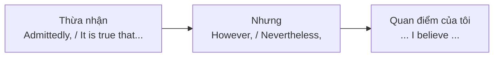

# B2-G018 · Contrast & Concession — Tương phản và nhượng bộ

## Mục lục

- [A. Lesson Information](#a-lesson-information)
- [B. Warm-up](#b-warm-up)
- [C. WHAT](#c-what)
- [D. WHY](#d-why)
- [E. FORM](#e-form)
- [F. HOW](#f-how)
- [G. VISUAL](#g-visual)
- [H. COMPARISON](#h-comparison)
- [I. COMMON MISTAKES](#i-common-mistakes)
- [J. MEMORY TRICKS](#j-memory-tricks)
- [K. REAL-LIFE APPLICATION](#k-real-life-application)
- [L. PRACTICE EXERCISES](#l-practice-exercises)
- [M. KNOWLEDGE CHECK](#m-knowledge-check)
- [N. ANSWER KEY](#n-answer-key)

---

## A. Lesson Information

| Mục | Nội dung |
|---|---|
| **Lesson ID** | B2-G018 |
| **Topic** | Concession: although/even though/though, despite/in spite of (+ the fact that), nevertheless/nonetheless, even so, all the same, admittedly ... but; adjective/adverb + as/though + S + V (Tired as he was...); much as; while/whereas; on the contrary vs on the other hand; however + adj |
| **Tên tiếng Việt** | Tương phản và nhượng bộ nâng cao |
| **CEFR Level** | B2 |
| **Prerequisites** | [B2-G017 — Advanced Linking Devices](B2-G017-advanced-linking-devices.md), [B1-G023 — Adverbial Clauses](../../04-B1-INTERMEDIATE/grammar/B1-G023-adverbial-clauses.md) |
| **Estimated Time** | 90 phút |

**Learning Objectives:**

1. Hệ thống các cách diễn đạt **tương phản** (hai điều khác nhau) và **nhượng bộ** (thừa nhận một điều nhưng vẫn giữ quan điểm).
2. Dùng ***nevertheless, nonetheless, even so, all the same***.
3. Dùng cấu trúc đảo ***Adj/Adv + as/though + S + V*** (*Tired as he was, ...*) và ***Much as I like...***
4. Phân biệt ***on the contrary*** và ***on the other hand***; ***while / whereas***.
5. Dùng chuỗi **nhượng bộ – phản bác** (*Admittedly... However...*) trong bài luận.

---

## B. Warm-up

> ***Tired as she was**, she finished the report.*
> ***Much as I love** my job, I need a break.*
> *The plan is risky. **Nevertheless**, it's worth trying.*

🤔 **Hãy suy nghĩ:** Ba câu đều diễn đạt ý "mặc dù... nhưng...", nhưng không dùng *although* hay *but*. Câu nào nghe trang trọng nhất? Câu 1 có trật tự từ lạ thế nào?

---

## C. WHAT

| Khái niệm | Ý nghĩa | Ví dụ |
|---|---|---|
| **Tương phản** (contrast) | So sánh **hai sự việc khác nhau** | *Hanoi is cold in winter, **whereas** Saigon is hot all year.* |
| **Nhượng bộ** (concession) | **Thừa nhận** một điều, nhưng kết quả **trái với mong đợi** | ***Although** it was raining, we went out.* |

| Loại từ | B1 | B2 bổ sung |
|---|---|---|
| Liên từ + mệnh đề | *although, even though, while* | *though, whereas, much as, adj + as/though + S + V* |
| Giới từ + N/V-ing | *despite, in spite of* | *despite the fact that, notwithstanding* |
| Trạng từ liên kết | *however* | *nevertheless, nonetheless, even so, all the same, admittedly, on the contrary* |

---

## D. WHY

Nhượng bộ là **kỹ năng lập luận cốt lõi** ở B2: một bài luận thuyết phục cần **thừa nhận quan điểm đối lập** rồi **phản bác**. Giám khảo đánh giá cao người viết thể hiện được **cân nhắc nhiều mặt**.



---

## E. FORM

### E1. Liên từ

| Từ | Cấu trúc | Ví dụ |
|---|---|---|
| *although / even though / though* | + mệnh đề | ***Even though** he's rich, he lives simply.* |
| *though* (cuối câu, thân mật) | mệnh đề + *though* | *The food was good. The service was slow, **though**.* |
| *while / whereas* | + mệnh đề (đối lập 2 sự việc) | *I love cities, **whereas** my wife prefers the countryside.* |
| *much as* | + mệnh đề (với động từ cảm xúc) | ***Much as** I admire him, I can't agree.* |

### E2. Đảo: Adj/Adv/N + as/though + S + V

| Cấu trúc | Ví dụ | = |
|---|---|---|
| **Adj + as/though + S + be** | ***Tired as** she was, she kept working.* | *Although she was tired...* |
| **Adv + as + S + V** | ***Hard as** he tried, he couldn't open it.* | *Although he tried hard...* |
| **N (không mạo từ) + as + S + be** | ***Child as** he was, he understood.* | *Although he was a child...* (văn chương) |

> ⚠️ *as* ở đây **không** mang nghĩa "bởi vì"; trật tự đảo này mang nghĩa **nhượng bộ**.

### E3. Giới từ

| Cấu trúc | Ví dụ |
|---|---|
| *despite / in spite of + N / V-ing* | ***Despite** the cost, ...* / ***In spite of having** no experience, ...* |
| *despite / in spite of + the fact that + mệnh đề* | ***Despite the fact that** he was ill, ...* |
| *notwithstanding + N* (rất trang trọng) | ***Notwithstanding** these difficulties, ...* |

### E4. Trạng từ liên kết

| Từ | Văn phong | Ví dụ |
|---|---|---|
| *however* | trung tính | *It's expensive. **However**, it's worth it.* |
| *nevertheless / nonetheless* | trang trọng | *The risks are high. **Nevertheless**, we will proceed.* |
| *even so* | trung tính | *He apologised. **Even so**, I'm still angry.* |
| *all the same* | thân mật | *It's a long way. **All the same**, I'd like to go.* |
| *admittedly* | thừa nhận | ***Admittedly**, the plan has some weaknesses. **But** ...* |
| *still* | thân mật | *It rained all day. **Still**, we had fun.* |

### E5. *On the contrary* vs *On the other hand*

| *on the other hand* | *on the contrary* |
|---|---|
| Đưa ra **mặt khác** của cùng vấn đề (cả hai đều đúng) | **Phủ nhận** ý vừa nói, khẳng định điều **ngược lại** |
| *The job is well paid. **On the other hand**, the hours are long.* | *"Was the film boring?" — "**On the contrary**, it was fascinating."* |

---

## F. HOW

| # | English | Tiếng Việt | Phân tích |
|---|---|---|---|
| 1 | ***Even though** she had studied for months, she failed the exam.* | Dù đã học nhiều tháng, cô ấy vẫn trượt. | even though — nhấn mạnh |
| 2 | *The flat is small. It's in a great location, **though**.* | Căn hộ nhỏ. Nhưng vị trí tuyệt vời. | *though* cuối câu |
| 3 | *Northern dishes tend to be milder, **whereas** southern ones are often sweeter.* | Món miền Bắc thường thanh hơn, trong khi... | whereas — đối lập (khái quát, có ngoại lệ) |
| 4 | ***Much as** I'd like to help, I simply don't have time.* | Dù rất muốn giúp, tôi không có thời gian. | much as |
| 5 | ***Strange as** it may seem, I've never been to the beach.* | Nghe có vẻ lạ, nhưng tôi chưa từng đi biển. | adj + as + may |
| 6 | ***Hard as** they tried, they couldn't save the business.* | Dù cố gắng hết sức, họ vẫn không cứu được công ty. | adv + as |
| 7 | ***Despite the fact that** the economy is growing, many people are struggling.* | Mặc dù kinh tế tăng trưởng, nhiều người vẫn khó khăn. | despite the fact that |
| 8 | *The evidence is limited. **Nevertheless**, the results are encouraging.* | Bằng chứng còn hạn chế. Tuy vậy, kết quả đáng khích lệ. | Trang trọng |
| 9 | *I know he didn't mean it. **Even so**, it hurt.* | Tôi biết anh ấy không cố ý. Dù vậy, vẫn đau. | even so |
| 10 | ***Admittedly**, online courses are convenient. **However**, they require strong self-discipline.* | Phải thừa nhận... Tuy nhiên... | Nhượng bộ – phản bác |
| 11 | *"I suppose you hated the trip." — "**On the contrary**, I loved every minute."* | Ngược lại, tôi thích từng phút. | on the contrary |
| 12 | ***However much** you earn, you'll always want more.* | Dù kiếm bao nhiêu, bạn vẫn muốn nhiều hơn. | however + adj/adv |

---

## G. VISUAL

### Chuỗi lập luận nhượng bộ

```text
[Ý kiến đối lập]          Admittedly, / It is true that / Some argue that ...
        ↓
[Phản bác]                However, / Nevertheless, / Even so, ...
        ↓
[Quan điểm + lý do]       ... I firmly believe that ... because ...
```

### Mức độ trang trọng

```text
thân mật  ← still · though (cuối câu) · all the same · even so · however · nevertheless · nonetheless · notwithstanding →  rất trang trọng
```

---

## H. COMPARISON

### *while* — hai nghĩa

| *while* = trong khi (thời gian) | *while* = trong khi đó (tương phản) |
|---|---|
| ***While** I was cooking, the phone rang.* | ***While** some people love cities, others hate them.* |

### *although* vs *despite* vs *however* (ôn tập [B1-G018](../../04-B1-INTERMEDIATE/grammar/B1-G018-linking-words.md))

| although + mệnh đề | despite + N/V-ing | However, + câu mới |
|---|---|---|
| *Although it rained, we went out.* | *Despite the rain, we went out.* | *It rained. However, we went out.* |

### *on the contrary* vs *in contrast*

| *in contrast* / *by contrast* | *on the contrary* |
|---|---|
| So sánh **hai đối tượng khác nhau** | Phủ nhận ý trước |
| *Sales rose in Asia. **In contrast**, they fell in Europe.* | *It wasn't cheap. **On the contrary**, it was very expensive.* |

---

## I. COMMON MISTAKES

| # | ❌ Sai | ✅ Đúng | Nguyên nhân | Cách tránh |
|---|---|---|---|---|
| 1 | **Although** he was tired, **but** he worked. | **Although** he was tired, he worked. | Hai liên từ | Một từ nối |
| 2 | **Despite** he was tired, ... | **Despite being** tired / **Despite the fact that** he was tired, ... | | despite + N/V-ing |
| 3 | **As tired as** she was, she kept working. (nghĩa nhượng bộ) | **Tired as** she was, ... | Trộn với so sánh | adj + as + S + be |
| 4 | It's cheap. **On the contrary**, it's fast. | It's cheap. **What's more / Moreover**, it's fast. | Sai chức năng | *on the contrary* = phủ nhận |
| 5 | The job pays well. **On the contrary**, the hours are long. | ... **On the other hand**, the hours are long. | | Hai mặt → *on the other hand* |
| 6 | **Nevertheless** the risks, we continued. | **Despite** the risks, we continued. | *Nevertheless* + N | *Nevertheless* là trạng từ, đứng một mình |
| 7 | **Even** it was cold, we swam. | **Even though** it was cold, ... | Thiếu *though* | *even* không là liên từ |

---

## J. MEMORY TRICKS

1. **"Admit → Attack"** ⚔️: *Admittedly X. However, Y.* — thừa nhận trước, phản công sau.
2. **"Tính từ nhảy lên đầu"**: *Tired **as** she was* = *Although she was tired* — tính từ "nhảy" lên trước *as*.
3. **"Contrary = ngược hẳn; Other hand = tay kia (mặt kia)"**.

---

## K. REAL-LIFE APPLICATION

### Đoạn văn nghị luận: Should homework be banned?

> *Some educators argue that homework should be abolished in primary schools. **Admittedly**, young children need time to play and rest, and too much homework can cause stress. **Much as** I sympathise with this view, **however**, I believe a complete ban would be a mistake.*
>
> ***Small as** it may seem, a short daily task helps children develop responsibility and study habits. **Whereas** classroom learning is guided by the teacher, homework teaches pupils to work independently. **Despite the fact that** some parents find it difficult to help, most tasks at this age are simple enough for children to complete alone.*
>
> *It is not true that homework has no value. **On the contrary**, when it is well designed, it reinforces what has been learned in class. **Nevertheless**, teachers should limit it to around 20 minutes per day.*

**Dịch tóm tắt:** Một số nhà giáo dục cho rằng nên bỏ bài tập về nhà ở tiểu học. Thừa nhận trẻ cần thời gian chơi và bài tập quá nhiều gây căng thẳng; dù đồng cảm, tác giả cho rằng cấm hoàn toàn là sai lầm. Dù nhỏ, bài tập hằng ngày giúp hình thành trách nhiệm và thói quen học; dạy học sinh tự làm. Ngược lại với ý cho rằng bài tập vô ích, nếu thiết kế tốt nó củng cố kiến thức. Tuy vậy, nên giới hạn khoảng 20 phút/ngày.

---

## L. PRACTICE EXERCISES

> ✍️ Đáp án: [B2-G018-ANSWERS](../../12-ANSWERS-AND-EXPLANATIONS/B2/B2-G018-ANSWERS.md)

### Level 1 — Recognition

**L1.1.** ___ as he was, he refused to rest.  A. Exhausted  B. Although exhausted  C. Despite exhausted
**L1.2.** ___ I enjoy my job, I sometimes feel underpaid.  A. Much as  B. Despite  C. Nevertheless
**L1.3.** "You must be tired." — "___, I feel full of energy."  A. On the other hand  B. On the contrary  C. In addition
**L1.4.** The task was difficult. ___, we finished on time.  A. Despite  B. Although  C. Nevertheless
**L1.5.** My brother is outgoing, ___ I'm rather shy.  A. whereas  B. despite  C. however
**L1.6.** ___ the fact that it was raining, the match went ahead.  A. Although  B. Despite  C. Even though

### Level 2 — Controlled Practice

Viết lại câu bằng từ/cấu trúc trong ngoặc, giữ nguyên nghĩa.

**L2.1.** Although the film was long, it never got boring. (Long as)
**L2.2.** Although I like her very much, I can't lend her any more money. (Much as)
**L2.3.** Although he tried hard, he couldn't remember her name. (Hard as)
**L2.4.** The hotel was expensive. But we enjoyed our stay. (Nevertheless)
**L2.5.** Although she has no experience, she got the job. (Despite)
**L2.6.** Although it seems strange, I've never eaten phở. (Strange as it may seem)
**L2.7.** He apologised. But I'm still upset. (Even so)
**L2.8.** Some people prefer tea. Others prefer coffee. (whereas)

Chọn *on the other hand* hoặc *on the contrary*.

**L2.9.** The city has great nightlife. ___, it's very expensive.
**L2.10.** "Did you find the lecture boring?" — "___, it was the best one this term."

### Level 3 — Error Correction

**L3.1.** Although the weather was bad, but we went hiking.
**L3.2.** As tired as she was, she went to the gym. (ý nhượng bộ)
**L3.3.** Nevertheless the heavy traffic, we arrived on time.
**L3.4.** The phone is cheap. On the contrary, it has a great camera.
**L3.5.** Despite he had a cold, he went to work.
**L3.6.** Even it was late, they kept talking.

### Level 4 — Production

**L4.1.** Dịch (*Much as*): *"Dù rất yêu Hà Nội, tôi không thể chịu được không khí ô nhiễm."*
**L4.2.** Dịch (*Adj + as*): *"Dù còn trẻ, cô ấy đã là quản lý."*
**L4.3.** Dịch (*Admittedly... However...*): *"Phải thừa nhận rằng ô tô điện đắt. Tuy nhiên, về lâu dài chúng tiết kiệm hơn."*
**L4.4.** Dịch (*whereas*): *"Thế hệ trước tiết kiệm tiền, trong khi giới trẻ thích trải nghiệm."*

**L4.5.** **Explain:** Phân biệt *on the contrary* và *on the other hand*, cho ví dụ.

### Level 5 — Real Communication

**L5.1.** Viết **đoạn văn nghị luận** 160–200 từ: *"Is it better to work for a large corporation or a small company?"* Bao gồm ít nhất một chuỗi *Admittedly... However...*, ≥ 1 cấu trúc *Adj/Adv + as + S + V*, ≥ 1 *Much as*, ≥ 1 *whereas*, ≥ 1 *Nevertheless/Even so*, ≥ 1 *Despite the fact that*.
**L5.2.** **Speaking — Devil's advocate:** Chọn một quan điểm bạn đồng ý (ví dụ: *Everyone should learn English*). Nói 2 phút: thừa nhận 2 ý kiến phản đối, rồi phản bác từng ý bằng *Admittedly..., but..., Much as I understand..., Even so...*

---

## M. KNOWLEDGE CHECK

### 5 câu hỏi tự kiểm tra

1. Tương phản và nhượng bộ khác nhau thế nào?
2. Cấu trúc *Tired as he was* tương đương với gì?
3. *on the contrary* khác *on the other hand* ra sao?
4. Kể 4 trạng từ nhượng bộ theo độ trang trọng tăng dần.
5. Chuỗi lập luận nhượng bộ trong bài luận gồm những bước nào?

### Checklist

- [ ] Tôi dùng được *Adj + as + S + V* và *Much as*.
- [ ] Tôi phân biệt *on the contrary / on the other hand / in contrast*.
- [ ] Tôi viết được chuỗi *Admittedly... However...*.

### 3 lỗi quan trọng cần nhớ

1. ~~Although..., but...~~ → một từ nối.
2. ~~As tired as she was~~ (nhượng bộ) → **Tired as** she was.
3. ~~On the contrary~~ (khi chỉ là mặt khác) → **On the other hand**.

### Lịch ôn tập

| Ngày | Việc cần làm |
|---|---|
| Ngày 1 | Làm lại L2 |
| Ngày 3 | Viết 3 cặp *Admittedly... However...* về các chủ đề xã hội |
| Ngày 7 | Áp dụng trong [W09 — Discussion Essays](../../09-FOUR-SKILLS/Writing/W09-discussion-essays.md) |

### Liên kết

- ➡️ Bài tiếp theo: [B2-G019 — Purpose, Result & Reason](B2-G019-purpose-result-reason.md)
- 🔜 [B2-G030 — Argumentation](B2-G030-argumentation.md)

---

## N. ANSWER KEY

👉 [B2-G018-ANSWERS.md](../../12-ANSWERS-AND-EXPLANATIONS/B2/B2-G018-ANSWERS.md)
