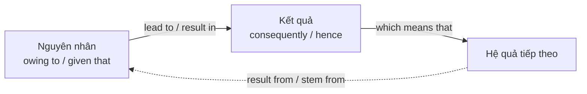

# B2-G019 · Purpose, Result & Reason — Mục đích, kết quả, lý do

## Mục lục

- [A. Lesson Information](#a-lesson-information)
- [B. Warm-up](#b-warm-up)
- [C. WHAT](#c-what)
- [D. WHY](#d-why)
- [E. FORM](#e-form)
- [F. HOW](#f-how)
- [G. VISUAL](#g-visual)
- [H. COMPARISON](#h-comparison)
- [I. COMMON MISTAKES](#i-common-mistakes)
- [J. MEMORY TRICKS](#j-memory-tricks)
- [K. REAL-LIFE APPLICATION](#k-real-life-application)
- [L. PRACTICE EXERCISES](#l-practice-exercises)
- [M. KNOWLEDGE CHECK](#m-knowledge-check)
- [N. ANSWER KEY](#n-answer-key)

---

## A. Lesson Information

| Mục | Nội dung |
|---|---|
| **Lesson ID** | B2-G019 |
| **Topic** | Purpose (in order to, so as to, so that, with a view to, for fear of / for fear that, lest — recognition); Reason (owing to, on account of, due to, seeing that, now that, in that, given that); Result (consequently, as a consequence, hence, thus, thereby, which means that, resulting in, leading to) |
| **Tên tiếng Việt** | Diễn đạt mục đích, lý do, kết quả nâng cao |
| **CEFR Level** | B2 |
| **Prerequisites** | [B2-G017 — Advanced Linking Devices](B2-G017-advanced-linking-devices.md), [B1-G023 — Adverbial Clauses](../../04-B1-INTERMEDIATE/grammar/B1-G023-adverbial-clauses.md) |
| **Estimated Time** | 90 phút |

**Learning Objectives:**

1. Dùng cụm mục đích nâng cao: ***with a view to + V-ing, for fear of + V-ing / for fear that***.
2. Dùng cụm lý do: ***owing to / on account of / due to + N***, ***given that / seeing that / now that + mệnh đề***.
3. Dùng từ nối kết quả trang trọng: ***consequently, as a consequence, hence, thus, thereby***.
4. Diễn đạt **chuỗi nguyên nhân – kết quả** bằng ***result in / lead to / cause / bring about*** và ***result from / stem from***.
5. Dùng ***, which means that / , resulting in*** để nối kết quả gọn gàng.

---

## B. Warm-up

> *Prices rose sharply **owing to** the shortage of rice. **Consequently**, many families cut back on spending, **which led to** a fall in retail sales.*

🤔 **Hãy suy nghĩ:** Câu này có một chuỗi nhân – quả gồm ba mắt xích. Hãy vẽ mũi tên: *thiếu gạo → ... → ... → ...* Những từ nào báo hiệu mỗi bước?

---

## C. WHAT

| Chức năng | B1 | B2 bổ sung |
|---|---|---|
| **Mục đích** | *to, in order to, so that* | *so as to, with a view to, for fear of, for fear that, in case* |
| **Lý do** | *because, as, since, because of* | *owing to, on account of, due to, given that, seeing that, now that, in that* |
| **Kết quả** | *so, therefore, as a result* | *consequently, as a consequence, hence, thus, thereby, which means that* |
| **Động từ nhân quả** | — | *cause, lead to, result in, bring about, give rise to / result from, stem from, arise from* |

---

## D. WHY



Văn nghị luận và báo cáo B2 thường phải giải thích **vì sao** một vấn đề xảy ra và **hậu quả** của nó (dạng *cause–effect essay*, *problem–solution essay*). Dùng **động từ nhân quả** giúp câu **gọn, học thuật** hơn so với lặp *because... so...*.

---

## E. FORM

### E1. Mục đích

| Cấu trúc | Ví dụ |
|---|---|
| **so as to / in order to + V** (phủ định: *so as not to / in order not to*) | *She left early **so as not to** miss the train.* |
| **so that + S + can/could/will/would** | *I'll write it down **so that** I won't forget.* |
| **with a view to + V-ing** (trang trọng) | *He's saving **with a view to buying** a flat.* |
| **for fear of + V-ing / N** | *She didn't speak **for fear of making** a mistake.* |
| **for fear that + S + might/would** | *He hid the letter **for fear that** his wife would read it.* |
| *lest + S + (should) V* (rất trang trọng — chỉ nhận biết) | *...**lest** we forget.* |

### E2. Lý do

| Cấu trúc | + | Ví dụ |
|---|---|---|
| **owing to / on account of / due to / because of** | N / V-ing | *The match was postponed **owing to** heavy rain.* |
| **given that / seeing that** | mệnh đề | ***Given that** he has no experience, his salary is reasonable.* |
| **now that** | mệnh đề (lý do mới xuất hiện) | ***Now that** I live near work, I walk every day.* |
| **in that** (trang trọng) | mệnh đề (giải thích theo khía cạnh nào) | *The plan is unusual **in that** it involves no cost.* |
| **as / since** | mệnh đề (lý do đã biết) | ***Since** you're here, let's start.* |

> 💡 *due to* truyền thống đi sau *be* (*The delay was **due to** fog*); *owing to* thường mở đầu câu (*Owing to fog, ...*). Ngày nay *due to* đầu câu cũng phổ biến.

### E3. Kết quả

| Từ | Vị trí | Ví dụ |
|---|---|---|
| **consequently / as a consequence / as a result** | Đầu câu + phẩy | ***Consequently**, the factory closed.* |
| **hence** (+ N hoặc mệnh đề, rất gọn) | Giữa câu | *The phone is small and cheap, **hence** its popularity among students.* |
| **thus** | Đầu câu / giữa câu | *Costs fell; **thus**, profits rose.* |
| **thereby + V-ing** | Sau mệnh đề | *They cut prices, **thereby attracting** new customers.* |
| **, which means (that)** | Nối mệnh đề | *The bridge is closed, **which means** we'll have to drive around.* |
| **, resulting in / leading to + N** | Nối mệnh đề | *Rain fell for days, **resulting in** severe floods.* |

### E4. Động từ nhân quả

| Hướng | Động từ | Ví dụ |
|---|---|---|
| Nguyên nhân → Kết quả | *cause, lead to, result in, bring about, give rise to, contribute to* | *Smoking **can lead to** lung disease.* |
| Kết quả ← Nguyên nhân | *result from, stem from, arise from, be caused by, be due to* | *Many accidents **result from** careless driving.* |

> ⚠️ *result **in*** (dẫn đến) ≠ *result **from*** (bắt nguồn từ).

---

## F. HOW

| # | English | Tiếng Việt | Phân tích |
|---|---|---|---|
| 1 | *She moved closer to the office **with a view to** spending less time commuting.* | Cô ấy chuyển gần văn phòng với mục đích bớt thời gian đi lại. | with a view to + V-ing |
| 2 | *He didn't tell anyone **for fear of** losing his job.* | Anh ấy không nói vì sợ mất việc. | for fear of |
| 3 | *All flights were cancelled **owing to** the typhoon.* | Mọi chuyến bay bị hủy do bão. | owing to + N |
| 4 | ***Given that** the budget is limited, we must prioritise.* | Vì ngân sách hạn chế, ... | given that |
| 5 | ***Now that** the children have left home, we have more free time.* | Giờ các con đã ra ở riêng... | now that |
| 6 | *The new law is controversial **in that** it limits freedom of speech.* | Luật mới gây tranh cãi ở chỗ hạn chế tự do ngôn luận. | in that |
| 7 | *Sales fell by 30%. **Consequently**, the company cut 200 jobs.* | Do đó... | consequently |
| 8 | *The government lowered taxes, **thereby encouraging** investment.* | ..., nhờ đó khuyến khích đầu tư. | thereby + V-ing |
| 9 | *The road was blocked, **which meant that** we had to take a longer route.* | ..., điều đó có nghĩa là... | which means that |
| 10 | *Deforestation **has led to** more frequent landslides.* | Phá rừng đã dẫn đến... | lead to |
| 11 | *Many health problems **stem from** a poor diet.* | Nhiều vấn đề sức khỏe bắt nguồn từ chế độ ăn kém. | stem from |
| 12 | *Heavy rain fell for three days, **resulting in** widespread flooding.* | ..., dẫn đến lũ lụt diện rộng. | resulting in |

---

## G. VISUAL

### Hai hướng của chuỗi nhân quả

```text
NGUYÊN NHÂN ──── cause / lead to / result in / bring about ────► KẾT QUẢ
KẾT QUẢ     ──── result from / stem from / be caused by ───────► NGUYÊN NHÂN
```

### Từ loại quyết định cấu trúc

```text
+ DANH TỪ / V-ing:   owing to · on account of · due to · because of · for fear of · with a view to
+ MỆNH ĐỀ:           given that · seeing that · now that · in that · so that · for fear that
+ CÂU MỚI:           Consequently, · As a consequence, · Thus, · Hence, (trang trọng)
```

---

## H. COMPARISON

### *in order to* vs *with a view to*

| *in order to + V* | *with a view to + V-ing* |
|---|---|
| Mục đích trực tiếp, mọi văn phong | Mục đích lâu dài/kế hoạch, trang trọng |
| *I study hard **in order to pass**.* | *He's studying law **with a view to becoming** a judge.* |

### *because of / owing to* vs *given that*

| *because of / owing to* + N | *given that* + mệnh đề |
|---|---|
| ***Owing to** the rain, ...* | ***Given that** it's raining, ...* |

### *result in* vs *result from*

| *A results in B* | *B results from A* |
|---|---|
| *Poor diet **results in** illness.* | *Illness **results from** poor diet.* |

---

## I. COMMON MISTAKES

| # | ❌ Sai | ✅ Đúng | Nguyên nhân | Cách tránh |
|---|---|---|---|---|
| 1 | He's saving money **with a view to buy** a house. | ... **with a view to buying** ... | *to* là giới từ | + V-ing |
| 2 | **Owing to** it was raining, ... | **Owing to** the rain / **As** it was raining, ... | + mệnh đề | + N |
| 3 | Smoking **results from** cancer. | Smoking **can result in** cancer. / Cancer can **result from** smoking. | Ngược hướng | *in* = dẫn đến |
| 4 | The price rose, **thereby** customers left. | ..., **thereby causing** customers to leave. | | *thereby + V-ing* |
| 5 | **Consequently** sales fell. | **Consequently,** sales fell. | Thiếu phẩy | |
| 6 | She whispered **for fear of wake** the baby. | ... **for fear of waking** ... | | + V-ing |
| 7 | **Now that** I will have a car, ... | **Now that** I have a car, ... | | Lý do hiện tại → hiện tại |

---

## J. MEMORY TRICKS

1. **"Result IN = đi VÀO kết quả; Result FROM = đến TỪ nguyên nhân"** ➡️⬅️
2. **"View, Fear, Owing — đều thích danh từ/V-ing"**.
3. **"Thereby = và nhờ đó" + V-ing**.

---

## K. REAL-LIFE APPLICATION

### Đoạn văn nguyên nhân – kết quả

> *Traffic congestion in Ho Chi Minh City **stems from** several factors. **To begin with**, the number of private vehicles has grown much faster than the road network, largely **owing to** rising incomes. **Given that** public transport has been limited for many years, most residents rely on motorbikes.*
>
> *This situation **has led to** serious consequences. Air quality has worsened, **resulting in** more respiratory illnesses. **Furthermore**, long commutes reduce productivity; **consequently**, businesses lose money every year.*
>
> *The city has opened its first metro line **with a view to** reducing car and motorbike use. **Now that** the line is running, many commuters have changed their habits, **thereby easing** pressure on some major roads.*

> ℹ️ Đoạn văn minh họa cấu trúc; khi viết bài thật, cần dẫn số liệu từ nguồn đáng tin cậy.

**Dịch tóm tắt:** Ùn tắc ở TP.HCM bắt nguồn từ nhiều yếu tố: xe cá nhân tăng nhanh hơn đường sá do thu nhập tăng; giao thông công cộng hạn chế nên người dân dựa vào xe máy. Hậu quả: không khí xấu đi, gây thêm bệnh hô hấp; đi lại lâu giảm năng suất. Thành phố mở tuyến metro đầu tiên nhằm giảm xe cá nhân; nay tuyến đã chạy, nhiều người đổi thói quen, nhờ đó giảm áp lực cho một số trục đường.

---

## L. PRACTICE EXERCISES

> ✍️ Đáp án: [B2-G019-ANSWERS](../../12-ANSWERS-AND-EXPLANATIONS/B2/B2-G019-ANSWERS.md)

### Level 1 — Recognition

**L1.1.** The flight was delayed ___ fog.  A. owing to  B. given that  C. so that
**L1.2.** He's learning Japanese with a view to ___ in Tokyo.  A. work  B. working  C. worked
**L1.3.** ___ you've finished your exams, you can relax.  A. Owing to  B. Now that  C. Due to
**L1.4.** Lack of sleep can ___ poor concentration.  A. result from  B. result in  C. stem from
**L1.5.** The company cut prices, ___ attracting new customers.  A. thereby  B. hence that  C. consequently
**L1.6.** She didn't say anything for fear of ___ him.  A. upset  B. upsetting  C. to upset

### Level 2 — Controlled Practice

Viết lại câu bằng từ trong ngoặc.

**L2.1.** The match was cancelled because it rained heavily. (owing to)
**L2.2.** Because he has no experience, he shouldn't expect a high salary. (Given that)
**L2.3.** She took notes because she didn't want to forget anything. (so as not to)
**L2.4.** He didn't ask questions because he was afraid of looking stupid. (for fear of)
**L2.5.** They are building a new road. They want to reduce traffic in the centre. (with a view to)
**L2.6.** The factory closed. 300 people lost their jobs. (resulting in)
**L2.7.** Stress causes many health problems. (stem from — bắt đầu bằng *Many health problems*)
**L2.8.** Prices went up. People bought less. (Consequently)
**L2.9.** I live near the beach now, so I swim every morning. (Now that)
**L2.10.** The bridge is closed. We'll have to take the ferry. (which means that)

### Level 3 — Error Correction

**L3.1.** Owing to it was snowing, the school was closed.
**L3.2.** He's saving money with a view to buy a car.
**L3.3.** Pollution results from many deaths each year.
**L3.4.** The government raised taxes, thereby people spent less.
**L3.5.** She left early for fear of miss the bus.
**L3.6.** Now that I will finish university, I want to travel.

### Level 4 — Production

**L4.1.** Dịch (*owing to*): *"Do dịch bệnh, nhiều doanh nghiệp nhỏ đã phải đóng cửa."*
**L4.2.** Dịch (*with a view to*): *"Cô ấy học thêm tiếng Hàn với mục đích làm việc cho một công ty Hàn Quốc."*
**L4.3.** Dịch (*lead to*): *"Việc dùng mạng xã hội quá nhiều có thể dẫn đến lo âu."*
**L4.4.** Dịch (*, which means that*): *"Thư viện đóng cửa vào Chủ nhật, điều đó có nghĩa là sinh viên phải học ở nhà."*

**L4.5.** **Explain:** Phân biệt *result in* và *result from*, cho ví dụ.

### Level 5 — Real Communication

**L5.1.** Viết **bài luận ngắn dạng nguyên nhân – kết quả** 180–220 từ: *"Why are more young Vietnamese people choosing to live alone, and what are the effects?"* Dùng ≥ 3 cấu trúc lý do, ≥ 3 cấu trúc kết quả, ≥ 2 động từ nhân quả, ≥ 1 cấu trúc mục đích nâng cao.
**L5.2.** **Speaking — Cause and effect chain:** Chọn một vấn đề (ví dụ: *rising house prices*). Nói 1,5 phút theo chuỗi: nguyên nhân → kết quả 1 → kết quả 2, dùng *owing to, which means that, consequently, this has led to...*

---

## M. KNOWLEDGE CHECK

### 5 câu hỏi tự kiểm tra

1. *with a view to* và *for fear of* đi với dạng gì?
2. *owing to* và *given that* khác nhau về cấu trúc?
3. *result in* vs *result from*?
4. *thereby* đi với dạng gì?
5. Kể 4 động từ "nguyên nhân → kết quả".

### Checklist

- [ ] Tôi dùng đúng N/V-ing hay mệnh đề sau mỗi từ chỉ lý do.
- [ ] Tôi không nhầm *result in/from*.
- [ ] Tôi viết được chuỗi nhân quả 3 bước.

### 3 lỗi quan trọng cần nhớ

1. ~~with a view to buy~~ → **buying**.
2. ~~Owing to it was~~ → Owing to **the** + N.
3. *result **in*** (dẫn đến) ≠ *result **from*** (do).

### Lịch ôn tập

| Ngày | Việc cần làm |
|---|---|
| Ngày 1 | Làm lại L2 |
| Ngày 3 | Vẽ sơ đồ nhân quả cho 2 vấn đề xã hội, viết câu cho mỗi mũi tên |
| Ngày 7 | Áp dụng trong [W11 — Problem–Solution Essays](../../09-FOUR-SKILLS/Writing/W11-problem-solution.md) |

### Liên kết

- ➡️ Bài tiếp theo: [B2-G020 — Complex Noun Phrases](B2-G020-complex-noun-phrases.md)

---

## N. ANSWER KEY

👉 [B2-G019-ANSWERS.md](../../12-ANSWERS-AND-EXPLANATIONS/B2/B2-G019-ANSWERS.md)
