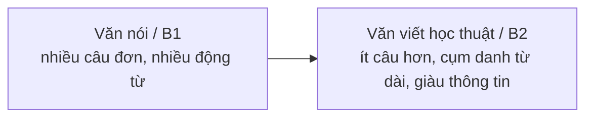

# B2-G020 · Complex Noun Phrases — Cụm danh từ phức

## Mục lục

- [A. Lesson Information](#a-lesson-information)
- [B. Warm-up](#b-warm-up)
- [C. WHAT](#c-what)
- [D. WHY](#d-why)
- [E. FORM](#e-form)
- [F. HOW](#f-how)
- [G. VISUAL](#g-visual)
- [H. COMPARISON](#h-comparison)
- [I. COMMON MISTAKES](#i-common-mistakes)
- [J. MEMORY TRICKS](#j-memory-tricks)
- [K. REAL-LIFE APPLICATION](#k-real-life-application)
- [L. PRACTICE EXERCISES](#l-practice-exercises)
- [M. KNOWLEDGE CHECK](#m-knowledge-check)
- [N. ANSWER KEY](#n-answer-key)

---

## A. Lesson Information

| Mục | Nội dung |
|---|---|
| **Lesson ID** | B2-G020 |
| **Topic** | Structure of complex noun phrases: determiners + premodifiers (adjectives, nouns, compound adjectives) + head noun + postmodifiers (prepositional phrases, reduced relatives, to-infinitives, relative clauses); compound adjectives (a five-star hotel, a well-known writer); noun + noun combinations |
| **Tên tiếng Việt** | Cấu trúc cụm danh từ phức: bổ ngữ trước và sau danh từ chính; tính từ ghép; danh từ + danh từ |
| **CEFR Level** | B2 |
| **Prerequisites** | [B2-G007 — Reduced Relative Clauses](B2-G007-relative-clause-reduction.md), [A2-G021 — Adjective Order](../../03-A2-ELEMENTARY/grammar/A2-G021-adjective-order.md) |
| **Estimated Time** | 75 phút |

**Learning Objectives:**

1. Phân tích cụm danh từ thành **từ hạn định + bổ ngữ trước + danh từ chính + bổ ngữ sau**.
2. Tạo **tính từ ghép** đúng: *a **ten-minute** walk, a **well-paid** job, a **time-consuming** task*.
3. Dùng **danh từ làm bổ ngữ** (*a **city** park, **customer** satisfaction*), không thêm *-s*.
4. Dùng nhiều loại **bổ ngữ sau**: cụm giới từ, V-ing/V3, to V, mệnh đề quan hệ.
5. **Nén thông tin** từ nhiều câu đơn thành một cụm danh từ học thuật.

---

## B. Warm-up

Câu A: *There is a hotel. It has five stars. It is new. It is near the beach. It was built last year.*

Câu B: *the **new five-star** hotel **near the beach built last year***

🤔 **Hãy suy nghĩ:** Năm câu đơn trở thành một cụm danh từ. Danh từ chính là gì? Những thông tin nào đứng **trước** nó, những thông tin nào đứng **sau** nó?

---

## C. WHAT

**Cụm danh từ phức** (complex noun phrase) có cấu trúc:

```text
[Từ hạn định] + [Bổ ngữ trước] + DANH TỪ CHÍNH + [Bổ ngữ sau]
   the           new five-star    HOTEL           near the beach built last year
```

| Thành phần | Loại | Ví dụ |
|---|---|---|
| Từ hạn định (determiner) | *a, the, this, my, some, many, two...* | ***the** hotel* |
| Bổ ngữ trước (premodifier) | tính từ, tính từ ghép, danh từ, phân từ | ***new five-star** hotel* |
| Danh từ chính (head) | danh từ | *hotel* |
| Bổ ngữ sau (postmodifier) | cụm giới từ, V-ing/V3, to V, mệnh đề quan hệ | *hotel **near the beach built last year*** |

---

## D. WHY



Văn học thuật, báo chí và báo cáo tiếng Anh **"nén" thông tin vào cụm danh từ** thay vì dùng nhiều mệnh đề. Đọc hiểu B2 đòi hỏi bạn **tìm được danh từ chính** trong cụm dài để hiểu câu; viết B2 được đánh giá cao khi dùng cụm danh từ chính xác và tự nhiên.

---

## E. FORM

### E1. Tính từ ghép (compound adjectives)

| Mẫu | Ví dụ | Lưu ý |
|---|---|---|
| **số + danh từ (số ít)** | *a **five-star** hotel, a **ten-minute** walk, a **two-year-old** child* | Danh từ **không** thêm *-s* |
| **adv + V3** | *a **well-known** writer, a **badly-paid** job* | (Gạch nối có thể bỏ trong một số văn phong; giữ khi đứng trước danh từ) |
| **adj + V3/N-ed** | *a **long-haired** cat, a **narrow-minded** person* | |
| **N + V-ing** | *a **time-consuming** task, an **English-speaking** country* | |
| **N + V3** | *a **hand-made** bag, a **state-owned** company* | |
| **adj + N** | *a **full-time** job, a **last-minute** decision* | |

### E2. Danh từ làm bổ ngữ (noun + noun)

| Ví dụ | Lưu ý |
|---|---|
| *a **city** park, **traffic** congestion, **customer** service* | Danh từ đứng trước thường ở **số ít** |
| *a **shoe** shop* (không ~~shoes shop~~) | Ngoại lệ: *sports car, clothes shop, savings account* |
| *a **university** **student** **accommodation** **policy*** | Chuỗi dài: đọc **từ phải sang trái** — một chính sách về chỗ ở cho sinh viên đại học |

### E3. Bổ ngữ sau

| Loại | Ví dụ |
|---|---|
| Cụm giới từ | *the man **in the blue shirt**, a book **about climate change*** |
| V-ing (rút gọn chủ động) | *people **living** in cities* |
| V3 (rút gọn bị động) | *a report **published** last week* |
| to V | *the first person **to arrive**, a decision **to close** the school* |
| Mệnh đề quan hệ | *the reason **why I left*** |
| Mệnh đề *that* (nội dung) | *the fact **that he lied**, the idea **that money brings happiness*** |

### E4. Trật tự bổ ngữ trước (tóm tắt)

```text
quan điểm → kích thước → tuổi → hình dạng → màu → nguồn gốc → chất liệu → mục đích/danh từ + DANH TỪ
a  lovely    small        old                   red    Vietnamese  silk       evening      dress
```

(Xem lại [A2-G021 — Adjective Order](../../03-A2-ELEMENTARY/grammar/A2-G021-adjective-order.md); thực tế hiếm khi dùng quá 3 tính từ.)

---

## F. HOW

| # | Cụm danh từ | Danh từ chính | Phân tích |
|---|---|---|---|
| 1 | *a **twenty-minute** presentation **on renewable energy*** | presentation | tính từ ghép + cụm giới từ |
| 2 | *the **rapidly growing** number **of elderly people living alone*** | number | adv + V-ing trước; cụm giới từ + V-ing sau |
| 3 | *a **well-paid** job **with flexible working hours*** | job | adv + V3; cụm giới từ |
| 4 | *the **government's** decision **to raise taxes*** | decision | sở hữu; to V |
| 5 | *a **state-owned** company **founded in 1975*** | company | N + V3; V3 |
| 6 | *the **main** reason **why young people leave rural areas*** | reason | mệnh đề quan hệ |
| 7 | *a **time-consuming** and **expensive** process* | process | hai tính từ nối bằng *and* |
| 8 | ***customer** satisfaction **survey** results* | results | chuỗi danh từ: kết quả khảo sát sự hài lòng khách hàng |
| 9 | *the idea **that technology makes us happier*** | idea | mệnh đề *that* nội dung |
| 10 | *an **English-speaking** country **with a high standard of living*** | country | N + V-ing; cụm giới từ |
| 11 | *a **three-year** research project **funded by the EU*** | project | số + N; N + N; V3 |
| 12 | *the **first female** student **in our class to win a national prize*** | student | first + tính từ; cụm giới từ; to V |

---

## G. VISUAL

### Đọc cụm danh từ dài: "Tìm danh từ chính trước"

```text
The  [recent sharp]  INCREASE  [in the number of students [studying abroad]]
     └─ bổ ngữ trước ┘           └────────── bổ ngữ sau ──────────────────┘
→ Danh từ chính: INCREASE (sự gia tăng)
→ Động từ chính của câu phải hòa hợp với INCREASE (số ít):
  "The recent sharp increase in the number of students studying abroad HAS..."
```

### Chuỗi danh từ: đọc từ phải sang trái

```text
city  centre  parking  regulations
  4      3       2          1
→ quy định (1) về đỗ xe (2) ở trung tâm (3) thành phố (4)
```

---

## H. COMPARISON

### Tính từ ghép số + N: số ít vs số nhiều

| Tính từ ghép (trước danh từ) | Cụm thường (sau động từ) |
|---|---|
| *a **ten-year-old** boy* | *The boy is **ten years old**.* |
| *a **five-kilometre** run* | *We ran **five kilometres**.* |

### N + N vs N's + N vs N of N

| N + N (loại/chức năng) | N's + N (sở hữu, thường với người) | N of N (bộ phận, trừu tượng) |
|---|---|---|
| *a **coffee** cup* (cốc dùng cho cà phê) | *the **teacher's** car* | *a cup **of coffee*** (cốc chứa cà phê) |
| *a **car** door* | *my **mother's** advice* | *the end **of the film*** |

---

## I. COMMON MISTAKES

| # | ❌ Sai | ✅ Đúng | Nguyên nhân | Cách tránh |
|---|---|---|---|---|
| 1 | a **five-stars** hotel | a **five-star** hotel | *-s* trong tính từ ghép | Số + N số ít |
| 2 | a **ten minutes** walk | a **ten-minute** walk | | hoặc *a ten minutes' walk* (ít dùng hơn) |
| 3 | **shoes** shop | **shoe** shop | N bổ ngữ số nhiều | Số ít (trừ ngoại lệ) |
| 4 | The increase in prices **have** affected... | The increase in prices **has** affected... | Hòa hợp với danh từ gần | Hòa hợp với danh từ chính |
| 5 | a **well know** writer | a **well-known** writer | Thiếu V3 | adv + V3 |
| 6 | the decision **of closing** the school | the decision **to close** the school | | *decision + to V* |
| 7 | **the people who they live** in cities | the people **(who) live / living** in cities | Thừa đại từ | |

---

## J. MEMORY TRICKS

1. **"Tìm Đầu trước"** 🎯: Trong cụm dài, tìm **danh từ chính (head)** rồi mới đọc phần còn lại.
2. **"Số đứng trước — danh từ không -s"**: *a five-star, a ten-minute, a two-year*.
3. **"Chuỗi danh từ đọc ngược"**: từ phải sang trái để hiểu nghĩa.

---

## K. REAL-LIFE APPLICATION

### Biến văn nói thành văn học thuật

**Văn nói (B1):**
> *Many students go abroad to study. The number is growing quickly. This worries some people. They think the country is losing talented young people. These young people often don't come back.*

**Văn học thuật (B2):**
> ***The rapidly growing number of students studying abroad** has raised **concerns about the loss of talented young people who often do not return home**.*

### Đoạn văn mẫu

> ***The government's recent decision to invest in high-speed rail** has received **a mixed response from economists and the general public**. Supporters point to **the potential long-term benefits for regional economies**, while critics highlight **the enormous cost of the project, estimated at billions of dollars**. **A two-year feasibility study funded by international organisations** is expected to provide **a clearer picture of the risks involved**.*

> ℹ️ Đoạn văn minh họa; không mô tả dự án cụ thể có thật.

---

## L. PRACTICE EXERCISES

> ✍️ Đáp án: [B2-G020-ANSWERS](../../12-ANSWERS-AND-EXPLANATIONS/B2/B2-G020-ANSWERS.md)

### Level 1 — Recognition

Gạch chân **danh từ chính** của cụm in nghiêng.

**L1.1.** *The rising cost of living in big cities* is a major concern.
**L1.2.** *A recently published report on youth unemployment* shows worrying trends.
**L1.3.** *The government's plan to build a second airport* has been approved.

Chọn đáp án đúng.

**L1.4.** We stayed in a ___ hotel.  A. five-stars  B. five-star  C. five star's
**L1.5.** It's a ___ walk from here.  A. ten-minute  B. ten-minutes  C. ten minutes
**L1.6.** The increase in house prices ___ made it difficult for young people to buy homes.  A. have  B. has  C. are

### Level 2 — Controlled Practice

Tạo tính từ ghép.

**L2.1.** a holiday that lasts two weeks → a ___ holiday
**L2.2.** a writer who is known well → a ___ writer
**L2.3.** a task that consumes a lot of time → a ___ task
**L2.4.** a company that the state owns → a ___ company
**L2.5.** a boy who is eight years old → an ___ boy

Nén các câu thành một cụm danh từ (hoặc một câu chứa cụm danh từ phức).

**L2.6.** There is a building. It is old. It is made of brick. It is next to the river. → ______
**L2.7.** A report was published yesterday. It is about air pollution in Hanoi. → ______
**L2.8.** The government decided something. It decided to ban single-use plastic. → ______
**L2.9.** Many people live alone. They are elderly. Their number is increasing. → ______
**L2.10.** Customers are satisfied. A survey measured this. Here are the results. → ______ (chuỗi danh từ)

### Level 3 — Error Correction

**L3.1.** We booked a three-nights stay in Da Lat.
**L3.2.** The number of tourists visiting Vietnam have increased.
**L3.3.** She works in a clothes shops.
**L3.4.** He is a well know actor.
**L3.5.** The decision of moving the office was unpopular.
**L3.6.** My son is a ten-years-old boy.

### Level 4 — Production

**L4.1.** Dịch thành cụm danh từ: *"một công việc toàn thời gian được trả lương cao ở một công ty quốc tế"*
**L4.2.** Dịch thành cụm danh từ: *"sự gia tăng nhanh chóng số lượng xe máy ở các thành phố lớn"*
**L4.3.** Dịch thành cụm danh từ: *"quyết định gần đây của chính phủ về việc tăng lương tối thiểu"*
**L4.4.** Dịch câu: *"Một khảo sát kéo dài ba năm do trường đại học thực hiện cho thấy..."*

**L4.5.** **Explain:** Vì sao nói *"a five-star hotel"* mà không *"a five-stars hotel"*, trong khi lại nói *"The hotel has five stars"*?

### Level 5 — Real Communication

**L5.1.** Viết lại đoạn văn sau (văn nói) thành **đoạn văn học thuật** 80–120 từ, dùng ≥ 5 cụm danh từ phức:
> *Many people in Vietnam use motorbikes. The number is growing. This causes traffic jams. It also makes the air dirty. The government wants to build more metro lines. It thinks this will help. But building them costs a lot of money and takes a long time.*

**L5.2.** **Speaking — Describe a product:** Mô tả 1 phút một sản phẩm bạn muốn bán (điện thoại, laptop, xe...) bằng nhiều cụm danh từ phức: *a lightweight, water-resistant laptop with a twelve-hour battery...*

---

## M. KNOWLEDGE CHECK

### 5 câu hỏi tự kiểm tra

1. Bốn thành phần của cụm danh từ phức?
2. Vì sao *a ten-minute walk* không có *-s*?
3. Đọc chuỗi danh từ theo hướng nào?
4. Kể 4 loại bổ ngữ sau.
5. Động từ chính của câu hòa hợp với thành phần nào trong cụm danh từ?

### Checklist

- [ ] Tôi tìm được danh từ chính trong cụm dài.
- [ ] Tôi tạo tính từ ghép đúng (không *-s*, có gạch nối).
- [ ] Tôi nén được nhiều câu đơn thành cụm danh từ.

### 3 lỗi quan trọng cần nhớ

1. ~~five-stars hotel~~ → **five-star**.
2. ~~The number of tourists have~~ → **has**.
3. ~~well know~~ → **well-known**.

### Lịch ôn tập

| Ngày | Việc cần làm |
|---|---|
| Ngày 1 | Làm lại L2 |
| Ngày 3 | Chọn 3 tiêu đề báo tiếng Anh, phân tích cụm danh từ |
| Ngày 7 | Học tiếp [B2-G021 — Nominalisation](B2-G021-nominalisation.md) |

### Liên kết

- ➡️ Bài tiếp theo: [B2-G021 — Nominalisation](B2-G021-nominalisation.md)
- 🔜 [B2-G022 — Subject–Verb Agreement](B2-G022-subject-verb-agreement.md)

---

## N. ANSWER KEY

👉 [B2-G020-ANSWERS.md](../../12-ANSWERS-AND-EXPLANATIONS/B2/B2-G020-ANSWERS.md)
