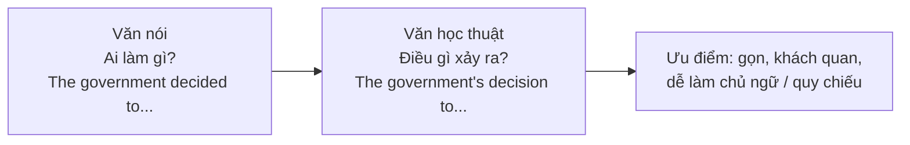

# B2-G021 · Nominalisation — Danh từ hóa

## Mục lục

- [A. Lesson Information](#a-lesson-information)
- [B. Warm-up](#b-warm-up)
- [C. WHAT](#c-what)
- [D. WHY](#d-why)
- [E. FORM](#e-form)
- [F. HOW](#f-how)
- [G. VISUAL](#g-visual)
- [H. COMPARISON](#h-comparison)
- [I. COMMON MISTAKES](#i-common-mistakes)
- [J. MEMORY TRICKS](#j-memory-tricks)
- [K. REAL-LIFE APPLICATION](#k-real-life-application)
- [L. PRACTICE EXERCISES](#l-practice-exercises)
- [M. KNOWLEDGE CHECK](#m-knowledge-check)
- [N. ANSWER KEY](#n-answer-key)

---

## A. Lesson Information

| Mục | Nội dung |
|---|---|
| **Lesson ID** | B2-G021 |
| **Topic** | Turning verbs and adjectives into nouns (-tion, -ment, -ance/-ence, -ity, -ness, -al, -ure, zero derivation); restructuring sentences around nouns; noun + preposition patterns (increase in, demand for, impact on, reason for); avoiding over-nominalisation |
| **Tên tiếng Việt** | Danh từ hóa: chuyển động từ/tính từ thành danh từ để viết học thuật |
| **CEFR Level** | B2 |
| **Prerequisites** | [B2-G020 — Complex Noun Phrases](B2-G020-complex-noun-phrases.md), [VOC-18 — Word Families](../../07-VOCABULARY/VOC-18-word-families.md) |
| **Estimated Time** | 75 phút |

**Learning Objectives:**

1. Nắm các **hậu tố** tạo danh từ: *-tion/-sion, -ment, -ance/-ence, -ity, -ness, -al, -ure, -th*.
2. **Viết lại** câu dùng động từ/tính từ thành câu dùng **danh từ** (văn học thuật).
3. Dùng đúng **giới từ đi kèm** danh từ: *increase **in**, demand **for**, effect **on**, reason **for**, solution **to***.
4. Chọn **động từ đi kèm** phù hợp với danh từ: *make a decision, carry out research, have an impact*.
5. Biết **khi nào không nên** danh từ hóa (văn nói, câu trở nên khó hiểu).

---

## B. Warm-up

> **A (văn nói):** *Prices **rose** sharply, so people **bought** less, and that's why the shop **closed**.*
>
> **B (văn học thuật):** *The sharp **rise** in prices led to a **reduction** in consumer **spending**, which resulted in the **closure** of the shop.*

🤔 **Hãy suy nghĩ:** Đoạn B chuyển những động từ nào của đoạn A thành danh từ? Các danh từ mới đi kèm giới từ nào?

---

## C. WHAT

**Danh từ hóa** (nominalisation) = diễn đạt **hành động** hoặc **tính chất** bằng **danh từ** thay vì động từ/tính từ.

| Động từ/tính từ | Danh từ | Câu với danh từ |
|---|---|---|
| *decide* | *decision* | *The **decision** to close the school was controversial.* |
| *grow* | *growth* | *Economic **growth** has slowed.* |
| *important* | *importance* | *The **importance** of education cannot be overstated.* |
| *fail* | *failure* | *The **failure** of the project surprised everyone.* |

---

## D. WHY



Danh từ hóa giúp văn bản:

- **Khách quan** hơn (tập trung vào sự việc, không vào người).
- **Gọn** hơn (nén mệnh đề thành cụm danh từ).
- **Dễ liên kết**: danh từ có thể làm chủ ngữ câu sau (*This decision...*) — xem [B2-G017](B2-G017-advanced-linking-devices.md).

> ⚠️ Lạm dụng danh từ hóa khiến văn **nặng nề, khó đọc**. Trong email thân mật hay hội thoại, dùng động từ tự nhiên hơn.

---

## E. FORM

### E1. Hậu tố tạo danh từ từ động từ

| Hậu tố | Động từ → Danh từ |
|---|---|
| **-tion / -sion** | *reduce → reduction, decide → decision, explain → explanation, introduce → introduction* |
| **-ment** | *develop → development, improve → improvement, achieve → achievement, govern → government* |
| **-ance / -ence** | *perform → performance, appear → appearance, depend → dependence, refer → reference* |
| **-al** | *arrive → arrival, approve → approval, refuse → refusal, propose → proposal* |
| **-ure** | *fail → failure, close → closure, press → pressure* |
| **-ing** | *spend → spending, build → building, plan → planning* |
| **Không đổi dạng** | *increase, decrease, rise, fall, change, use, report, research, demand, cost, control* |
| **Biến đổi gốc** | *grow → growth, die → death, choose → choice, lose → loss, analyse → analysis* |

### E2. Hậu tố tạo danh từ từ tính từ

| Hậu tố | Tính từ → Danh từ |
|---|---|
| **-ity** | *able → ability, possible → possibility, popular → popularity, secure → security* |
| **-ness** | *happy → happiness, aware → awareness, effective → effectiveness, weak → weakness* |
| **-ance / -ence** | *important → importance, different → difference, confident → confidence* |
| **-th** | *strong → strength, long → length, wide → width, deep → depth, true → truth* |
| **-y** | *difficult → difficulty, honest → honesty* |

### E3. Biến đổi câu

| Bước | Ví dụ |
|---|---|
| Câu gốc | *The government **decided** to **raise** taxes, and people **complained**.* |
| 1. Động từ → danh từ | *decide → decision, raise → (rise/increase), complain → complaints* |
| 2. Chủ ngữ → sở hữu / *of* / *by* | *the government's decision* / *the decision **by** the government* |
| 3. Trạng từ → tính từ | *rose **sharply** → a **sharp** rise* |
| 4. Nối bằng động từ nhân quả | *The government's **decision** to raise taxes **led to** widespread **complaints**.* |

### E4. Danh từ + giới từ

| Danh từ | Giới từ | Ví dụ |
|---|---|---|
| increase / decrease / rise / fall / reduction / change | **in** | *a rise **in** prices* |
| demand / need / reason / responsibility / respect | **for** | *demand **for** housing* |
| effect / impact / influence / pressure / emphasis | **on** | *the impact **of** X **on** Y* |
| solution / answer / approach / access / key | **to** | *a solution **to** the problem* |
| cause / lack / knowledge / awareness | **of** | *a lack **of** experience* |
| difference / connection / relationship | **between** | *the difference **between** A and B* |

### E5. Động từ đi kèm danh từ (collocations)

| Danh từ | Động từ thường đi kèm |
|---|---|
| decision | *make, reach, take* |
| research / a survey / an investigation | *carry out, conduct* |
| impact / effect | *have* |
| progress | *make* |
| an improvement | *make, bring about* |
| a contribution | *make* |
| attention | *pay, draw (to)* |

---

## F. HOW

| # | Câu với động từ/tính từ | Câu danh từ hóa | Ghi chú |
|---|---|---|---|
| 1 | *Unemployment **increased** dramatically.* | *There was a dramatic **increase in** unemployment.* | adv → adj |
| 2 | *The company **expanded** rapidly, which **surprised** investors.* | *The company's rapid **expansion** came as a **surprise** to investors.* | sở hữu |
| 3 | *Because the bridge **collapsed**, ...* | ***Owing to** the **collapse** of the bridge, ...* | + B2-G019 |
| 4 | *People are not **aware** of the dangers.* | *There is a lack of **awareness** of the dangers.* | adj → N |
| 5 | *The city **is** very **popular** with tourists.* | *The city's **popularity** with tourists ...* | |
| 6 | *If we **analyse** the data carefully, ...* | *A careful **analysis** of the data ...* | |
| 7 | *The government **failed** to act.* | *The government's **failure** to act ...* | failure + to V |
| 8 | *They **arrived** late, so the meeting started late.* | *Their late **arrival** delayed the meeting.* | |
| 9 | *Students **depend** heavily on technology.* | *Students' heavy **dependence** on technology ...* | |
| 10 | *How **long** is the river?* | *What is the **length** of the river?* | -th |
| 11 | *We need to **solve** this problem.* | *We need a **solution to** this problem.* | solution to |
| 12 | *Tourism **affects** the environment greatly.* | *Tourism **has** a great **impact on** the environment.* | have + impact on |

---

## G. VISUAL

### Quy tắc biến đổi

```text
CÂU ĐỘNG TỪ:   [Ai]      [làm gì]    [như thế nào]   [cái gì]
               Prices     rose        sharply
                 ↓          ↓            ↓
CỤM DANH TỪ:   a          sharp        rise          in prices
                          (adv→adj)    (V→N)         (S → of/in)
```

---

## H. COMPARISON

### Khi nào nên / không nên danh từ hóa

| ✅ Nên | ❌ Không nên |
|---|---|
| Bài luận, báo cáo, tóm tắt học thuật | Hội thoại, email thân mật |
| Khi muốn ý trở thành chủ ngữ để nói tiếp | Khi câu trở nên mơ hồ (không rõ ai làm) |
| *The introduction of the new law caused confusion.* | ~~The making of a decision regarding the provision of lunch will occur.~~ → *We'll decide about lunch.* |

### *the X of Y* vs *Y's X*

| *the decision **of** the government* | *the government's decision* |
|---|---|
| Trang trọng hơn, dùng khi Y dài | Gọn hơn, thường với người/tổ chức |

---

## I. COMMON MISTAKES

| # | ❌ Sai | ✅ Đúng | Nguyên nhân | Cách tránh |
|---|---|---|---|---|
| 1 | an increase **of** prices | an increase **in** prices | Sai giới từ | *increase in* |
| 2 | the effect **to** children | the effect **on** children | | *effect on* |
| 3 | a solution **for** the problem | a solution **to** the problem | | *solution to* |
| 4 | **do** a decision | **make** a decision | Collocation | *make a decision* |
| 5 | **rapidly** growth (*the rapidly growth of tourism*) | **rapid** growth (*the rapid growth of tourism*) | Giữ trạng từ | adv → adj trước danh từ |
| 6 | The **develop** of tourism... | The **development** of tourism... | Nhầm từ loại | Kiểm tra hậu tố |
| 7 | the **strongness** of the economy | the **strength** of the economy | Hậu tố sai | Học danh từ bất quy tắc |

---

## J. MEMORY TRICKS

1. **"Động → Danh, Trạng → Tính"** 🔄: Khi đổi động từ thành danh từ, trạng từ đi kèm thành tính từ (*grew rapidly → rapid growth*).
2. **"IN cho tăng giảm, ON cho tác động, TO cho giải pháp, FOR cho nhu cầu"**.
3. **"Ai làm? → 's hoặc of"**: chủ ngữ cũ thành sở hữu.

---

## K. REAL-LIFE APPLICATION

### Tóm tắt báo cáo (văn học thuật)

> *Over the past decade, Vietnam has experienced a significant **increase in** internet **usage**. The **expansion** of mobile networks and the **availability** of cheap smartphones have played a key role in this **development**. One major **consequence** has been the rapid **growth** of e-commerce, together with a **reduction in** cash **payments**.*
>
> *However, this **transformation** has also raised **concerns** about data **security** and online **privacy**. A recent **survey** revealed a lack of **awareness** among older users about common online **risks**. Experts recommend the **introduction** of digital **education** programmes as a **solution to** this problem.*

> ℹ️ Đoạn văn minh họa; không dẫn số liệu cụ thể.

**Dịch tóm tắt:** Thập kỷ qua, sử dụng internet ở VN tăng mạnh nhờ mạng di động mở rộng và smartphone rẻ; thương mại điện tử phát triển nhanh, thanh toán tiền mặt giảm. Tuy nhiên, có lo ngại về an ninh dữ liệu và quyền riêng tư; người lớn tuổi thiếu nhận thức về rủi ro trực tuyến. Chuyên gia đề xuất chương trình giáo dục kỹ thuật số.

---

## L. PRACTICE EXERCISES

> ✍️ Đáp án: [B2-G021-ANSWERS](../../12-ANSWERS-AND-EXPLANATIONS/B2/B2-G021-ANSWERS.md)

### Level 1 — Recognition

Viết danh từ của các từ sau.

**L1.1.** reduce → ___ · improve → ___ · fail → ___
**L1.2.** aware → ___ · strong → ___ · possible → ___

Chọn giới từ đúng.

**L1.3.** There has been a sharp increase ___ crime.  A. of  B. in  C. on
**L1.4.** Social media has a strong influence ___ teenagers.  A. on  B. to  C. for
**L1.5.** There is a growing demand ___ electric cars.  A. of  B. for  C. in
**L1.6.** We need to find a solution ___ this problem.  A. for  B. of  C. to

### Level 2 — Controlled Practice

Viết lại câu bằng danh từ hóa, bắt đầu bằng từ cho sẵn.

**L2.1.** Unemployment rose sharply last year. → There was ______.
**L2.2.** The factory closed, and 500 people lost their jobs. → The closure ______.
**L2.3.** The government decided to ban fireworks. It was unpopular. → The government's ______.
**L2.4.** People are not aware of the risks. → There is a lack ______.
**L2.5.** The team performed poorly, which disappointed the fans. → The team's poor ______.
**L2.6.** Tourism affects local culture. (have / impact) → Tourism ______.
**L2.7.** How deep is the lake? → What is the ______?
**L2.8.** The company expanded rapidly into Asia. → The company's ______.
**L2.9.** If we analyse the results carefully, we can see a clear pattern. → A careful ______.
**L2.10.** The new manager arrived, and everything changed. → The arrival ______.

### Level 3 — Error Correction

**L3.1.** There has been a big increase of house prices.
**L3.2.** The pandemic had a huge effect to the economy.
**L3.3.** We did a decision to move abroad.
**L3.4.** The rapidly development of technology has changed our lives.
**L3.5.** We need a solution for traffic congestion.
**L3.6.** The strongness of the team is its defence.

### Level 4 — Production

**L4.1.** Dịch (danh từ hóa): *"Việc chính phủ đưa ra luật mới đã gây ra nhiều tranh cãi."*
**L4.2.** Dịch: *"Sự phụ thuộc của giới trẻ vào điện thoại thông minh là một mối lo ngại ngày càng lớn."*
**L4.3.** Dịch: *"Thiếu kinh nghiệm là lý do chính cho sự thất bại của dự án."*
**L4.4.** Dịch: *"Đã có sự giảm đáng kể về số lượng du khách quốc tế."*

**L4.5.** **Explain:** Nêu 2 lợi ích và 1 rủi ro của danh từ hóa trong bài viết.

### Level 5 — Real Communication

**L5.1.** Viết lại đoạn văn sau thành **văn học thuật** (100–130 từ) bằng danh từ hóa, dùng ≥ 6 danh từ hóa và ≥ 4 cặp danh từ + giới từ đúng:
> *More and more people are moving to the cities. Because of this, cities are growing very fast. Houses are becoming expensive, and roads are crowded. The government wants to solve these problems, so it is building new satellite towns. Many people don't know about these towns yet, and some are worried that the towns don't have enough schools and hospitals.*

**L5.2.** **Speaking — Formal summary:** Tóm tắt 1 phút một tin tức gần đây (bạn đọc/nghe được) theo phong cách bản tin trang trọng, dùng ≥ 5 danh từ hóa: *The announcement of..., A significant increase in..., The government's decision to...*

---

## M. KNOWLEDGE CHECK

### 5 câu hỏi tự kiểm tra

1. Kể 5 hậu tố tạo danh từ.
2. Khi danh từ hóa, trạng từ biến đổi thế nào?
3. Giới từ đi sau *increase, impact, solution, demand*?
4. Động từ đi với *decision, research, progress*?
5. Khi nào không nên danh từ hóa?

### Checklist

- [ ] Tôi biết ≥ 30 cặp động từ/tính từ – danh từ.
- [ ] Tôi dùng đúng giới từ sau danh từ.
- [ ] Tôi biết cân bằng, không lạm dụng danh từ hóa.

### 3 lỗi quan trọng cần nhớ

1. ~~increase of prices~~ → increase **in** prices.
2. ~~effect to~~ → effect **on**.
3. ~~rapidly growth~~ → **rapid** growth.

### Lịch ôn tập

| Ngày | Việc cần làm |
|---|---|
| Ngày 1 | Làm lại L2 |
| Ngày 3 | Lập bảng 40 cặp V/adj → N vào sổ từ vựng |
| Ngày 7 | Ôn với [VOC-18 — Word Families](../../07-VOCABULARY/VOC-18-word-families.md) |

### Liên kết

- ➡️ Bài tiếp theo: [B2-G022 — Subject–Verb Agreement](B2-G022-subject-verb-agreement.md)
- 🔜 [B2-G025 — Hedging & Academic Language](B2-G025-hedging-academic-language.md)

---

## N. ANSWER KEY

👉 [B2-G021-ANSWERS.md](../../12-ANSWERS-AND-EXPLANATIONS/B2/B2-G021-ANSWERS.md)
