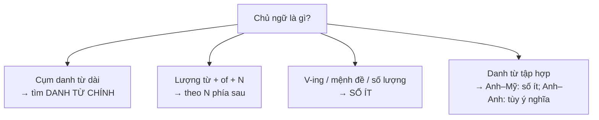

# B2-G022 · Advanced Subject–Verb Agreement — Hòa hợp chủ ngữ – động từ nâng cao

## Mục lục

- [A. Lesson Information](#a-lesson-information)
- [B. Warm-up](#b-warm-up)
- [C. WHAT](#c-what)
- [D. WHY](#d-why)
- [E. FORM](#e-form)
- [F. HOW](#f-how)
- [G. VISUAL](#g-visual)
- [H. COMPARISON](#h-comparison)
- [I. COMMON MISTAKES](#i-common-mistakes)
- [J. MEMORY TRICKS](#j-memory-tricks)
- [K. REAL-LIFE APPLICATION](#k-real-life-application)
- [L. PRACTICE EXERCISES](#l-practice-exercises)
- [M. KNOWLEDGE CHECK](#m-knowledge-check)
- [N. ANSWER KEY](#n-answer-key)

---

## A. Lesson Information

| Mục | Nội dung |
|---|---|
| **Lesson ID** | B2-G022 |
| **Topic** | Agreement with long noun phrases; collective nouns (team, government, family); quantity expressions (a number of / the number of, a lot of, most of, half of, percentage); each/every/either/neither; uncountable nouns ending in -s (news, physics); plural-only nouns (police, people, jeans); amounts as singular (ten dollars is); there is/are; what-clauses and gerund subjects |
| **Tên tiếng Việt** | Hòa hợp chủ – vị nâng cao: cụm danh từ dài, danh từ tập hợp, lượng từ, danh từ đặc biệt |
| **CEFR Level** | B2 |
| **Prerequisites** | [B2-G020 — Complex Noun Phrases](B2-G020-complex-noun-phrases.md), [B1-G025 — Both, Either, Neither, Each, Every](../../04-B1-INTERMEDIATE/grammar/B1-G025-both-either-neither-each-every.md) |
| **Estimated Time** | 75 phút |

**Learning Objectives:**

1. Hòa hợp động từ với **danh từ chính** trong cụm danh từ dài.
2. Dùng đúng ***a number of*** (+ V số nhiều) và ***the number of*** (+ V số ít).
3. Hòa hợp với **lượng từ + of** (*most of, half of, 30% of*) theo danh từ phía sau.
4. Hòa hợp với **danh từ tập hợp** (Anh–Anh vs Anh–Mỹ), danh từ đặc biệt (*news, police, people*).
5. Hòa hợp với **V-ing / mệnh đề làm chủ ngữ** và **số lượng/khoảng cách/tiền**.

---

## B. Warm-up

Chọn *is* hoặc *are*:

> 1. *The quality of the products ___ excellent.*
> 2. *A number of students ___ absent today.*
> 3. *The number of students ___ increasing.*
> 4. *The news ___ surprising.*
> 5. *Ten kilometres ___ a long way to walk.*

🤔 **Hãy suy nghĩ:** Câu 1 có *products* (số nhiều) ngay trước động từ — vậy động từ có số nhiều không? Câu 2 và 3 gần như giống nhau — vì sao đáp án khác?

---

## C. WHAT

**Hòa hợp chủ – vị** (subject–verb agreement): động từ chia theo **danh từ chính của chủ ngữ**, không phải theo danh từ **gần nhất**.

Ở B2, khó khăn đến từ:

| Nguồn khó | Ví dụ |
|---|---|
| Chủ ngữ dài, có bổ ngữ sau | *The **cost** of the new buildings **is** high.* |
| Lượng từ | *Most of the **water** **is** polluted.* / *Most of the **rivers** **are** polluted.* |
| Danh từ tập hợp | *The **team** **is/are** playing well.* |
| Danh từ đặc biệt | *The **news** **is**... / The **police** **are**...* |
| Chủ ngữ là V-ing/mệnh đề | ***Learning** languages **is** fun.* |

---

## D. WHY



Lỗi hòa hợp là **lỗi ngữ pháp phổ biến nhất** trong bài viết B1–B2 của người Việt — vì tiếng Việt **không chia động từ**. Một lỗi nhỏ này lặp lại nhiều lần sẽ ảnh hưởng điểm **Grammatical accuracy**.

---

## E. FORM

### E1. Danh từ chính trong cụm dài

| Ví dụ | Danh từ chính |
|---|---|
| *The **list** of items **is** on the table.* | list |
| *The **students** in the back row **are** noisy.* | students |
| *One of my best friends **lives** in Japan.* | **one** |
| *The **teacher**, together with her students, **is** visiting the museum.* | teacher (*together with / as well as / along with* không làm chủ ngữ số nhiều) |

### E2. *a number of* vs *the number of*

| Cụm | Nghĩa | Động từ | Ví dụ |
|---|---|---|---|
| **a number of** + N số nhiều | nhiều, một số | **số nhiều** | *A number of problems **have** arisen.* |
| **the number of** + N số nhiều | con số, số lượng | **số ít** | *The number of tourists **has** doubled.* |

### E3. Lượng từ + of + danh từ → theo danh từ

| Lượng từ | + Không đếm được → số ít | + Số nhiều → số nhiều |
|---|---|---|
| *most of, some of, all of, a lot of, half of, part of, the rest of, X% of* | *Most of the **money** **was** spent.* | *Most of the **students** **were** late.* |
| | *30% of the **land** **is** forest.* | *30% of the **people** **are** over 60.* |

### E4. Luôn số ít

| Loại | Ví dụ |
|---|---|
| *each, every, either, neither* (+ N số ít) | *Every student **has** a laptop.* |
| *everyone, nobody, something...* | *Everyone **knows** the answer.* |
| V-ing làm chủ ngữ | *Reading books **improves** vocabulary.* |
| Mệnh đề làm chủ ngữ | *What they need **is** more time.* / *Whether he comes **doesn't** matter.* |
| Số lượng, tiền, thời gian, khoảng cách (xem như một khối) | *Ten dollars **is** too much.* / *Three hours **is** a long time.* |
| Danh từ tận cùng -s nhưng không đếm được | *news, physics, mathematics, economics, politics (môn học), measles* |
| Tên nước/tổ chức số nhiều | *The United States **is**... / The Philippines **is**...* |

### E5. Luôn số nhiều

| Loại | Ví dụ |
|---|---|
| *police, people, cattle, staff* (thường) | *The police **are** investigating.* |
| Danh từ chỉ vật có hai phần | *My jeans **are** too tight.* / *These scissors **are** sharp.* (nhưng *A pair of jeans **is**...*) |
| *the + tính từ* (chỉ nhóm người) | *The rich **are** getting richer.* / *The elderly **need** support.* |

### E6. Danh từ tập hợp (*team, family, government, staff, class, committee, audience*)

| Anh–Mỹ | Anh–Anh |
|---|---|
| Thường **số ít**: *The team **is** winning.* | **Số ít** khi xem như một khối: *The committee **has** made a decision.* |
| | **Số nhiều** khi nghĩ đến các thành viên: *The team **are** arguing among themselves.* |

> Ở bài thi, giữ **nhất quán** trong một bài viết.

### E7. *There is / There are*

Động từ hòa hợp với **danh từ đầu tiên** sau nó:
*There **is** a pen and two books on the desk.* / *There **are** two books and a pen on the desk.*

---

## F. HOW

| # | English | Tiếng Việt | Phân tích |
|---|---|---|---|
| 1 | *The impact of these policies on small businesses **has** been significant.* | Tác động của các chính sách... | Danh từ chính: *impact* |
| 2 | *One of the main reasons for the delays **was** bad weather.* | Một trong những lý do chính... | *One of* → số ít |
| 3 | *A number of companies **have** moved to the suburbs.* | Một số công ty đã chuyển... | a number of → số nhiều |
| 4 | *The number of unemployed people **has** fallen.* | Số người thất nghiệp đã giảm. | the number of → số ít |
| 5 | *Most of the information **was** out of date.* | Phần lớn thông tin đã lỗi thời. | + không đếm được |
| 6 | *Over 60% of the respondents **were** women.* | Hơn 60% người trả lời là nữ. | % + số nhiều |
| 7 | *Learning a new language **requires** patience.* | Học ngôn ngữ mới đòi hỏi kiên nhẫn. | V-ing chủ ngữ |
| 8 | *Economics **is** my favourite subject.* | Kinh tế học là môn yêu thích của tôi. | Môn học -s → số ít |
| 9 | *The police **have** arrested two suspects.* | Cảnh sát đã bắt hai nghi phạm. | police → số nhiều |
| 10 | *Five hundred dollars **is** a lot to pay for a phone.* | 500 đô là nhiều... | Số tiền → số ít |
| 11 | *The manager, as well as his assistants, **is** attending the conference.* | Quản lý, cùng các trợ lý... | as well as không cộng |
| 12 | *The elderly **are** particularly vulnerable to heatwaves.* | Người cao tuổi đặc biệt dễ bị tổn thương... | the + adj → số nhiều |

---

## G. VISUAL

### Tìm danh từ chính — bỏ ngoặc

```text
The cost [of living] [in big cities] ──► IS  rising.
    ↑ danh từ chính

A number of students ──► ARE   (= many students)
The number of students ──► IS  (= the figure)

Most of [the water]   ──► IS     (theo "water")
Most of [the rivers]  ──► ARE    (theo "rivers")
```

---

## H. COMPARISON

### Bảng tổng hợp nhanh

| Số ít | Số nhiều | Theo danh từ sau *of* |
|---|---|---|
| *each, every, everyone, the number of, one of, V-ing, mệnh đề, số tiền/thời gian, news, physics* | *a number of, police, people, the + adj, jeans/scissors, both* | *most of, some of, all of, half of, X% of, a lot of, the rest of* |

### *either/neither ... or/nor* (ôn [B1-G025](../../04-B1-INTERMEDIATE/grammar/B1-G025-both-either-neither-each-every.md))

Động từ hòa hợp với **chủ ngữ gần nhất**: *Neither the manager nor the **workers** **were** happy.*

---

## I. COMMON MISTAKES

| # | ❌ Sai | ✅ Đúng | Nguyên nhân | Cách tránh |
|---|---|---|---|---|
| 1 | The quality of the products **are** excellent. | ... **is** excellent. | Hòa hợp với danh từ gần | Tìm danh từ chính |
| 2 | **The number** of cars **are** increasing. | ... **is** increasing. | | the number of → số ít |
| 3 | **A number** of people **has** complained. | ... **have** complained. | | a number of → số nhiều |
| 4 | One of my friends **live** in Hue. | ... **lives** in Hue. | | *one* → số ít |
| 5 | The news **are** good. | The news **is** good. | *-s* đánh lừa | *news* không đếm được |
| 6 | The police **is** coming. | The police **are** coming. | | *police* số nhiều |
| 7 | Playing video games **are** fun. | Playing video games **is** fun. | Hòa hợp với *games* | V-ing chủ ngữ → số ít |
| 8 | Everyone **have** a ticket. | Everyone **has** a ticket. | | *everyone* số ít |

---

## J. MEMORY TRICKS

1. **"Bỏ ngoặc — tìm đầu"** ✂️: Gạch bỏ cụm giới từ/mệnh đề sau danh từ chính, rồi chia động từ.
2. **"A number = nhiều (số nhiều); THE number = con số (số ít)"**.
3. **"Lượng từ nhìn về sau"**: *most of, half of, 30% of* → xem danh từ sau *of*.

---

## K. REAL-LIFE APPLICATION

### Mô tả kết quả khảo sát

> *A recent survey of 1,000 office workers in Hanoi **has** produced some interesting results. **The number of** people who work from home at least one day a week **has** risen to 45%. **A number of** respondents **say** that this **improves** their work-life balance. However, **one of** the most common complaints **is** the lack of social contact.*
>
> ***Most of** the participants **were** aged between 25 and 40, and **nearly half of** them **have** children. **Commuting** to the office **takes** an average of 50 minutes each way, and **50 minutes is** considered too long by most workers. The research team, as well as several HR experts, **believes** that hybrid work **is** here to stay.*

> ℹ️ Số liệu khảo sát là giả định để luyện ngữ pháp.

---

## L. PRACTICE EXERCISES

> ✍️ Đáp án: [B2-G022-ANSWERS](../../12-ANSWERS-AND-EXPLANATIONS/B2/B2-G022-ANSWERS.md)

### Level 1 — Recognition

**L1.1.** The price of these shoes ___ too high.  A. is  B. are
**L1.2.** A number of employees ___ asked for a pay rise.  A. has  B. have
**L1.3.** The number of accidents ___ decreased this year.  A. has  B. have
**L1.4.** Physics ___ a difficult subject for many students.  A. is  B. are
**L1.5.** The police ___ looking for the missing child.  A. is  B. are
**L1.6.** Most of the furniture ___ made of wood.  A. is  B. are

### Level 2 — Controlled Practice

Chia động từ trong ngoặc ở hiện tại đơn (hoặc hiện tại hoàn thành nếu có gợi ý).

**L2.1.** One of the biggest problems in cities (be) ___ air pollution.
**L2.2.** About 70% of the students (live) ___ in the dormitory. (minh họa)
**L2.3.** About 70% of the land in this park (be) ___ covered by forest. (minh họa)
**L2.4.** Swimming in the sea (be) ___ my favourite summer activity.
**L2.5.** What we really need (be) ___ more qualified teachers.
**L2.6.** The rich (have) ___ more opportunities than the poor.
**L2.7.** Two years (be) ___ a long time to wait for a visa.
**L2.8.** The director, along with her two assistants, (attend) ___ the meeting.
**L2.9.** There (be) ___ a lot of people at the concert.
**L2.10.** My new pair of jeans (be) ___ too tight.

### Level 3 — Error Correction

**L3.1.** The effects of climate change is becoming more obvious.
**L3.2.** The number of students who study abroad are rising.
**L3.3.** Each of the rooms have a balcony.
**L3.4.** The news about the election were shocking.
**L3.5.** Reading English newspapers help me improve my vocabulary.
**L3.6.** Neither the teacher nor the students was ready.

### Level 4 — Production

**L4.1.** Dịch: *"Số lượng người dùng mạng xã hội ở Việt Nam đã tăng mạnh."*
**L4.2.** Dịch: *"Một số chuyên gia tin rằng giá nhà sẽ tiếp tục tăng."*
**L4.3.** Dịch: *"Phần lớn thông tin trên mạng không được kiểm chứng."*
**L4.4.** Dịch: *"Một trong những lý do khiến tôi học tiếng Anh là để đi du lịch."*

**L4.5.** **Explain:** Giải thích vì sao *"A number of students are absent"* nhưng *"The number of students is 30"*.

### Level 5 — Real Communication

**L5.1.** Viết **đoạn mô tả số liệu** 120–150 từ (giả định) về thói quen của sinh viên (đọc sách, dùng điện thoại, làm thêm...). Dùng ≥ 2 *the number of*, ≥ 1 *a number of*, ≥ 3 lượng từ + *of* (với cả danh từ đếm được và không đếm được), ≥ 1 V-ing làm chủ ngữ, ≥ 1 *one of*. Kiểm tra từng động từ.
**L5.2.** **Speaking — Class survey:** Hỏi 5–10 người một câu hỏi (ví dụ: *How do you get to work/school?*). Báo cáo kết quả trong 1 phút với *Most of them..., None of them..., The number of people who... is..., A number of people...*

---

## M. KNOWLEDGE CHECK

### 5 câu hỏi tự kiểm tra

1. Động từ hòa hợp với thành phần nào của chủ ngữ dài?
2. *a number of* vs *the number of*?
3. *most of + N* hòa hợp thế nào?
4. Kể 3 danh từ tận cùng *-s* nhưng dùng số ít.
5. *The teacher, as well as the students, ___* — *is* hay *are*?

### Checklist

- [ ] Tôi tìm danh từ chính trước khi chia động từ.
- [ ] Tôi phân biệt *a number of / the number of*.
- [ ] Tôi kiểm tra hòa hợp trong mọi câu bài viết.

### 3 lỗi quan trọng cần nhớ

1. ~~The quality of the products are~~ → **is**.
2. ~~The number of cars are~~ → **is**.
3. ~~One of my friends live~~ → **lives**.

### Lịch ôn tập

| Ngày | Việc cần làm |
|---|---|
| Ngày 1 | Làm lại L2 |
| Ngày 3 | Kiểm tra lại hòa hợp trong 2 bài viết cũ của bạn |
| Ngày 7 | Ghi lỗi hòa hợp vào [Error Log](../../13-LEARNING-TRACKER/ERROR-LOG.md) |

### Liên kết

- ➡️ Bài tiếp theo: [B2-G023 — Ellipsis & Substitution](B2-G023-ellipsis-substitution.md)

---

## N. ANSWER KEY

👉 [B2-G022-ANSWERS.md](../../12-ANSWERS-AND-EXPLANATIONS/B2/B2-G022-ANSWERS.md)
