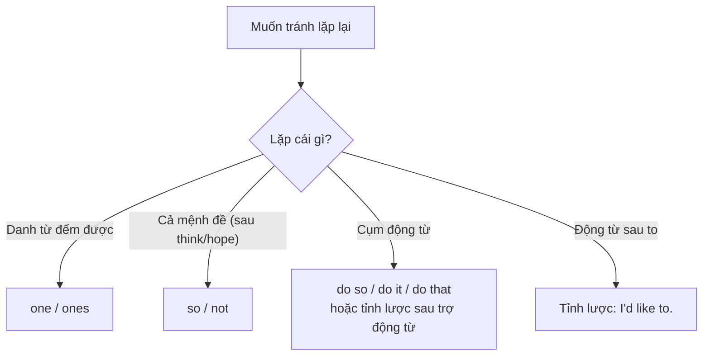

# B2-G023 · Ellipsis & Substitution — Tỉnh lược và thay thế

## Mục lục

- [A. Lesson Information](#a-lesson-information)
- [B. Warm-up](#b-warm-up)
- [C. WHAT](#c-what)
- [D. WHY](#d-why)
- [E. FORM](#e-form)
- [F. HOW](#f-how)
- [G. VISUAL](#g-visual)
- [H. COMPARISON](#h-comparison)
- [I. COMMON MISTAKES](#i-common-mistakes)
- [J. MEMORY TRICKS](#j-memory-tricks)
- [K. REAL-LIFE APPLICATION](#k-real-life-application)
- [L. PRACTICE EXERCISES](#l-practice-exercises)
- [M. KNOWLEDGE CHECK](#m-knowledge-check)
- [N. ANSWER KEY](#n-answer-key)

---

## A. Lesson Information

| Mục | Nội dung |
|---|---|
| **Lesson ID** | B2-G023 |
| **Topic** | Substitution with one/ones, so/not (I think so, I hope not), do so / do it / do that; ellipsis after auxiliaries (I can't, but she can), after to (I'd like to), in coordinated clauses; short answers and responses (So do I, Neither can she) |
| **Tên tiếng Việt** | Thay thế bằng *one/ones, so/not, do so*; tỉnh lược sau trợ động từ và *to* |
| **CEFR Level** | B2 |
| **Prerequisites** | [A2-G020 — Question Tags](../../03-A2-ELEMENTARY/grammar/A2-G020-question-tags.md), [B1-G026 — Expressing Opinions](../../04-B1-INTERMEDIATE/grammar/B1-G026-expressing-opinions.md) |
| **Estimated Time** | 75 phút |

**Learning Objectives:**

1. Thay danh từ bằng ***one / ones*** để tránh lặp: *I like the red **one**.*
2. Thay mệnh đề bằng ***so / not*** sau *think, hope, expect, suppose, believe, afraid*.
3. Thay cụm động từ bằng ***do so / do it / do that / do the same***.
4. **Tỉnh lược** động từ sau trợ động từ (*I haven't finished, but she **has***) và sau ***to*** (*I'd love **to***).
5. Dùng tỉnh lược và thay thế để làm văn nói tự nhiên và văn viết mạch lạc, không lặp từ.

---

## B. Warm-up

> **A:** *Do you think it will rain?*
> **B:** *I **hope not**. I didn't bring an umbrella. Did you?*
> **A:** *No, but Lan **did**. She has a big **one**.*
> **B:** *Great. Can we share hers?*
> **A:** *We can try **to**.*

🤔 **Hãy suy nghĩ:** Nếu viết đầy đủ, đoạn hội thoại sẽ lặp những từ nào? (*I hope that it will not rain... Lan brought an umbrella... a big umbrella... We can try to share it.*) Vì sao người nói tự nhiên lại bỏ chúng?

---

## C. WHAT

| Kỹ thuật | Định nghĩa | Ví dụ |
|---|---|---|
| **Thay thế** (substitution) | Dùng từ khác **thay cho** từ/cụm đã nói | *I lost my pen. Can you lend me **one**?* |
| **Tỉnh lược** (ellipsis) | **Bỏ hẳn** từ/cụm có thể hiểu từ ngữ cảnh | *I can swim, but my sister can't (~~swim~~).* |

Cả hai giúp **tránh lặp từ** và tạo **liên kết** (cohesion) giữa các câu.

---

## D. WHY



Người bản ngữ **gần như luôn** dùng tỉnh lược/thay thế trong hội thoại. Câu trả lời đầy đủ (*Yes, I think that it will rain tomorrow*) nghe máy móc. Trong bài viết, các kỹ thuật này là phần của tiêu chí **cohesion**.

---

## E. FORM

### E1. *one / ones*

| Cấu trúc | Ví dụ |
|---|---|
| **a/an + adj + one** | *I don't want a big car — a **small one** is fine.* |
| **the + (adj) + one(s)** | *Which shoes? — **The black ones**.* |
| **this/that/which one** | *I prefer **this one**.* |
| **one of + N** | *She's **one of** my best friends.* |

> ⚠️ Không dùng *one* thay danh từ **không đếm được**: *I like white wine more than red* (~~red one~~). Không dùng *a one* đứng một mình: ~~I want a one~~ → *I want one.*

### E2. *so / not* thay mệnh đề

| Động từ | Khẳng định | Phủ định |
|---|---|---|
| *think, believe, expect, suppose, imagine* | *I think **so**.* | *I **don't** think **so**.* (phổ biến hơn *I think not*) |
| *hope* | *I hope **so**.* | *I hope **not**.* (không ~~I don't hope so~~) |
| *be afraid* | *I'm afraid **so**.* | *I'm afraid **not**.* |
| *guess* (Anh–Mỹ) | *I guess **so**.* | *I guess **not**.* |

Cũng dùng: ***If so**, ...* (nếu vậy) / ***If not**, ...* (nếu không).

### E3. *do so / do it / do that / do the same*

| Cấu trúc | Văn phong | Ví dụ |
|---|---|---|
| **do so** | Trang trọng | *Applicants must submit their forms by Friday. Those who fail to **do so** will be rejected.* |
| **do it / do that** | Thân mật; thường với hành động cụ thể, có chủ ý | *"Who broke the vase?" — "Tom **did it**."* |
| **do the same** | "làm giống vậy" | *My brother quit his job, and I **did the same**.* |

### E4. Tỉnh lược sau trợ động từ / modal

| Ví dụ | Phần bị lược |
|---|---|
| *I haven't finished, but Lan **has**.* | *finished* |
| *"Can you drive?" — "Yes, I **can**."* | *drive* |
| *He said he would call, and he **did**.* | *call* |
| *She's working harder than she **was** last year.* | *working* |

### E5. Tỉnh lược sau *to*

| Ví dụ |
|---|
| *"Would you like to come?" — "I'd love **to**."* |
| *I didn't want to go, but I had **to**.* |
| *You can stay if you want **to**.* |

> ⚠️ Giữ *to*, chỉ bỏ động từ: ~~I'd love.~~ ✅ *I'd love to.*
> Với *be*, thường giữ *be*: *"Are you ready?" — "I'm trying **to be**."*

### E6. Tỉnh lược trong mệnh đề nối

*Lan plays the piano and (~~Lan plays~~) the guitar.*
*Some students went by bus; others (~~went~~) by car.*

---

## F. HOW

| # | English | Tiếng Việt | Phân tích |
|---|---|---|---|
| 1 | *These glasses are too small. Do you have bigger **ones**?* | Có cái nào lớn hơn không? | ones |
| 2 | *"Is the shop open on Sundays?" — "I **think so**."* | Tôi nghĩ vậy. | so |
| 3 | *"Will it be expensive?" — "I **hope not**."* | Hy vọng là không. | hope not |
| 4 | *"Did you fail the test?" — "I'm **afraid so**."* | E là vậy. | afraid so |
| 5 | *You may leave early. If you **do so**, please inform reception.* | Nếu bạn làm vậy... | do so — trang trọng |
| 6 | *My sister became a vegetarian, and later I **did the same**.* | Sau đó tôi cũng làm vậy. | do the same |
| 7 | *I can't speak French, but my brother **can**.* | ... nhưng anh tôi nói được. | Tỉnh lược sau *can* |
| 8 | *"Have you been to Japan?" — "No, but I'd **like to**."* | ... nhưng tôi muốn đi. | Tỉnh lược sau *to* |
| 9 | *She promised to help, and she **did**.* | Cô ấy hứa giúp và đã giúp. | Tỉnh lược sau *did* |
| 10 | *Is the meeting still on? **If so**, I'll be there at 3.* | Nếu vậy... | If so |
| 11 | *Some people prefer tea; others, coffee.* | Một số người thích trà; số khác thích cà phê. | Tỉnh lược động từ (văn viết) |
| 12 | *"Who wants pizza?" — "I **do**!"* | Tôi! | Tỉnh lược sau *do* |

---

## G. VISUAL

### Bản đồ thay thế

```text
LẶP DANH TỪ      →   one / ones              the blue one, these ones
LẶP MỆNH ĐỀ      →   so / not                I think so, I hope not
LẶP CỤM ĐỘNG TỪ  →   do so / do it / did     He did so, I did it
                 →   (tỉnh lược)             She can't, but I can.
LẶP SAU "TO"     →   (tỉnh lược)             I'd love to.
```

---

## H. COMPARISON

### *I don't think so* vs *I think not*

| *I don't think so.* | *I think not.* |
|---|---|
| Phổ biến, tự nhiên | Trang trọng, hơi cổ, có thể nghe dứt khoát |

### *I hope not* vs ~~*I don't hope so*~~

*hope* không dùng phủ định chuyển: chỉ *I hope **not***.

### *do so* vs *do it*

| *do so* | *do it* |
|---|---|
| Thay cho hành động **vừa nêu**, văn trang trọng | Thay cho hành động cụ thể; văn nói |
| *Visitors may take photos, but must not **do so** inside the temple.* | *I'll fix the computer. I'll **do it** tomorrow.* |

---

## I. COMMON MISTAKES

| # | ❌ Sai | ✅ Đúng | Nguyên nhân | Cách tránh |
|---|---|---|---|---|
| 1 | I don't **hope so**. | I **hope not**. | Phủ định sai | *hope not* |
| 2 | "Will you come?" — "I **think**." | "I **think so**." | Thiếu *so* | *think* cần *so* |
| 3 | I want **a one**. | I want **one**. | Thừa *a* | *a one* chỉ khi có tính từ: *a big one* |
| 4 | I prefer red wine to white **one**. | ... to **white**. | *one* với không đếm được | Không đếm được → tỉnh lược |
| 5 | "Would you like to join?" — "I'd love." | "I'd love **to**." | Bỏ cả *to* | Giữ *to* |
| 6 | She can't drive, but I **can drive**. (lặp) | ..., but I **can**. | Lặp không cần thiết | Tỉnh lược sau trợ động từ |
| 7 | "Is it true?" — "I'm afraid **it**." | "I'm afraid **so**." | | *afraid so/not* |

---

## J. MEMORY TRICKS

1. **"Hope NOT, không Don't hope"** 🙏.
2. **"Giữ cái móc — bỏ cái treo"**: giữ trợ động từ / *to* (cái móc), bỏ động từ chính (cái treo): *I can.* / *I'd love to.*
3. **"One cho đếm được"**: chỉ thay danh từ đếm được.

---

## K. REAL-LIFE APPLICATION

### Hội thoại: Planning a weekend trip

> **Minh:** *Are you coming to Ha Long this weekend?*
> **Lan:** *I'd like **to**, but I'm not sure I can. My boss might need me on Saturday.*
> **Minh:** *Can you ask her today? **If not**, we'll book without you and you can join on Sunday.*
> **Lan:** *OK, I will. Is Tuan coming?*
> **Minh:** *I **think so**. He said he would, and he usually **does** what he says.*
> **Lan:** *Great. Should I bring my tent?*
> **Minh:** *We're staying in a homestay, so I **don't think so**. But bring a jacket — I've got a spare **one** if you need it.*
> **Lan:** *Will it be cold?*
> **Minh:** *I **hope not**, but the forecast says it might **be**.*

**Dịch tóm tắt:** Minh rủ Lan đi Hạ Long; Lan muốn đi nhưng chưa chắc vì sếp có thể cần; nếu không đi thứ Bảy thì Chủ nhật đến sau. Tuấn có lẽ đi. Không cần lều vì ở homestay, nhưng mang áo khoác — Minh có cái dự phòng. Hy vọng không lạnh, nhưng dự báo nói có thể lạnh.

---

## L. PRACTICE EXERCISES

> ✍️ Đáp án: [B2-G023-ANSWERS](../../12-ANSWERS-AND-EXPLANATIONS/B2/B2-G023-ANSWERS.md)

### Level 1 — Recognition

**L1.1.** "Is it going to rain?" — "I hope ___."  A. not  B. no  C. don't
**L1.2.** I don't like this shirt. Can I see the blue ___?  A. it  B. one  C. ones
**L1.3.** "Has the train left?" — "I'm afraid ___."  A. it  B. yes  C. so
**L1.4.** "Would you like to come with us?" — "I'd love ___."  A. it  B. to  C. —
**L1.5.** Visitors must not smoke. Anyone who does ___ will be fined.  A. so  B. it so  C. this
**L1.6.** She doesn't eat meat, and neither ___ her husband.  A. is  B. does  C. eats

### Level 2 — Controlled Practice

Viết lại phần in đậm bằng thay thế hoặc tỉnh lược.

**L2.1.** These apples are sour. Do you have any sweeter **apples**?
**L2.2.** "Is the museum open today?" — "I think **that the museum is open today**."
**L2.3.** "Will the exam be difficult?" — "I hope **that the exam won't be difficult**."
**L2.4.** I haven't read the book, but my sister **has read the book**.
**L2.5.** "Do you want to go to the party?" — "Not really, but I have **to go to the party**."
**L2.6.** My father stopped smoking last year, and my uncle **stopped smoking** too. (do the same)
**L2.7.** Passengers may use their phones. If passengers **use their phones**, they must keep the volume low. (do so)
**L2.8.** Are you free on Saturday? If **you are free on Saturday**, let's meet for coffee.
**L2.9.** "Who left the door open?" — "Nam **left the door open**."
**L2.10.** I'd like a coffee. Would you like **a coffee** too?

### Level 3 — Error Correction

**L3.1.** "Will he pass?" — "I don't hope so."
**L3.2.** "Is it true?" — "I think."
**L3.3.** I need a new laptop. My old is too slow.
**L3.4.** I prefer hot water to cold one.
**L3.5.** "Can you come tomorrow?" — "I'd like, but I can't."
**L3.6.** "Did you enjoy the film?" — "Yes, I enjoyed."

### Level 4 — Production

Trả lời tự nhiên (dùng thay thế/tỉnh lược).

**L4.1.** *"Do you think it will be sunny tomorrow?"* (bạn không chắc nhưng nghĩ là có)
**L4.2.** *"Have you ever been to Paris?"* (chưa, nhưng muốn đi)
**L4.3.** *"Is the restaurant still open?"* (bạn e là không)
**L4.4.** *"Which phone do you want — the black one or the white one?"* (bạn chọn màu trắng)

**L4.5.** **Explain:** Vì sao *"I don't hope so"* sai trong khi *"I don't think so"* đúng?

### Level 5 — Real Communication

**L5.1.** Viết **đoạn hội thoại** 12–16 lượt (130–170 từ) giữa hai người lên kế hoạch cho một sự kiện. Dùng ≥ 2 *one/ones*, ≥ 3 *so/not*, ≥ 1 *do so/do the same*, ≥ 3 tỉnh lược sau trợ động từ, ≥ 2 tỉnh lược sau *to*, ≥ 1 *If so / If not*.
**L5.2.** **Speaking — Quick-fire responses:** Nhờ một người hỏi bạn 10 câu hỏi Yes/No nhanh (*Do you like...? Have you ever...? Will you...? Is it...?*). Trả lời **chỉ** bằng câu ngắn có tỉnh lược/thay thế (*I do / I'd love to / I hope not / I think so / I'm afraid so*).

---

## M. KNOWLEDGE CHECK

### 5 câu hỏi tự kiểm tra

1. Khác biệt giữa thay thế và tỉnh lược?
2. Phủ định của *I hope so* và *I think so*?
3. *one* có thay được danh từ không đếm được không?
4. *do so* dùng trong văn phong nào?
5. Khi tỉnh lược sau *to*, cái gì được giữ lại?

### Checklist

- [ ] Tôi trả lời ngắn tự nhiên bằng *I think so / I hope not*.
- [ ] Tôi dùng *one/ones* đúng.
- [ ] Tôi tỉnh lược sau trợ động từ và *to*.

### 3 lỗi quan trọng cần nhớ

1. ~~I don't hope so~~ → **I hope not**.
2. ~~I'd love.~~ → **I'd love to.**
3. ~~cold one~~ (không đếm được) → **cold**.

### Lịch ôn tập

| Ngày | Việc cần làm |
|---|---|
| Ngày 1 | Làm lại L2 |
| Ngày 3 | Trả lời 20 câu hỏi Yes/No bằng câu ngắn |
| Ngày 7 | Áp dụng trong [S02 — Everyday Conversations](../../09-FOUR-SKILLS/Speaking/S02-everyday-conversations.md) |

### Liên kết

- ➡️ Bài tiếp theo: [B2-G024 — Parallel Structures](B2-G024-parallel-structures.md)

---

## N. ANSWER KEY

👉 [B2-G023-ANSWERS.md](../../12-ANSWERS-AND-EXPLANATIONS/B2/B2-G023-ANSWERS.md)
