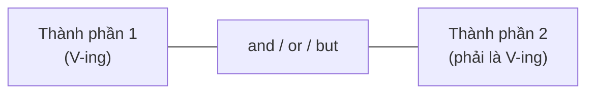

# B2-G024 · Parallel Structures — Cấu trúc song song

## Mục lục

- [A. Lesson Information](#a-lesson-information)
- [B. Warm-up](#b-warm-up)
- [C. WHAT](#c-what)
- [D. WHY](#d-why)
- [E. FORM](#e-form)
- [F. HOW](#f-how)
- [G. VISUAL](#g-visual)
- [H. COMPARISON](#h-comparison)
- [I. COMMON MISTAKES](#i-common-mistakes)
- [J. MEMORY TRICKS](#j-memory-tricks)
- [K. REAL-LIFE APPLICATION](#k-real-life-application)
- [L. PRACTICE EXERCISES](#l-practice-exercises)
- [M. KNOWLEDGE CHECK](#m-knowledge-check)
- [N. ANSWER KEY](#n-answer-key)

---

## A. Lesson Information

| Mục | Nội dung |
|---|---|
| **Lesson ID** | B2-G024 |
| **Topic** | Parallelism in lists (and/or), with correlative conjunctions (both...and, either...or, neither...nor, not only...but also), in comparisons (than/as), with prepositions and articles; parallel structures for rhetorical effect |
| **Tên tiếng Việt** | Cấu trúc song song trong liệt kê, cặp liên từ, so sánh |
| **CEFR Level** | B2 |
| **Prerequisites** | [B1-G016 — Gerund vs Infinitive](../../04-B1-INTERMEDIATE/grammar/B1-G016-gerund-vs-infinitive.md), [B1-G025 — Both, Either, Neither](../../04-B1-INTERMEDIATE/grammar/B1-G025-both-either-neither-each-every.md) |
| **Estimated Time** | 60 phút |

**Learning Objectives:**

1. Hiểu nguyên tắc **song song**: các thành phần được nối phải có **cùng dạng ngữ pháp**.
2. Viết danh sách song song: *reading, writing **and** speaking* (không ~~reading, writing and to speak~~).
3. Đặt cặp liên từ (*both...and, not only...but also*) **trước cùng loại từ**.
4. Giữ song song trong **so sánh** (*than/as*).
5. Dùng song song để tạo **nhịp điệu và sức thuyết phục** trong bài viết/bài nói.

---

## B. Warm-up

Câu nào nghe "trơn tru" hơn?

> **A.** *My job involves **answering** emails, **to attend** meetings and **I write** reports.*
> **B.** *My job involves **answering** emails, **attending** meetings and **writing** reports.*

🤔 **Hãy suy nghĩ:** Cả hai câu đều hiểu được, nhưng câu A có vấn đề. Ba thành phần trong danh sách của câu A có dạng ngữ pháp giống nhau không?

---

## C. WHAT

**Cấu trúc song song** (parallelism) = khi nối hai hay nhiều thành phần bằng *and, or, but, both...and, not only...but also, than, as...*, các thành phần đó phải có **cùng dạng ngữ pháp**:

| Dạng | ✅ Song song |
|---|---|
| Danh từ | *She bought **apples**, **bananas** and **grapes**.* |
| V-ing | *I enjoy **swimming**, **cycling** and **hiking**.* |
| to V | *I want **to travel**, **to learn** and **to grow**.* (có thể lược *to* sau cái đầu: *to travel, learn and grow*) |
| Tính từ | *The room was **clean**, **bright** and **spacious**.* |
| Mệnh đề | *She said **that she was tired** and **that she wanted to go home**.* |
| Cụm giới từ | *We searched **in the kitchen**, **in the garden** and **under the bed**.* |

---

## D. WHY



Song song giúp câu **rõ ràng, cân đối, dễ đọc** và là dấu hiệu **văn viết trưởng thành**. Lỗi song song (*faulty parallelism*) là lỗi phổ biến trong bài viết của người học — và là dạng **tìm lỗi sai** quen thuộc trong đề thi. Ngoài ra, song song là công cụ **tu từ** mạnh trong diễn thuyết: *"government of the people, by the people, for the people"*.

---

## E. FORM

### E1. Liệt kê với *and / or / but*

| ❌ | ✅ |
|---|---|
| *She likes **to dance**, **singing** and **to paint**.* | *She likes **dancing**, **singing** and **painting**.* |
| *The course is **useful**, **interesting** and **has many activities**.* | *The course is **useful**, **interesting** and **interactive**.* |

### E2. Cặp liên từ (correlative conjunctions)

Đặt mỗi vế **ngay trước** thành phần cùng loại:

| Cặp | ❌ | ✅ |
|---|---|---|
| *both ... and* | *She **both** speaks English **and** French.* | *She speaks **both** English **and** French.* |
| *either ... or* | *You can **either** pay by card **or** in cash.* (chấp nhận trong văn nói) | *You can pay **either** by card **or** in cash.* |
| *neither ... nor* | *He **neither** likes tea **nor** coffee.* | *He likes **neither** tea **nor** coffee.* |
| *not only ... but also* | *She **not only** is clever **but also** kind.* | *She is **not only** clever **but also** kind.* |
| *whether ... or* | *I don't know **whether** to stay **or** going.* | *I don't know **whether** to stay **or** (to) go.* |

### E3. So sánh với *than / as*

| ❌ | ✅ |
|---|---|
| *Walking is healthier **than to drive**.* | *Walking is healthier **than driving**.* |
| *The weather in Da Lat is cooler **than Hanoi**.* | *The weather in Da Lat is cooler **than that in Hanoi** / **than in Hanoi**.* |
| *Her salary is higher **than her husband**.* | *Her salary is higher **than her husband's**.* |

> ⚠️ So sánh phải **cùng loại đối tượng**: thời tiết với thời tiết, lương với lương.

### E4. Giới từ và mạo từ

Khi các thành phần cần **giới từ khác nhau**, phải viết đủ:
*She is **interested in** and **good at** maths.* (không ~~interested and good at~~)

### E5. Song song tu từ (rhetorical parallelism)

| Ví dụ | Hiệu quả |
|---|---|
| *We need **better schools**, **better hospitals** and **better roads**.* | Lặp cấu trúc → nhấn mạnh |
| ***The more** we learn, **the more** we realise how little we know.* | Cân đối |
| *It's **not about** winning; it's **about** taking part.* | Đối lập |

---

## F. HOW

| # | English | Tiếng Việt | Phân tích |
|---|---|---|---|
| 1 | *A good leader should be **honest**, **confident** and **fair**.* | Lãnh đạo giỏi nên trung thực, tự tin và công bằng. | 3 tính từ |
| 2 | *In my free time I enjoy **reading**, **cooking** and **gardening**.* | ... đọc sách, nấu ăn và làm vườn. | 3 V-ing |
| 3 | *The aim of the course is **to improve** your grammar and **(to) expand** your vocabulary.* | ... cải thiện ngữ pháp và mở rộng vốn từ. | 2 to V |
| 4 | *She is **not only** a talented singer **but also** a skilled dancer.* | Cô ấy không chỉ là ca sĩ tài năng mà còn là vũ công giỏi. | N – N |
| 5 | *You can apply **either** online **or** in person.* | Bạn có thể nộp trực tuyến hoặc trực tiếp. | trạng ngữ – trạng ngữ |
| 6 | *He enjoys **neither** swimming **nor** running.* | Anh ấy không thích bơi cũng không thích chạy. | V-ing – V-ing |
| 7 | *Living in the city is more expensive **than living** in the countryside.* | Sống ở thành phố đắt hơn sống ở nông thôn. | V-ing – V-ing |
| 8 | *The population of Hanoi is larger than **that of** Da Nang.* | Dân số Hà Nội lớn hơn của Đà Nẵng. | *that of* — so sánh đúng đối tượng |
| 9 | *She said **that** she was busy and **that** she would call later.* | Cô ấy nói rằng bận và rằng sẽ gọi sau. | 2 mệnh đề *that* |
| 10 | *We are committed **to reducing** waste and **(to) protecting** the environment.* | ... giảm rác thải và bảo vệ môi trường. | *to* giới từ + V-ing |
| 11 | *He was **both** surprised **and** delighted by the news.* | Anh ấy vừa ngạc nhiên vừa vui mừng. | adj – adj |
| 12 | *Education is **not a privilege** but **a right**.* | Giáo dục không phải đặc quyền mà là quyền. | Song song đối lập |

---

## G. VISUAL

### Kiểm tra song song: "xếp hàng dọc"

```text
My job involves  ┌ answering emails,
                 ├ attending meetings, and
                 └ writing reports.          ✅ cùng V-ing

My job involves  ┌ answering emails,
                 ├ to attend meetings, and   ❌
                 └ I write reports.          ❌
```

---

## H. COMPARISON

### Vị trí cặp liên từ

| ❌ Lệch | ✅ Song song |
|---|---|
| *He **not only** plays the guitar **but also** the piano.* | *He plays **not only** the guitar **but also** the piano.* |
| (*not only* trước động từ, *but also* trước danh từ) | (cả hai trước danh từ) |

> 💡 Câu lệch vẫn phổ biến trong văn nói; trong bài viết học thuật nên viết song song.

### *than him* vs *than his*

| *She is taller **than him/he is**.* | *Her car is newer **than his**.* |
|---|---|
| so sánh người với người | so sánh xe với xe |

---

## I. COMMON MISTAKES

| # | ❌ Sai | ✅ Đúng | Nguyên nhân | Cách tránh |
|---|---|---|---|---|
| 1 | I like **swimming**, **to read** and **cook**. | I like **swimming**, **reading** and **cooking**. | Trộn dạng | Một dạng cho cả danh sách |
| 2 | She is **smart**, **friendly** and **works hard**. | ..., friendly and **hard-working**. | Tính từ + cụm động từ | Đổi thành tính từ |
| 3 | He **both** plays football **and** tennis. | He plays **both** football **and** tennis. | Vị trí *both* | Trước cùng loại từ |
| 4 | The climate here is hotter **than Hanoi**. | ... hotter **than (that) in Hanoi**. | So sánh khác loại | Khí hậu ↔ khí hậu |
| 5 | Walking is better **than to take** a taxi. | ... better **than taking** a taxi. | | V-ing ↔ V-ing |
| 6 | She is **interested and good at** music. | She is **interested in** and **good at** music. | Thiếu giới từ | Viết đủ giới từ |
| 7 | **Not only** she is kind **but also** clever. | She is **not only** kind **but also** clever. / **Not only is** she kind, **but** she is **also** clever. | | Vị trí hoặc đảo ngữ (B2-G009) |

---

## J. MEMORY TRICKS

1. **"Xếp hàng dọc"** 📏: Viết các thành phần thành cột — chúng phải "mặc đồng phục" giống nhau.
2. **"Cặp liên từ là đôi đũa"** 🥢: hai chiếc đặt **song song**, trước **cùng loại** từ.
3. **"So sánh táo với táo"** 🍎: *than/as* nối hai thứ cùng loại.

---

## K. REAL-LIFE APPLICATION

### Thư xin việc (trích)

> *I am writing to apply for the position of Marketing Assistant. I have a degree in business, **two years of experience in digital marketing** and **a strong interest in consumer behaviour**.*
>
> *In my current role, I am responsible for **planning** social media campaigns, **analysing** customer data and **preparing** monthly reports. I am **not only** creative **but also** highly organised, and I work well **both** independently **and** as part of a team.*
>
> *I believe that this position would allow me **to develop** my skills, **contribute** to your company's growth and **build** a long-term career in marketing.*

**Dịch tóm tắt:** Ứng tuyển vị trí trợ lý marketing; có bằng kinh doanh, 2 năm kinh nghiệm marketing số và quan tâm đến hành vi người tiêu dùng; phụ trách lên kế hoạch chiến dịch mạng xã hội, phân tích dữ liệu khách hàng, chuẩn bị báo cáo; không chỉ sáng tạo mà còn có tổ chức; làm tốt cả độc lập và theo nhóm; vị trí giúp phát triển kỹ năng, đóng góp và xây dựng sự nghiệp lâu dài.

---

## L. PRACTICE EXERCISES

> ✍️ Đáp án: [B2-G024-ANSWERS](../../12-ANSWERS-AND-EXPLANATIONS/B2/B2-G024-ANSWERS.md)

### Level 1 — Recognition

Câu nào **song song** đúng?

**L1.1.** A. She enjoys reading, to write and painting.  B. She enjoys reading, writing and painting.
**L1.2.** A. He plays both the piano and the violin.  B. He both plays the piano and the violin.
**L1.3.** A. The weather in Hue is wetter than Hanoi.  B. The weather in Hue is wetter than that in Hanoi.
**L1.4.** A. Cycling is cheaper than driving.  B. Cycling is cheaper than to drive.
**L1.5.** A. The hotel was clean, comfortable and had a good location.  B. The hotel was clean, comfortable and well located.
**L1.6.** A. You can either call me or send an email.  B. You can either call me or sending an email.

### Level 2 — Controlled Practice

Sửa thành phần không song song (viết lại cả câu).

**L2.1.** My goals are to improve my English, getting a better job and travel more.
**L2.2.** The manager was rude, unhelpful and he didn't listen.
**L2.3.** She not only won the race but also the respect of her rivals.
**L2.4.** I'd rather stay at home than going to the party.
**L2.5.** His explanation was clear, logical and it convinced everyone.
**L2.6.** The rent in District 1 is higher than District 7.

Nối hai câu bằng cặp liên từ, giữ song song.

**L2.7.** He doesn't smoke. He doesn't drink. (neither ... nor)
**L2.8.** The project was expensive. It was also time-consuming. (both ... and)
**L2.9.** She speaks Japanese. She also speaks Korean. (not only ... but also)
**L2.10.** We can take the train. We can take the bus. (either ... or)

### Level 3 — Error Correction

**L3.1.** The job requires patience, creativity and to be organised.
**L3.2.** She is interested and skilled at photography.
**L3.3.** Learning online is more flexible than to study in a classroom.
**L3.4.** He neither called me nor he sent a message.
**L3.5.** My phone is more expensive than my brother.
**L3.6.** The festival was fun, colourful and there were many people.

### Level 4 — Production

**L4.1.** Dịch: *"Công việc của tôi bao gồm trả lời khách hàng, xử lý đơn hàng và viết báo cáo."*
**L4.2.** Dịch: *"Cô ấy không chỉ thông minh mà còn rất chăm chỉ."*
**L4.3.** Dịch: *"Học một ngôn ngữ đòi hỏi thời gian, sự kiên nhẫn và thực hành thường xuyên."*
**L4.4.** Dịch: *"Giá nhà ở Hà Nội cao hơn giá nhà ở Huế."* (so sánh đúng đối tượng)

**L4.5.** **Explain:** Vì sao câu *"The climate in Da Lat is cooler than Ho Chi Minh City"* bị coi là lỗi về logic? Sửa lại.

### Level 5 — Real Communication

**L5.1.** Viết **đoạn giới thiệu bản thân trong thư xin việc** (120–150 từ). Dùng ≥ 3 danh sách song song (danh từ, V-ing, to V), ≥ 2 cặp liên từ song song, ≥ 1 so sánh song song.
**L5.2.** **Speaking — Persuasive speech:** Nói 1 phút kêu gọi bảo vệ môi trường, dùng song song tu từ: *We need cleaner air, cleaner water and cleaner cities. It's not about..., it's about... The more we..., the more we...*

---

## M. KNOWLEDGE CHECK

### 5 câu hỏi tự kiểm tra

1. Nguyên tắc song song là gì?
2. Đặt *both ... and* ở đâu?
3. Vì sao *than Hanoi* trong câu về khí hậu là lỗi?
4. Khi hai tính từ cần hai giới từ khác nhau thì sao?
5. Cho 1 ví dụ song song tu từ.

### Checklist

- [ ] Danh sách của tôi cùng một dạng ngữ pháp.
- [ ] Cặp liên từ của tôi đặt trước cùng loại từ.
- [ ] So sánh của tôi cùng loại đối tượng.

### 3 lỗi quan trọng cần nhớ

1. ~~reading, to write and painting~~ → **reading, writing and painting**.
2. ~~both plays football and tennis~~ → plays **both** football **and** tennis.
3. ~~hotter than Hanoi~~ → hotter than **that in** Hanoi.

### Lịch ôn tập

| Ngày | Việc cần làm |
|---|---|
| Ngày 1 | Làm lại L2 |
| Ngày 3 | Kiểm tra song song trong 2 bài viết cũ |
| Ngày 7 | Ôn chung với [B2-G009 — Inversion](B2-G009-inversion.md) (*Not only...*) |

### Liên kết

- ➡️ Bài tiếp theo: [B2-G025 — Hedging & Academic Language](B2-G025-hedging-academic-language.md)

---

## N. ANSWER KEY

👉 [B2-G024-ANSWERS.md](../../12-ANSWERS-AND-EXPLANATIONS/B2/B2-G024-ANSWERS.md)
