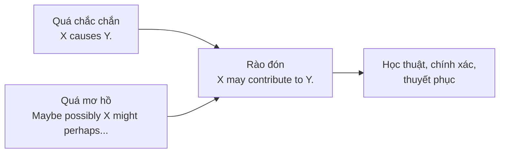

# B2-G025 · Hedging & Academic Language — Rào đón và ngôn ngữ học thuật

## Mục lục

- [A. Lesson Information](#a-lesson-information)
- [B. Warm-up](#b-warm-up)
- [C. WHAT](#c-what)
- [D. WHY](#d-why)
- [E. FORM](#e-form)
- [F. HOW](#f-how)
- [G. VISUAL](#g-visual)
- [H. COMPARISON](#h-comparison)
- [I. COMMON MISTAKES](#i-common-mistakes)
- [J. MEMORY TRICKS](#j-memory-tricks)
- [K. REAL-LIFE APPLICATION](#k-real-life-application)
- [L. PRACTICE EXERCISES](#l-practice-exercises)
- [M. KNOWLEDGE CHECK](#m-knowledge-check)
- [N. ANSWER KEY](#n-answer-key)

---

## A. Lesson Information

| Mục | Nội dung |
|---|---|
| **Lesson ID** | B2-G025 |
| **Topic** | Hedging devices: modal verbs (may, might, could), lexical verbs (seem, appear, tend to, suggest, indicate), adverbs (possibly, probably, generally, largely, arguably), adjectives (likely, possible), quantifiers (some, many, in most cases), impersonal structures (It is likely that..., There is evidence that...), boosters (clearly, undoubtedly) and when to use them |
| **Tên tiếng Việt** | Rào đón (giảm mức độ khẳng định) và ngôn ngữ học thuật |
| **CEFR Level** | B2 |
| **Prerequisites** | [B2-G011 — Advanced Modals](B2-G011-advanced-modals.md), [B2-G005 — Passive Reporting](B2-G005-passive-reporting.md) |
| **Estimated Time** | 75 phút |

**Learning Objectives:**

1. Hiểu **hedging** (rào đón): làm mềm/giảm độ chắc chắn của khẳng định để **chính xác và thận trọng**.
2. Dùng 6 nhóm phương tiện rào đón: **modal, động từ, trạng từ, tính từ, lượng từ, cấu trúc phi ngôi**.
3. Dùng **boosters** (*clearly, undoubtedly*) khi có bằng chứng mạnh — và biết không lạm dụng.
4. Biến câu khẳng định tuyệt đối thành câu học thuật thận trọng.
5. Tránh **khái quát hóa quá mức** (*all, always, never, everyone*) trong bài luận.

---

## B. Warm-up

So sánh:

> **A.** *Social media **makes** teenagers depressed.*
> **B.** *Excessive use of social media **may contribute to** depression **in some** teenagers.*

🤔 **Hãy suy nghĩ:** Câu A nghe mạnh mẽ, nhưng có **đúng** không? Có phải *mọi* thiếu niên dùng mạng xã hội đều trầm cảm? Câu B đã thêm những từ nào để câu chính xác hơn?

---

## C. WHAT

**Hedging** là dùng ngôn ngữ để thể hiện mức độ **không hoàn toàn chắc chắn**, **giới hạn phạm vi** khẳng định, hoặc **giữ khoảng cách** với thông tin.

| Mục đích | Ví dụ |
|---|---|
| Thể hiện mức độ chắc chắn phù hợp với bằng chứng | *The results **suggest** that...* |
| Giới hạn phạm vi | ***Many** students, **in most cases**...* |
| Lịch sự, tránh áp đặt | ***It could be argued** that...* |
| Bảo vệ người viết khỏi bị phản bác | *This **may** be due to...* |

---

## D. WHY



Trong bài luận B2, khẳng định tuyệt đối (*Everyone knows that..., Technology always...*) bị xem là **thiếu cân nhắc**. Ngược lại, rào đón **quá nhiều** khiến người viết có vẻ **không có quan điểm**. Mục tiêu là **cân bằng**: khẳng định rõ quan điểm, nhưng rào đón những tuyên bố về sự thật/số liệu chưa chắc chắn.

---

## E. FORM

### E1. Sáu nhóm phương tiện rào đón

| Nhóm | Ví dụ |
|---|---|
| **Modal** | *may, might, could, can, would* — *This **could** lead to problems.* |
| **Động từ** | *seem, appear, tend to, suggest, indicate, assume, believe* — *Prices **tend to** rise in winter.* |
| **Trạng từ** | *possibly, probably, perhaps, generally, largely, relatively, arguably, to some extent* — *This is **largely** due to...* |
| **Tính từ** | *likely, possible, probable, unlikely* — *It is **likely** that...* |
| **Lượng từ / tần suất** | *some, many, most, a number of, often, usually, in most cases* — ***Most** experts agree...* |
| **Cấu trúc phi ngôi** | *It is thought that..., There is evidence that..., It could be argued that...* (xem [B2-G005](B2-G005-passive-reporting.md)) |

### E2. Thang chắc chắn

| Mức | Ví dụ |
|---|---|
| Rất chắc | *X **clearly / certainly** causes Y.* |
| Khá chắc | *X **probably / is likely to** cause Y.* |
| Có thể | *X **may / might / could** cause Y.* |
| Không chắc | *X is **unlikely to** cause Y.* |

### E3. Boosters (tăng cường)

*clearly, obviously, undoubtedly, certainly, it is evident that, there is no doubt that*

Dùng **khi có bằng chứng mạnh** hoặc khi khẳng định quan điểm cá nhân rõ ràng: *There is **clear** evidence that smoking damages health.*

### E4. Biến đổi câu tuyệt đối → câu rào đón

| Tuyệt đối | Rào đón |
|---|---|
| *Young people are addicted to phones.* | ***Many** young people **appear to** spend excessive time on their phones.* |
| *This policy will fail.* | *This policy **is unlikely to** succeed **without** further investment.* |
| *Online learning is better than classroom learning.* | ***It could be argued that** online learning is **more effective for some** learners.* |
| *The economy is growing because of tourism.* | *Economic growth **is largely due to** tourism.* |

### E5. Ngôn ngữ học thuật khác

| Đặc điểm | Thay vì | Dùng |
|---|---|---|
| Phi ngôi (tránh *I, you*) | *I think...* | *It can be argued that...* |
| Danh từ hóa | *Prices rose.* | *There was a rise in prices.* (B2-G021) |
| Động từ trang trọng | *find out, look into, go up* | *discover, investigate, increase* |
| Tránh rút gọn | *don't, can't* | *do not, cannot* |
| Tránh từ mơ hồ | *things, stuff, a lot of* | *factors, aspects, a significant number of* |

---

## F. HOW

| # | English | Tiếng Việt | Phân tích |
|---|---|---|---|
| 1 | *Regular exercise **may reduce** the risk of heart disease.* | Tập thể dục đều đặn có thể giảm nguy cơ bệnh tim. | Modal |
| 2 | *Students who sleep well **tend to** perform better.* | Học sinh ngủ đủ thường học tốt hơn. | tend to |
| 3 | *The data **suggest** that the policy has had a positive effect.* | Dữ liệu cho thấy... | suggest (*data* — số nhiều trong văn học thuật; *suggests* cũng phổ biến) |
| 4 | *This is **probably** the most important factor.* | Đây có lẽ là yếu tố quan trọng nhất. | Trạng từ |
| 5 | ***It is likely that** prices will continue to rise.* | Có khả năng giá sẽ tiếp tục tăng. | Tính từ, phi ngôi |
| 6 | ***In most cases**, the problem can be solved quickly.* | Trong hầu hết trường hợp... | Lượng từ |
| 7 | ***It could be argued that** technology has made us less social.* | Có thể lập luận rằng... | Phi ngôi |
| 8 | *The decline in sales **appears to** be linked to the new competitor.* | Doanh số giảm dường như liên quan... | appear to |
| 9 | ***Arguably**, education is the key to reducing poverty.* | Có thể nói giáo dục là chìa khóa... | Trạng từ |
| 10 | *The results are **largely** consistent with previous research.* | Kết quả phần lớn phù hợp với nghiên cứu trước. | largely |
| 11 | *There is **some evidence** that green spaces improve mental health.* | Có một số bằng chứng... | some evidence |
| 12 | *There is **clear evidence** that air pollution damages the lungs.* | Có bằng chứng rõ ràng... | Booster — khi bằng chứng mạnh |

---

## G. VISUAL

### Từ khẳng định tuyệt đối → khẳng định học thuật

```text
"Social media causes depression."
      ↓ thêm modal                 → Social media may cause depression.
      ↓ đổi động từ                → Social media may contribute to depression.
      ↓ giới hạn phạm vi           → ... in some teenagers.
      ↓ thêm điều kiện             → Excessive use of social media may contribute
                                     to depression in some teenagers.
```

---

## H. COMPARISON

### Rào đón vừa đủ vs rào đón quá mức

| ✅ Vừa đủ | ❌ Quá mức |
|---|---|
| *This **may** be due to rising costs.* | *This **might perhaps possibly** be **somewhat** due to rising costs.* |

### Quan điểm vs sự thật

| Nêu **quan điểm** (có thể khẳng định rõ) | Nêu **sự thật/kết quả** (nên rào đón nếu chưa chắc) |
|---|---|
| *I **strongly believe** that education should be free.* | *Free education **may** increase university enrolment.* |

---

## I. COMMON MISTAKES

| # | ❌ Sai | ✅ Đúng | Nguyên nhân | Cách tránh |
|---|---|---|---|---|
| 1 | **Everyone** knows that exercise is good. | **It is widely accepted** that exercise is beneficial. | Khái quát quá mức | Phi ngôi + rào đón |
| 2 | Technology **always** makes life easier. | Technology **often / generally** makes life easier. | Tuyệt đối | Trạng từ tần suất |
| 3 | It **may possibly could** happen. | It **may** happen. / It **could possibly** happen. | Chồng modal | Một modal |
| 4 | The data **proves** that... | The data **suggest / indicate** that... | Quá chắc | Động từ rào đón |
| 5 | It is **likely** prices **rising**. | It is likely **that** prices **will rise**. / Prices are likely **to rise**. | Sai cấu trúc | *likely that* + mệnh đề / *be likely to V* |
| 6 | **I think** maybe it is **probably** true. | It is **probably** true. | Rào đón chồng chéo | Một phương tiện là đủ |
| 7 | Young people **tend** spending too much. | Young people **tend to spend** too much. | | *tend to + V* |

---

## J. MEMORY TRICKS

1. **"Đo bằng chứng trước khi nói"** ⚖️: Bằng chứng mạnh → *clearly*; trung bình → *likely/suggest*; yếu → *may/might*.
2. **"Một cái rào là đủ"**: không xếp chồng *may possibly perhaps*.
3. **"Bốn từ tuyệt đối cần soát"** 🚩: *all, always, never, everyone* — khi nói về sự thật, cân nhắc thay bằng *most, often, rarely, many*.

---

## K. REAL-LIFE APPLICATION

### Đoạn văn học thuật

> *The relationship between screen time and academic performance has received considerable attention. **Some** studies **suggest** that excessive use of smartphones **may** have a negative effect on students' concentration. However, the evidence is **not entirely** consistent. **It could be argued that** the type of content matters more than the amount of time spent on screens.*
>
> *Students who use their devices for learning **tend to** benefit, whereas those who mainly use social media **appear to** experience more distraction. **It is likely that** other factors, such as sleep and family support, **also** play a role. **Therefore**, a complete ban on phones in schools is **unlikely to** be the most effective solution. A more balanced approach **would probably** produce better results.*

> ℹ️ Đoạn văn mô phỏng phong cách học thuật; khi viết thật, mỗi khẳng định về "studies" cần dẫn nguồn cụ thể.

---

## L. PRACTICE EXERCISES

> ✍️ Đáp án: [B2-G025-ANSWERS](../../12-ANSWERS-AND-EXPLANATIONS/B2/B2-G025-ANSWERS.md)

### Level 1 — Recognition

Câu nào **có rào đón** phù hợp hơn cho bài luận học thuật?

**L1.1.** A. Fast food causes obesity.  B. Regular consumption of fast food may contribute to obesity.
**L1.2.** A. Most experts agree that the climate is changing.  B. Everybody knows the climate is changing.
**L1.3.** A. The results prove that the drug works.  B. The results suggest that the drug may be effective.

Chọn từ phù hợp.

**L1.4.** Young people ___ to spend more time online than older people.  A. tend  B. are tend  C. tending
**L1.5.** It is ___ that the economy will recover next year.  A. likely  B. likely to  C. like
**L1.6.** Câu nào **rào đón quá mức**?  A. This may be due to rising costs.  B. This might perhaps possibly be somewhat due to rising costs.

### Level 2 — Controlled Practice

Viết lại câu học thuật hơn bằng phương tiện trong ngoặc.

**L2.1.** Video games make children violent. (may / some)
**L2.2.** People in cities are stressed. (tend to)
**L2.3.** This law will reduce pollution. (likely)
**L2.4.** Tourism is the main reason for the town's growth. (largely)
**L2.5.** Working from home is better than working in an office. (It could be argued that)
**L2.6.** Everyone uses smartphones nowadays. (the majority of)
**L2.7.** The new teaching method improved students' results. (appear to)
**L2.8.** Online shopping always saves time. (often)
**L2.9.** Climate change causes more extreme weather. (There is evidence that)
**L2.10.** The project will fail. (unlikely to succeed)

### Level 3 — Error Correction

**L3.1.** Teenagers tend spending too much time on social media.
**L3.2.** It is likely prices increasing next year.
**L3.3.** The study proves that coffee is good for everyone.
**L3.4.** This may possibly could cause problems.
**L3.5.** All students hate exams.
**L3.6.** It seems that the plan will be probably successful maybe.

### Level 4 — Production

**L4.1.** Dịch (rào đón): *"Ô nhiễm không khí có thể là một trong những nguyên nhân gây ra bệnh hô hấp."*
**L4.2.** Dịch: *"Có vẻ như người trẻ ngày càng ít đọc sách in."*
**L4.3.** Dịch: *"Có khả năng giá nhà sẽ tiếp tục tăng trong vài năm tới."*
**L4.4.** Dịch: *"Có thể lập luận rằng giáo dục trực tuyến giúp mở rộng cơ hội học tập."*

**L4.5.** **Explain:** Vì sao trong bài luận nên rào đón khi nói về **sự thật/kết quả nghiên cứu**, nhưng vẫn có thể nêu **quan điểm cá nhân** một cách rõ ràng?

### Level 5 — Real Communication

**L5.1.** Viết **đoạn văn học thuật** 150–180 từ về *"The effects of working from home on productivity"*. Dùng ≥ 6 phương tiện rào đón thuộc ≥ 4 nhóm, ≥ 1 booster có căn cứ, không dùng *always/never/everyone*.
**L5.2.** **Speaking — Discussing research:** Nói 1,5 phút về một xu hướng xã hội (ví dụ: *people are getting married later*), dùng ngôn ngữ thận trọng: *It seems that..., This may be because..., In many cases..., It's likely that...*

---

## M. KNOWLEDGE CHECK

### 5 câu hỏi tự kiểm tra

1. Hedging là gì? Vì sao cần trong văn học thuật?
2. Kể 6 nhóm phương tiện rào đón.
3. Booster là gì? Khi nào dùng?
4. Cấu trúc đúng với *likely*?
5. Thế nào là rào đón quá mức?

### Checklist

- [ ] Tôi tránh *all, always, never, everyone* khi nói về sự thật.
- [ ] Tôi dùng *tend to, appear to, likely, may* đúng cấu trúc.
- [ ] Tôi cân bằng giữa rào đón và nêu quan điểm rõ ràng.

### 3 lỗi quan trọng cần nhớ

1. ~~tend spending~~ → **tend to spend**.
2. ~~proves~~ (khi chưa chắc) → **suggests / indicates**.
3. ~~may possibly could~~ → một modal.

### Lịch ôn tập

| Ngày | Việc cần làm |
|---|---|
| Ngày 1 | Làm lại L2 |
| Ngày 3 | Rào đón lại 5 câu khẳng định tuyệt đối trong bài luận cũ của bạn |
| Ngày 7 | Áp dụng trong [B2-G030 — Argumentation](B2-G030-argumentation.md) |

### Liên kết

- ➡️ Bài tiếp theo: [B2-G026 — Common Collocations](B2-G026-collocations.md)

---

## N. ANSWER KEY

👉 [B2-G025-ANSWERS.md](../../12-ANSWERS-AND-EXPLANATIONS/B2/B2-G025-ANSWERS.md)
