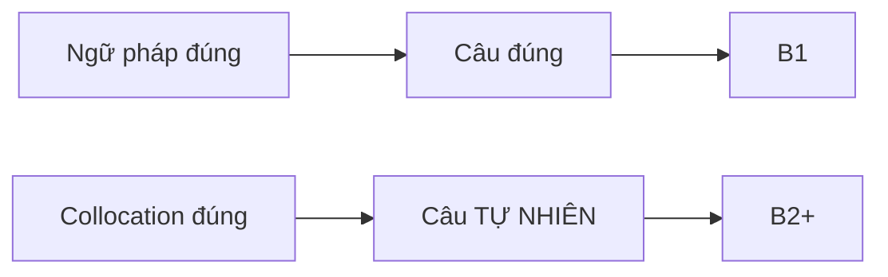

# B2-G026 · Common Collocations — Kết hợp từ thông dụng

## Mục lục

- [A. Lesson Information](#a-lesson-information)
- [B. Warm-up](#b-warm-up)
- [C. WHAT](#c-what)
- [D. WHY](#d-why)
- [E. FORM](#e-form)
- [F. HOW](#f-how)
- [G. VISUAL](#g-visual)
- [H. COMPARISON](#h-comparison)
- [I. COMMON MISTAKES](#i-common-mistakes)
- [J. MEMORY TRICKS](#j-memory-tricks)
- [K. REAL-LIFE APPLICATION](#k-real-life-application)
- [L. PRACTICE EXERCISES](#l-practice-exercises)
- [M. KNOWLEDGE CHECK](#m-knowledge-check)
- [N. ANSWER KEY](#n-answer-key)

---

## A. Lesson Information

| Mục | Nội dung |
|---|---|
| **Lesson ID** | B2-G026 |
| **Topic** | Collocation patterns: verb + noun (make/do/take/have/pay/give), adjective + noun (heavy rain, strong coffee), adverb + adjective (highly likely, deeply concerned), verb + adverb (strongly recommend), noun + noun, noun + preposition; intensifying collocations; common Vietnamese-learner errors |
| **Tên tiếng Việt** | Các mẫu kết hợp từ (collocations): động từ + danh từ, tính từ + danh từ, trạng từ + tính từ… |
| **CEFR Level** | B2 |
| **Prerequisites** | Không bắt buộc; nên học sau [B2-G021 — Nominalisation](B2-G021-nominalisation.md). Xem thêm [VOC-17 — Common Collocations](../../07-VOCABULARY/VOC-17-common-collocations.md). |
| **Estimated Time** | 75 phút |

**Learning Objectives:**

1. Hiểu **collocation** = những từ **thường đi cùng nhau** theo thói quen của người bản ngữ.
2. Phân biệt **make / do / take / have / pay / give** + danh từ.
3. Dùng **tính từ + danh từ** tự nhiên: *heavy traffic, strong wind, high price*.
4. Dùng **trạng từ + tính từ** để nhấn mạnh: *highly likely, bitterly disappointed, fully aware*.
5. Tránh lỗi **dịch từng từ** từ tiếng Việt (*~~big rain~~, ~~learn knowledge~~*).

---

## B. Warm-up

Câu nào nghe tự nhiên?

> *There was **big rain** yesterday.* / *There was **heavy rain** yesterday.*
> *I **made** my homework.* / *I **did** my homework.*
> *She is **highly** interested.* / *She is **very** interested.*

🤔 **Hãy suy nghĩ:** Ngữ pháp của cả hai câu trong mỗi cặp đều đúng. Vậy vì sao một câu lại "nghe sai" với người bản ngữ?

---

## C. WHAT

**Collocation** là sự **kết hợp từ cố định hoặc ưa dùng** trong một ngôn ngữ. Không có quy tắc ngữ pháp nào cấm *big rain*, nhưng người bản ngữ **luôn** nói *heavy rain*.

| Mẫu | Ví dụ |
|---|---|
| Động từ + danh từ | *make a decision, do research, take a risk* |
| Tính từ + danh từ | *heavy rain, strong coffee, high temperature* |
| Trạng từ + tính từ | *highly likely, deeply concerned, fully aware* |
| Động từ + trạng từ | *strongly recommend, deeply regret, seriously injured* |
| Danh từ + danh từ | *a sense of humour, a round of applause* |
| Danh từ + giới từ | *reason for, impact on, solution to* (xem [B2-G021](B2-G021-nominalisation.md)) |

---

## D. WHY



Ở B2, tiêu chí **Lexical resource** đánh giá không chỉ số lượng từ mà **sự tự nhiên của kết hợp từ**. Người học biết nhiều từ nhưng kết hợp sai (*~~do a mistake~~, ~~say a lie~~*) sẽ bị xem là "dịch từ tiếng mẹ đẻ".

---

## E. FORM

### E1. make / do / take / have / pay / give

| Động từ | Collocations thường gặp |
|---|---|
| **make** (tạo ra, quyết định) | *a decision, a mistake, a choice, progress, an effort, a complaint, a suggestion, money, friends, a difference, an excuse, a phone call, a promise, sense* |
| **do** (thực hiện công việc, nhiệm vụ) | *homework, research, business, a favour, your best, damage, harm, an exercise, the shopping, a course, the washing-up* |
| **take** | *a risk, a break, a photo, a seat, notes, action, responsibility, part (in), advantage (of), place, care (of), an exam* |
| **have** | *a rest, a look, a chat, a good time, an argument, a problem, an effect (on), an impact (on), difficulty (in)* |
| **pay** | *attention (to), a visit, a compliment, the price, tribute (to)* |
| **give** | *advice, a speech, a presentation, permission, a hand, an example, priority (to), birth (to)* |

### E2. Tính từ + danh từ

| Danh từ | Tính từ tự nhiên | ❌ Không tự nhiên |
|---|---|---|
| rain | *heavy, light, torrential* | ~~big, strong~~ rain |
| traffic | *heavy, light* | ~~big, many~~ traffic |
| wind | *strong, gentle, high* | ~~heavy~~ wind |
| coffee / tea | *strong, weak* | ~~heavy, thick~~ coffee |
| price / cost | *high, low, reasonable* | ~~expensive, cheap~~ price |
| smoker / drinker | *heavy* | ~~big~~ smoker |
| mistake | *serious, big, common* | ~~heavy~~ mistake |
| opportunity | *golden, great, rare* | |
| knowledge | *in-depth, extensive, basic* | |
| problem | *serious, major, growing* | ~~heavy~~ problem |

### E3. Trạng từ + tính từ (nhấn mạnh)

| Trạng từ | Tính từ đi kèm |
|---|---|
| **highly** | *likely, unlikely, recommended, successful, qualified, competitive* |
| **deeply** | *concerned, moved, disappointed, rooted* |
| **bitterly** | *disappointed, cold, opposed* |
| **fully** | *aware, booked, committed* (với động từ: *fully understand*) |
| **utterly / completely** | *exhausted, ridiculous, impossible* (tính từ cực độ) |
| **widely** | *known, used, accepted, available* |
| **strongly** | *opposed, recommended* |

### E4. Động từ + trạng từ

*strongly recommend / disagree*, *deeply regret*, *seriously injured / consider*, *firmly believe*, *sincerely apologise*, *badly damaged*

### E5. Cụm cố định khác

*a sense of humour, a piece of advice, a round of applause, a means of transport, a matter of time, at a high speed, on purpose, by accident, in advance, in charge of, out of order*

---

## F. HOW

| # | English | Tiếng Việt | Collocation |
|---|---|---|---|
| 1 | *We need to **make a decision** by Friday.* | Cần quyết định trước thứ Sáu. | make + decision |
| 2 | *She is **doing research** on climate change.* | Cô ấy đang nghiên cứu về biến đổi khí hậu. | do + research |
| 3 | *Could you **do me a favour**?* | Bạn giúp tôi một việc được không? | do + a favour |
| 4 | *The meeting will **take place** next Monday.* | Cuộc họp sẽ diễn ra thứ Hai tới. | take + place |
| 5 | *Please **pay attention to** the instructions.* | Vui lòng chú ý hướng dẫn. | pay + attention |
| 6 | *Flights were cancelled due to **heavy rain** and **strong winds**.* | ... mưa lớn và gió mạnh. | adj + N |
| 7 | *It's **highly unlikely** that he'll arrive on time.* | Rất khó có khả năng... | adv + adj |
| 8 | *I was **bitterly disappointed** by the result.* | Tôi vô cùng thất vọng. | adv + adj |
| 9 | *We **strongly recommend** booking in advance.* | Chúng tôi đặc biệt khuyên đặt trước. | V + adv |
| 10 | *English is **widely used** in international business.* | Tiếng Anh được dùng rộng rãi... | adv + V3 |
| 11 | *The hotel is **fully booked** for the holidays.* | Khách sạn đã kín phòng. | adv + adj |
| 12 | *Her speech received **a long round of applause**.* | Bài phát biểu nhận tràng pháo tay dài. | N + of + N |

---

## G. VISUAL

### make vs do — hình dung

```text
MAKE  →  tạo ra cái gì MỚI       🛠️  make a cake, make a plan, make a decision, make noise
DO    →  thực hiện việc/nhiệm vụ  ✅  do homework, do the dishes, do business, do your best
```

### Lỗi "dịch thẳng" từ tiếng Việt

```text
"mưa to"           big rain         →  heavy rain
"học kiến thức"    learn knowledge  →  gain / acquire knowledge
"nói dối"          say a lie        →  tell a lie
"mở đèn"           open the light   →  turn on the light
"uống thuốc"       drink medicine   →  take medicine
"phạm sai lầm"     do a mistake     →  make a mistake
```

---

## H. COMPARISON

### say / tell / speak / talk

| say | tell | speak | talk |
|---|---|---|---|
| *say something, say hello, say sorry* | *tell a story, tell a lie, tell the truth, tell a joke, tell sb* | *speak English, speak to sb, speak your mind* | *talk about, talk to sb, small talk* |

### *very* vs collocation nhấn mạnh

| Trung tính | Tự nhiên hơn ở B2 |
|---|---|
| *very disappointed* | *bitterly / deeply disappointed* |
| *very likely* | *highly likely* |
| *very tired* | *completely exhausted* |

---

## I. COMMON MISTAKES

| # | ❌ Sai | ✅ Đúng | Nguyên nhân | Cách tránh |
|---|---|---|---|---|
| 1 | **do** a mistake | **make** a mistake | Dịch "làm sai" | make + mistake |
| 2 | **make** homework | **do** homework | | do + nhiệm vụ |
| 3 | **big** rain | **heavy** rain | Dịch "mưa to" | Học theo cụm |
| 4 | **learn** knowledge | **gain / acquire** knowledge | | |
| 5 | **say** a lie | **tell** a lie | | tell + lie/truth/story |
| 6 | **drink** medicine | **take** medicine | | |
| 7 | **very** exhausted | **completely / utterly** exhausted | Tính từ cực độ | *very* + tính từ thường |
| 8 | **expensive** price | **high** price | Thừa nghĩa | *price* + high/low |

---

## J. MEMORY TRICKS

1. **"Học cụm, không học từ lẻ"** 📦: Ghi *heavy rain*, không chỉ *rain*.
2. **"MAKE tạo — DO làm"**: tạo ra kết quả mới → make; thực hiện nhiệm vụ → do.
3. **"Tra từ điển collocation"**: Khi viết, tra danh từ chính trong từ điển (ví dụ Oxford Collocations Dictionary) để tìm tính từ/động từ đi kèm.

---

## K. REAL-LIFE APPLICATION

### Email trang trọng giàu collocation

> *Dear Ms Nguyen,*
>
> *Thank you for **giving** such an interesting **presentation** at our conference. Many participants **paid** close **attention** and **took** detailed **notes**.*
>
> *I am currently **doing research** on sustainable tourism and would **highly value** your opinion. I fully understand that you have a busy schedule, but would it be possible to **have a** short **chat** next week? I would **strongly recommend** that we meet online, as hotels in the city are **fully booked** due to the festival.*
>
> *I **sincerely apologise** for the short notice. Please **take** your **time** to consider my request.*
>
> *Yours sincerely,*
> *Tran Van Bao*

**Dịch tóm tắt:** Cảm ơn bài thuyết trình hay; nhiều người chú ý và ghi chép. Tôi đang nghiên cứu du lịch bền vững và rất đánh giá cao ý kiến của bà. Có thể trò chuyện ngắn tuần tới không? Đề nghị họp trực tuyến vì khách sạn kín phòng. Xin lỗi vì báo gấp.

---

## L. PRACTICE EXERCISES

> ✍️ Đáp án: [B2-G026-ANSWERS](../../12-ANSWERS-AND-EXPLANATIONS/B2/B2-G026-ANSWERS.md)

### Level 1 — Recognition

**L1.1.** I need to ___ a decision soon.  A. do  B. make  C. take
**L1.2.** Could you ___ me a favour?  A. make  B. give  C. do
**L1.3.** There was ___ traffic on the way to work.  A. big  B. heavy  C. strong
**L1.4.** It's ___ likely that prices will rise.  A. highly  B. strongly  C. heavily
**L1.5.** Please ___ attention to the safety instructions.  A. give  B. pay  C. take
**L1.6.** He never ___ the truth.  A. says  B. speaks  C. tells

### Level 2 — Controlled Practice

Điền *make, do, take, have, pay, give* (đúng dạng).

**L2.1.** Don't worry if you ___ a mistake — that's how you learn.
**L2.2.** The conference will ___ place in Da Nang next month.
**L2.3.** Let's ___ a short break and continue in 15 minutes.
**L2.4.** My grandparents ___ us a visit every Tet.
**L2.5.** Could you ___ me some advice about choosing a university?
**L2.6.** She has ___ a lot of progress in her speaking.

Chọn tính từ/trạng từ phù hợp: *strong, heavy, deeply, widely, fully, serious*.

**L2.7.** He's a ___ smoker — about 30 cigarettes a day.
**L2.8.** I like my coffee ___ and without sugar.
**L2.9.** We are ___ aware of the risks.
**L2.10.** This app is ___ used by students across the country.

### Level 3 — Error Correction

**L3.1.** I did a lot of mistakes in the test.
**L3.2.** There was a big rain last night.
**L3.3.** You should drink this medicine three times a day.
**L3.4.** At university, students learn a lot of knowledge.
**L3.5.** The price of this phone is very expensive.
**L3.6.** She said a lie to her parents.

### Level 4 — Production

**L4.1.** Dịch: *"Chúng tôi cần hành động ngay để giải quyết vấn đề này."* (*take action*)
**L4.2.** Dịch: *"Tôi vô cùng thất vọng với dịch vụ của khách sạn."* (*bitterly/deeply*)
**L4.3.** Dịch: *"Cô ấy đang làm nghiên cứu về văn hóa Việt Nam."*
**L4.4.** Dịch: *"Thời tiết xấu đã gây thiệt hại nghiêm trọng cho mùa màng."* (*cause serious damage*)

**L4.5.** **Explain:** Vì sao *"big rain"* đúng ngữ pháp nhưng vẫn bị coi là lỗi?

### Level 5 — Real Communication

**L5.1.** Viết **email phàn nàn** 130–160 từ gửi khách sạn hoặc hãng hàng không (giả định). Dùng ≥ 10 collocation khác nhau thuộc ≥ 4 mẫu (V + N, adj + N, adv + adj, V + adv). Gạch chân các collocation.
**L5.2.** **Speaking — Collocation story:** Kể 1,5 phút về một ngày tồi tệ, dùng ≥ 8 collocation: *heavy traffic, make a mistake, take a deep breath, pay attention, have an argument, deeply regret...*

---

## M. KNOWLEDGE CHECK

### 5 câu hỏi tự kiểm tra

1. Collocation là gì?
2. Phân biệt *make* và *do*, mỗi từ 4 ví dụ.
3. Tính từ nào đi với *rain, traffic, coffee*?
4. Trạng từ nào đi với *likely, aware, disappointed*?
5. Kể 3 lỗi "dịch thẳng" từ tiếng Việt.

### Checklist

- [ ] Tôi ghi từ mới theo cụm collocation.
- [ ] Tôi không dùng *do a mistake, big rain, say a lie*.
- [ ] Tôi dùng trạng từ nhấn mạnh tự nhiên thay cho *very*.

### 3 lỗi quan trọng cần nhớ

1. ~~do a mistake~~ → **make** a mistake.
2. ~~big rain~~ → **heavy** rain.
3. ~~learn knowledge~~ → **gain** knowledge.

### Lịch ôn tập

| Ngày | Việc cần làm |
|---|---|
| Ngày 1 | Làm lại L2 |
| Ngày 3 | Làm flashcard 50 collocation trong bài |
| Ngày 7 | Ôn với [VOC-17 — Common Collocations](../../07-VOCABULARY/VOC-17-common-collocations.md) |

### Liên kết

- ➡️ Bài tiếp theo: [B2-G027 — Discourse Markers](B2-G027-discourse-markers.md)

---

## N. ANSWER KEY

👉 [B2-G026-ANSWERS.md](../../12-ANSWERS-AND-EXPLANATIONS/B2/B2-G026-ANSWERS.md)
