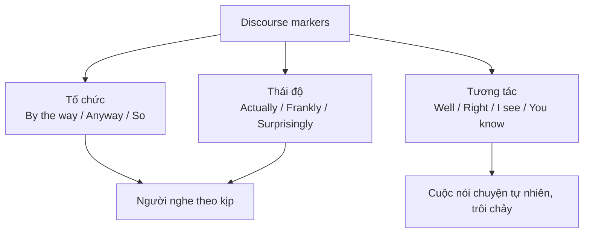

# B2-G027 · Discourse Markers — Dấu hiệu diễn ngôn

## Mục lục

- [A. Lesson Information](#a-lesson-information)
- [B. Warm-up](#b-warm-up)
- [C. WHAT](#c-what)
- [D. WHY](#d-why)
- [E. FORM](#e-form)
- [F. HOW](#f-how)
- [G. VISUAL](#g-visual)
- [H. COMPARISON](#h-comparison)
- [I. COMMON MISTAKES](#i-common-mistakes)
- [J. MEMORY TRICKS](#j-memory-tricks)
- [K. REAL-LIFE APPLICATION](#k-real-life-application)
- [L. PRACTICE EXERCISES](#l-practice-exercises)
- [M. KNOWLEDGE CHECK](#m-knowledge-check)
- [N. ANSWER KEY](#n-answer-key)

---

## A. Lesson Information

| Mục | Nội dung |
|---|---|
| **Lesson ID** | B2-G027 |
| **Topic** | Spoken and written discourse markers: opening/changing topic (By the way, Anyway, Speaking of), buying time (Well, Let me see, You know), showing attitude (Actually, Frankly, To be honest, Obviously), returning/summarising (Anyway, So, In short, All in all), responding (Right, Fair enough, I see), giving examples and clarifying in speech (I mean, Like, Say) |
| **Tên tiếng Việt** | Dấu hiệu diễn ngôn trong văn nói và văn viết: mở đầu, chuyển chủ đề, câu giờ, bày tỏ thái độ, tóm tắt |
| **CEFR Level** | B2 |
| **Prerequisites** | [B2-G017 — Advanced Linking Devices](B2-G017-advanced-linking-devices.md) |
| **Estimated Time** | 75 phút |

**Learning Objectives:**

1. Hiểu **discourse markers** (DM): từ/cụm **tổ chức** cuộc nói chuyện hoặc văn bản, thể hiện **thái độ** người nói.
2. Dùng DM để **mở đầu, chuyển chủ đề, quay lại chủ đề**: *By the way, Anyway, Speaking of...*
3. Dùng DM để **câu giờ** tự nhiên khi nói: *Well, Let me think, How can I put it...*
4. Dùng DM bày tỏ **thái độ**: *Actually, Frankly, To be honest, Surprisingly, Obviously*.
5. Dùng DM để **làm rõ, tóm tắt, phản hồi**: *I mean, In other words, So, Fair enough*.

---

## B. Warm-up

> **A:** *How was your trip to Sa Pa?*
> **B:** ***Well**, it was amazing, **actually**. The views were incredible. **Mind you**, it was freezing! **Oh, by the way**, I saw your cousin there.*
> **A:** *Really? **Anyway**, did you try the local food?*
> **B:** ***To be honest**, not much. **I mean**, I tried some, but I mostly ate at the hotel.*

🤔 **Hãy suy nghĩ:** Nếu bỏ các từ in đậm, nội dung có mất không? Vậy chúng có vai trò gì? Cuộc trò chuyện nghe thế nào khi thiếu chúng?

---

## C. WHAT

**Dấu hiệu diễn ngôn** không thay đổi nội dung chính của câu, nhưng giúp người nghe/đọc hiểu:

- **Cấu trúc** cuộc nói chuyện (bắt đầu, chuyển ý, kết thúc).
- **Thái độ** người nói (bất ngờ, thẳng thắn, đồng ý miễn cưỡng).
- **Quan hệ** giữa các ý (làm rõ, sửa lại, tóm tắt).

| Chức năng | Văn nói | Văn viết |
|---|---|---|
| Chuyển chủ đề | *By the way, Anyway, Speaking of...* | *Turning to..., With regard to...* |
| Câu giờ | *Well, Let me see, You know* | — |
| Thái độ | *Actually, Frankly, To be honest* | *Surprisingly, Interestingly, Clearly* |
| Làm rõ | *I mean, What I mean is* | *In other words, That is to say* |
| Tóm tắt | *So, Anyway, In short* | *In summary, To sum up, Overall* |
| Phản hồi | *Right, Fair enough, I see, Exactly* | — |

---

## D. WHY



Trong bài thi nói B2, tiêu chí **Fluency & Coherence** đánh giá khả năng nói **liên tục, mạch lạc**. DM giúp bạn **câu giờ** mà không im lặng, và giúp giám khảo thấy rõ **cấu trúc** câu trả lời. Tuy nhiên, lạm dụng (*like, you know* liên tục) bị xem là **thiếu tự tin**.

---

## E. FORM

### E1. Mở đầu và chuyển chủ đề

| DM | Chức năng | Ví dụ |
|---|---|---|
| **By the way / Incidentally** | Thêm thông tin không liên quan trực tiếp | ***By the way**, did you get my email?* |
| **Speaking of / Talking of** | Chuyển sang chủ đề liên quan | ***Speaking of** holidays, where are you going this summer?* |
| **Anyway / Anyhow** | Quay lại chủ đề chính / kết thúc chủ đề | ***Anyway**, as I was saying...* |
| **Right / OK / So** | Bắt đầu phần mới | ***Right**, let's get started.* |

### E2. Câu giờ (buying time)

| DM | Ví dụ |
|---|---|
| **Well** | ***Well**, it depends on the situation.* |
| **Let me see / Let me think** | ***Let me think**... I'd say about 20 people.* |
| **How can I put it?** | *He's... **how can I put it**... not very reliable.* |
| **That's a good / an interesting question.** | ***That's an interesting question.** I've never really thought about it.* |

### E3. Thái độ người nói

| DM | Thái độ | Ví dụ |
|---|---|---|
| **Actually / In fact** | Sửa lại, đưa thông tin bất ngờ | *I thought it would be boring. **Actually**, it was great.* |
| **To be honest / Frankly / Honestly** | Thẳng thắn | ***Frankly**, I don't think it will work.* |
| **Obviously / Clearly / Of course** | Hiển nhiên | ***Obviously**, safety comes first.* |
| **Surprisingly / Interestingly / Unfortunately** | Đánh giá | ***Unfortunately**, the shop was closed.* |
| **Mind you** (Anh–Anh) | Thêm ý trái chiều nhẹ | *The hotel was cheap. **Mind you**, it was a bit noisy.* |
| **Admittedly** | Thừa nhận | ***Admittedly**, I was late.* |

### E4. Làm rõ, sửa lại

| DM | Ví dụ |
|---|---|
| **I mean** | *She's very talented — **I mean**, she can play five instruments.* |
| **In other words / That is to say** | *He's "between jobs" — **in other words**, he's unemployed.* |
| **Or rather** | *I'll call you tomorrow — **or rather**, on Monday.* |
| **What I'm trying to say is...** | ***What I'm trying to say is** that we need more time.* |

### E5. Tóm tắt và kết thúc

| Văn nói | Văn viết |
|---|---|
| *So, basically..., Anyway..., In short...* | *In summary, To sum up, In conclusion, Overall, All in all* |

### E6. Phản hồi (back-channelling)

*Right. / I see. / Really? / Fair enough. / Exactly. / Absolutely. / That makes sense. / Oh, I didn't know that.*

---

## F. HOW

| # | English | Tiếng Việt | Chức năng |
|---|---|---|---|
| 1 | ***Well**, I'm not really sure, but I'd guess about 200 people.* | À, tôi không chắc lắm... | Câu giờ |
| 2 | ***By the way**, have you heard that Mai got a new job?* | Nhân tiện... | Chuyển chủ đề |
| 3 | ***Anyway**, let's get back to the main point.* | Dù sao, quay lại ý chính. | Quay lại |
| 4 | ***Speaking of** jobs, how's your new position going?* | Nói về công việc... | Chuyển liên quan |
| 5 | *Everyone says it's expensive. **Actually**, it's quite reasonable.* | Thật ra... | Sửa thông tin |
| 6 | ***To be honest**, I didn't enjoy the film much.* | Thành thật mà nói... | Thẳng thắn |
| 7 | *The flat is small. **Mind you**, it's in a great location.* | Nhưng mà... | Ý trái chiều nhẹ |
| 8 | *It's not ideal — **I mean**, it works, but it's slow.* | Ý tôi là... | Làm rõ |
| 9 | ***Let me think**... the best time to visit would be October.* | Để tôi nghĩ... | Câu giờ |
| 10 | *"I can't come because I have an exam." — "**Fair enough**."* | Hợp lý thôi. | Chấp nhận |
| 11 | ***Interestingly**, younger users preferred the older design.* | Điều thú vị là... | Đánh giá (văn viết) |
| 12 | ***So, basically**, we need to find a cheaper supplier.* | Vậy tóm lại là... | Tóm tắt (văn nói) |

---

## G. VISUAL

### Một câu trả lời Speaking có DM

```text
Câu hỏi:  "Do you think young people read less than in the past?"

Well, that's an interesting question.          ← câu giờ
To be honest, I think they read just as much,  ← thái độ
but they read differently.
I mean, they read on phones rather than books. ← làm rõ
Actually, my younger brother reads novels      ← thông tin bất ngờ
online every night.
Mind you, they're not always classic novels!   ← ý trái chiều nhẹ
So, basically, it's the format that's changed. ← tóm tắt
```

---

## H. COMPARISON

### *Actually* (tiếng Anh) vs "thực tế" (tiếng Việt)

| *Actually* | Lưu ý |
|---|---|
| Dùng để **sửa lại** hoặc đưa thông tin **trái với mong đợi** | Không dùng *actually* như "hiện nay" (*currently*) — đây là lỗi phổ biến |
| *I thought she was 30. **Actually**, she's 45.* | ~~**Actually**, I'm working at a bank.~~ (ý "hiện tại") → ***Currently**, I'm working at a bank.* |

### *Anyway* vs *By the way*

| *By the way* | *Anyway* |
|---|---|
| Chuyển **sang** chủ đề phụ | Quay **lại** chủ đề chính hoặc kết thúc |

---

## I. COMMON MISTAKES

| # | ❌ Sai | ✅ Đúng | Nguyên nhân | Cách tránh |
|---|---|---|---|---|
| 1 | **Actually**, I live in Hanoi. (ý "hiện nay") | **Currently**, I live in Hanoi. | Dịch "thực tế/hiện tại" | *actually* = thật ra |
| 2 | **By the way**, as I was saying... | **Anyway**, as I was saying... | Nhầm chiều | Quay lại → *anyway* |
| 3 | Lạm dụng: *Like, I, like, went there and, like...* | Dùng có chọn lọc | Thói quen | Tối đa 1–2 DM mỗi câu |
| 4 | **Frankly speaking**, ... (lặp nhiều) | *Frankly / To be honest / Honestly* (thay đổi) | Lặp một cụm | Đa dạng |
| 5 | **In conclusion**, ... (trong hội thoại thân mật) | **So / Anyway / In short**, ... | Sai văn phong | Văn nói → *so, anyway* |
| 6 | Im lặng dài khi chưa nghĩ ra | **Well, let me think...** | Thiếu chiến lược | Dùng DM câu giờ |

---

## J. MEMORY TRICKS

1. **"By the way = rẽ ngang; Anyway = quay về đường chính"** 🛣️
2. **"Actually = Thật ra (trái với bạn nghĩ)"** — không phải "hiện tại".
3. **"Well = phanh nhẹ"**: cho bạn 1–2 giây suy nghĩ.

---

## K. REAL-LIFE APPLICATION

### Speaking Part 3 (mô phỏng)

> **Examiner:** *Do you think it's better to live in a city or in the countryside?*
>
> **Candidate:** ***Well**, **that's a difficult question**, **because** it really depends on your stage of life. **Personally**, I've always lived in Hanoi, so I'm used to city life. **I mean**, I love having everything nearby — cafés, cinemas, hospitals.*
>
> ***Having said that**, the pollution and traffic can be exhausting. **Actually**, last year I spent a month at my grandparents' house in the countryside, and **to be honest**, I slept better than I had for years. **Mind you**, I was bored after a couple of weeks!*
>
> ***So, overall**, I'd say cities are better for young people who are building careers, **whereas** the countryside is **probably** better for families and retired people.*

**Dịch tóm tắt:** Câu hỏi khó, tùy giai đoạn cuộc sống. Tác giả sống ở Hà Nội, thích mọi thứ gần; nhưng ô nhiễm và tắc đường mệt mỏi. Năm ngoái ở quê một tháng ngủ ngon hơn nhiều năm, nhưng sau hai tuần thấy chán. Tóm lại: thành phố tốt cho người trẻ lập nghiệp, nông thôn có lẽ tốt hơn cho gia đình và người nghỉ hưu.

---

## L. PRACTICE EXERCISES

> ✍️ Đáp án: [B2-G027-ANSWERS](../../12-ANSWERS-AND-EXPLANATIONS/B2/B2-G027-ANSWERS.md)

### Level 1 — Recognition

**L1.1.** ___, did you remember to buy milk? (chuyển sang chủ đề phụ)  A. Anyway  B. By the way  C. In conclusion
**L1.2.** I thought the test would be hard. ___, it was really easy.  A. Actually  B. By the way  C. Anyway
**L1.3.** "I can't lend you my car — I need it tomorrow." — "___."  A. Fair enough  B. By the way  C. Actually
**L1.4.** ___ holidays, where are you going this year?  A. Speaking of  B. To be honest  C. In other words
**L1.5.** The food was great. ___, it was a bit expensive.  A. Mind you  B. Speaking of  C. Right
**L1.6.** Câu nào dùng *actually* **sai**?  A. I thought he was French; actually, he's Belgian.  B. Actually, I am a student at Hanoi University. (ý: hiện tại)

### Level 2 — Controlled Practice

Điền DM phù hợp: *Well, Anyway, By the way, Actually, To be honest, I mean, Mind you, Speaking of, So, Let me think*.

**L2.1.** "What's your favourite film?" — "___... probably *Spirited Away*."
**L2.2.** "You look tired." — "___, I didn't sleep at all last night."
**L2.3.** I'm sorry to interrupt. ___, as I was saying, we need to finish by Friday.
**L2.4.** The hotel was cheap. ___, the rooms were tiny.
**L2.5.** "Is the restaurant good?" — "___, it's OK, but not great."
**L2.6.** He's not lazy — ___, he just needs clear instructions.
**L2.7.** ___ food, have you tried the new Thai place?
**L2.8.** Everyone thinks Lan is shy. ___, she's very talkative with friends.
**L2.9.** ___, did you see the email from the manager?
**L2.10.** ___, to sum up, we need a bigger budget and more staff.

### Level 3 — Error Correction

**L3.1.** Actually, I am working as an engineer for a big company. (ý: hiện tại)
**L3.2.** By the way, as I was saying before you interrupted...
**L3.3.** In conclusion, I had a great time at the party, haha. (hội thoại với bạn thân)
**L3.4.** "Why are you late?" — (im lặng 10 giây) "...The traffic."
**L3.5.** Like, I went to, like, the shop and, like, it was closed.
**L3.6.** Speaking of, the weather has been terrible.

### Level 4 — Production

Trả lời câu hỏi Speaking (2–3 câu), dùng ít nhất 2 DM.

**L4.1.** *"What do you usually do at weekends?"*
**L4.2.** *"Do you prefer reading books or watching films?"*
**L4.3.** *"What's the biggest problem in your city?"*
**L4.4.** *"Would you like to live abroad?"*

**L4.5.** **Explain:** Vì sao *actually* không nên dùng với nghĩa "hiện tại"? Cho ví dụ đúng.

### Level 5 — Real Communication

**L5.1.** Viết **kịch bản hội thoại tự nhiên** 12–16 lượt (150–180 từ) giữa hai người bạn gặp lại nhau sau lâu ngày. Dùng ≥ 10 DM thuộc ≥ 5 chức năng (mở đầu, chuyển chủ đề, câu giờ, thái độ, làm rõ, tóm tắt, phản hồi).
**L5.2.** **Speaking — Part 3 practice:** Trả lời 3 câu hỏi (mỗi câu 45–60 giây), ghi âm: *(1) Should university education be free? (2) How has technology changed the way people communicate? (3) Is it important to learn about history?* Đếm số DM bạn dùng và đa dạng hóa ở lần ghi âm thứ hai.

---

## M. KNOWLEDGE CHECK

### 5 câu hỏi tự kiểm tra

1. Discourse marker là gì?
2. *By the way* và *Anyway* khác nhau thế nào?
3. Kể 3 DM câu giờ.
4. *Actually* nghĩa là gì? Lỗi phổ biến của người Việt?
5. Vì sao không nên lạm dụng DM?

### Checklist

- [ ] Tôi dùng *Well / Let me think* thay vì im lặng.
- [ ] Tôi không dùng *actually* với nghĩa "hiện tại".
- [ ] Tôi đa dạng DM trong câu trả lời Speaking.

### 3 lỗi quan trọng cần nhớ

1. ~~Actually~~ (= hiện tại) → **Currently**.
2. Quay lại chủ đề → **Anyway**, không *By the way*.
3. Văn nói thân mật → **So / Anyway**, không *In conclusion*.

### Lịch ôn tập

| Ngày | Việc cần làm |
|---|---|
| Ngày 1 | Làm lại L2 |
| Ngày 3 | Nghe một podcast tiếng Anh, ghi lại 10 DM nghe được |
| Ngày 7 | Áp dụng trong [S06 — Fluency Exercises](../../09-FOUR-SKILLS/Speaking/S06-fluency-exercises.md) |

### Liên kết

- ➡️ Bài tiếp theo: [B2-G028 — Formal vs Informal English](B2-G028-formal-informal.md)

---

## N. ANSWER KEY

👉 [B2-G027-ANSWERS.md](../../12-ANSWERS-AND-EXPLANATIONS/B2/B2-G027-ANSWERS.md)
