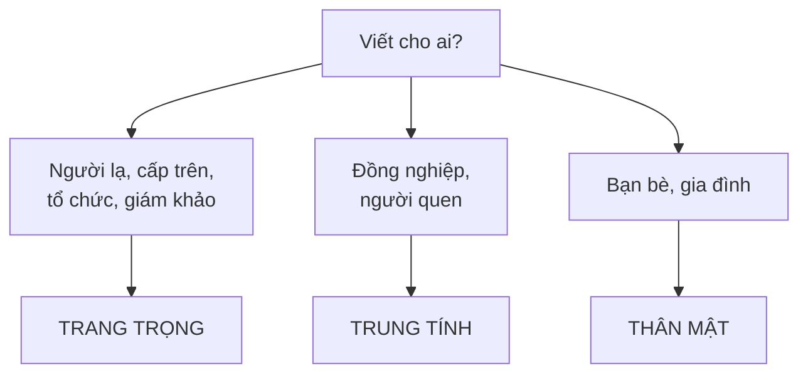

# B2-G028 · Formal vs Informal English — Văn phong trang trọng và thân mật

## Mục lục

- [A. Lesson Information](#a-lesson-information)
- [B. Warm-up](#b-warm-up)
- [C. WHAT](#c-what)
- [D. WHY](#d-why)
- [E. FORM](#e-form)
- [F. HOW](#f-how)
- [G. VISUAL](#g-visual)
- [H. COMPARISON](#h-comparison)
- [I. COMMON MISTAKES](#i-common-mistakes)
- [J. MEMORY TRICKS](#j-memory-tricks)
- [K. REAL-LIFE APPLICATION](#k-real-life-application)
- [L. PRACTICE EXERCISES](#l-practice-exercises)
- [M. KNOWLEDGE CHECK](#m-knowledge-check)
- [N. ANSWER KEY](#n-answer-key)

---

## A. Lesson Information

| Mục | Nội dung |
|---|---|
| **Lesson ID** | B2-G028 |
| **Topic** | Register: vocabulary (phrasal verbs vs Latinate verbs), grammar (contractions, passive, inversion, ellipsis), politeness strategies (indirect requests, could/would/might), email openings and closings, neutral register |
| **Tên tiếng Việt** | Văn phong (register): từ vựng, ngữ pháp, chiến lược lịch sự, mở đầu/kết thư |
| **CEFR Level** | B2 |
| **Prerequisites** | [B2-G027 — Discourse Markers](B2-G027-discourse-markers.md), [B1-G020 — Phrasal Verbs](../../04-B1-INTERMEDIATE/grammar/B1-G020-phrasal-verbs.md) |
| **Estimated Time** | 75 phút |

**Learning Objectives:**

1. Nhận biết **ba mức văn phong**: trang trọng, trung tính, thân mật.
2. Thay **phrasal verb/từ thân mật** bằng **từ trang trọng** tương đương (và ngược lại).
3. Điều chỉnh **ngữ pháp** theo văn phong: rút gọn, bị động, đảo ngữ, tỉnh lược.
4. Dùng **yêu cầu gián tiếp/lịch sự**: *I was wondering if..., Would you mind...?*
5. Viết **mở đầu và kết thúc email** phù hợp từng mức văn phong.

---

## B. Warm-up

Hai tin nhắn cùng nội dung:

> **A.** *Hi Tom! Can't make it tomorrow, sorry — something's come up. Can we do Friday instead? Let me know! 😊*
>
> **B.** *Dear Mr Smith, I regret to inform you that I will be unable to attend tomorrow's meeting due to unforeseen circumstances. Would it be possible to reschedule for Friday? I look forward to hearing from you. Kind regards, Lan Nguyen*

🤔 **Hãy suy nghĩ:** Liệt kê ít nhất 5 điểm khác nhau giữa A và B (từ vựng, ngữ pháp, dấu câu, mở đầu/kết thúc). Nếu Lan gửi tin A cho giám đốc, chuyện gì có thể xảy ra?

---

## C. WHAT

**Register** (văn phong) là mức độ trang trọng của ngôn ngữ, phụ thuộc vào **người nhận, mục đích, tình huống**.

| Mức | Khi nào dùng | Ví dụ |
|---|---|---|
| **Trang trọng** (formal) | Thư xin việc, email công việc với cấp trên/khách hàng, báo cáo, văn bản chính thức, bài luận | *I would be grateful if you could...* |
| **Trung tính** (neutral) | Email với đồng nghiệp, bài báo phổ thông, thông báo | *Could you send me the file?* |
| **Thân mật** (informal) | Tin nhắn, email bạn bè, mạng xã hội, hội thoại | *Can you send me the file?* / *Send me the file, yeah?* |

---

## D. WHY



Bài thi viết B2 (gồm VSTEP-style) thường có **email/thư** với yêu cầu văn phong cụ thể. Giám khảo đánh giá **tính phù hợp văn phong** (appropriacy). Viết quá thân mật cho thư trang trọng — hoặc ngược lại, quá cứng nhắc với bạn bè — đều bị trừ điểm.

---

## E. FORM

### E1. Từ vựng

| Thân mật | Trang trọng |
|---|---|
| ask for | request |
| get | receive / obtain |
| buy | purchase |
| need | require |
| help | assist |
| find out | discover / ascertain |
| look into | investigate |
| put off | postpone |
| get in touch | contact |
| tell | inform |
| give back | return |
| start / begin | commence |
| a lot of | a great deal of / numerous / a significant number of |
| sorry | I apologise / I regret |
| about | regarding / concerning |
| because of | due to / owing to |
| but | however |
| enough | sufficient |
| OK, fine | acceptable, satisfactory |

### E2. Ngữ pháp

| Đặc điểm | Thân mật | Trang trọng |
|---|---|---|
| Rút gọn | *I'm, don't, can't* | *I am, do not, cannot* |
| Chủ ngữ | Có thể bỏ: *Hope you're well.* | Đầy đủ: *I hope you are well.* |
| Bị động | Ít | Phổ biến: *The payment has been received.* |
| Câu mệnh lệnh | *Send it by Friday.* | *Please ensure it is sent by Friday.* |
| Đảo ngữ điều kiện | — | *Should you have any questions, ...* (B2-G002) |
| Câu hỏi trực tiếp | *Where's the office?* | *Could you tell me where the office is?* |

### E3. Yêu cầu lịch sự (từ trực tiếp → gián tiếp)

| Mức | Ví dụ |
|---|---|
| Rất trực tiếp | *Send me the report.* |
| Thân mật | *Can you send me the report?* |
| Trung tính | *Could you send me the report, please?* |
| Lịch sự | *Would you mind sending me the report?* |
| Rất lịch sự | *I was wondering if you could send me the report.* |
| Trang trọng | *I would be grateful if you could send me the report.* |

### E4. Mở đầu và kết thúc email

| | Trang trọng | Trung tính | Thân mật |
|---|---|---|---|
| **Mở đầu** | *Dear Sir or Madam,* (không biết tên) / *Dear Mr/Ms Tran,* | *Dear Lan,* / *Hello Lan,* | *Hi Lan,* / *Hey!* |
| **Câu đầu** | *I am writing to enquire about...* | *I'm writing about...* | *Just a quick note to say...* |
| **Câu cuối** | *I look forward to hearing from you.* | *Looking forward to hearing from you.* | *Speak soon! / Let me know!* |
| **Kết thư** | *Yours faithfully,* (sau *Dear Sir or Madam*) / *Yours sincerely,* (sau tên) | *Kind regards, / Best regards,* | *Cheers, / Love, / Take care,* |

---

## F. HOW

| # | Thân mật | Trang trọng | Thay đổi |
|---|---|---|---|
| 1 | *Thanks for your email.* | *Thank you for your email.* | Đầy đủ |
| 2 | *Sorry I didn't reply sooner.* | *I apologise for the delay in replying.* | Danh từ hóa, từ trang trọng |
| 3 | *Can you tell me the price?* | *I would be grateful if you could inform me of the price.* | Gián tiếp |
| 4 | *We need to put off the meeting.* | *The meeting will need to be postponed.* | Bị động, từ trang trọng |
| 5 | *I want to know about the course.* | *I am writing to enquire about the course.* | Cụm trang trọng |
| 6 | *Lots of people complained.* | *A significant number of complaints were received.* | Lượng từ trang trọng, bị động |
| 7 | *If you've got questions, just ask.* | *Should you have any questions, please do not hesitate to contact me.* | Đảo ngữ |
| 8 | *I'm sending the form with this email.* | *Please find attached the application form.* | Cụm cố định |
| 9 | *It's because of the bad weather.* | *This is due to adverse weather conditions.* | Từ trang trọng |
| 10 | *Get back to me soon!* | *I look forward to your prompt reply.* | Kết thư |
| 11 | *We're really sorry about the problem.* | *We sincerely regret any inconvenience caused.* | Collocation trang trọng |
| 12 | *Don't forget to bring your ID.* | *Please remember to bring a form of identification.* | Lịch sự |

---

## G. VISUAL

### Thanh trượt văn phong

```text
THÂN MẬT ◄──────────────────────────────────────────► TRANG TRỌNG
Hey!          Hi Lan,        Dear Lan,        Dear Ms Tran,     Dear Sir or Madam,
Can u...?     Can you...?    Could you...?    Would you mind... I would be grateful if...
Cheers!       Thanks!        Best regards,    Kind regards,     Yours faithfully,
```

---

## H. COMPARISON

### *Yours sincerely* vs *Yours faithfully* (Anh–Anh)

| *Yours sincerely* | *Yours faithfully* |
|---|---|
| Khi biết **tên** người nhận (*Dear Mr Tran*) | Khi **không biết tên** (*Dear Sir or Madam*) |

> Tiếng Anh–Mỹ thường dùng *Sincerely,* cho cả hai trường hợp.

### Trang trọng ≠ dài dòng

| ❌ Quá cứng | ✅ Trang trọng, rõ ràng |
|---|---|
| *I am hereby writing this letter in order to make an enquiry with regard to the aforementioned course.* | *I am writing to enquire about the course.* |

---

## I. COMMON MISTAKES

| # | ❌ Sai | ✅ Đúng | Nguyên nhân | Cách tránh |
|---|---|---|---|---|
| 1 | *Dear Sir or Madam, ... Yours sincerely,* | *... Yours faithfully,* | Ghép sai | Không tên → faithfully |
| 2 | *Dear Mr Nam,* (dùng tên riêng) | *Dear Mr Nguyen,* | Dùng tên gọi với Mr/Ms | Mr/Ms + họ |
| 3 | *Hi Sir,* | *Dear Sir,* | Trộn văn phong | |
| 4 | *I wanna ask about the job.* (thư xin việc) | *I am writing to enquire about the position.* | Quá thân mật | |
| 5 | *Plz reply asap!!!* | *I look forward to your reply.* | Viết tắt, dấu chấm than | Không viết tắt/emoji trong thư trang trọng |
| 6 | *Dear Sir, Thanks a lot!!! Love, Mai* | Đồng nhất một văn phong | Không nhất quán | Giữ một mức xuyên suốt |
| 7 | *Hey mate, I hereby request your assistance.* | *Hey, could you help me out?* | Quá cứng với bạn | Thân mật → từ đơn giản |

---

## J. MEMORY TRICKS

1. **"Người nhận quyết định"** 👔👕: Viết cho ai → chọn văn phong.
2. **"Phrasal verb = áo phông; từ Latin = áo vest"**: *put off* (áo phông) → *postpone* (áo vest).
3. **"Biết tên — Sincerely; không biết — Faithfully"**: *S*incerely đi với *S*urname (đã biết họ người nhận); còn lại → *Faithfully*.

---

## K. REAL-LIFE APPLICATION

### Cùng một tình huống — ba văn phong

**Tình huống:** Bạn muốn đổi ngày hẹn.

**Thân mật (bạn bè):**
> *Hey Minh! So sorry, something's come up and I can't make it on Thursday. Are you free Friday instead? Let me know! 😊*

**Trung tính (đồng nghiệp):**
> *Hi Minh, I'm afraid I won't be able to make our meeting on Thursday. Would Friday work for you instead? Thanks, Lan*

**Trang trọng (khách hàng):**
> *Dear Mr Tran,*
>
> *I regret to inform you that, due to an unexpected commitment, I will be unable to attend our meeting on Thursday. I sincerely apologise for any inconvenience this may cause.*
>
> *Would it be possible to reschedule the meeting for Friday at a time convenient for you? Should Friday not be suitable, I would be happy to arrange an alternative date.*
>
> *I look forward to hearing from you.*
>
> *Yours sincerely,*
> *Nguyen Thi Lan*
> *Account Manager*

---

## L. PRACTICE EXERCISES

> ✍️ Đáp án: [B2-G028-ANSWERS](../../12-ANSWERS-AND-EXPLANATIONS/B2/B2-G028-ANSWERS.md)

### Level 1 — Recognition

Xác định văn phong: **F** (formal), **N** (neutral), **I** (informal).

**L1.1.** *I would be grateful if you could send me further information.*
**L1.2.** *Can you send me the details?*
**L1.3.** *Gimme a call when you're free!*
**L1.4.** *Please find attached my CV.*

Chọn đáp án đúng.

**L1.5.** Thư bắt đầu *"Dear Sir or Madam,"* nên kết thúc bằng:  A. Yours sincerely,  B. Yours faithfully,  C. Love,
**L1.6.** Từ trang trọng của *"find out"* là:  A. discover  B. look for  C. get

### Level 2 — Controlled Practice

Thay từ/cụm thân mật in đậm bằng từ trang trọng.

**L2.1.** We need to **put off** the conference.
**L2.2.** I want to **ask for** a refund.
**L2.3.** **Lots of** customers have complained.
**L2.4.** Please **tell** us if you cannot attend.
**L2.5.** The problem is **because of** a technical error.
**L2.6.** We will **look into** your complaint.

Viết lại câu trang trọng hơn.

**L2.7.** Sorry for the late reply.
**L2.8.** Can you send me the price list?
**L2.9.** If you have any questions, just ask me.
**L2.10.** I'm sending my CV with this email.

### Level 3 — Error Correction

Sửa lỗi văn phong trong thư trang trọng.

**L3.1.** *Dear Mr Hung,* (người nhận tên đầy đủ là Tran Van Hung)
**L3.2.** *Dear Sir or Madam, ... Yours sincerely,*
**L3.3.** *I'm writing to ask about the job. Plz reply ASAP!!!*
**L3.4.** *Hi Sir, I want to apply for the position.*
**L3.5.** *I wanna know if there are any discounts.*
**L3.6.** *Thanks a lot! Cheers, Nam* (kết thư xin việc)

### Level 4 — Production

**L4.1.** Viết câu mở đầu trang trọng cho email hỏi thông tin khóa học.
**L4.2.** Viết câu yêu cầu rất lịch sự: nhờ người nhận gửi lịch thi.
**L4.3.** Chuyển sang thân mật: *"I regret to inform you that I will be unable to attend the party."*
**L4.4.** Viết câu kết thúc trang trọng cho email phàn nàn.

**L4.5.** **Explain:** Vì sao viết thư trang trọng **không** có nghĩa là dùng thật nhiều từ khó và câu dài?

### Level 5 — Real Communication

**L5.1.** Viết **hai email** về cùng một nội dung: bạn muốn **hủy đăng ký một khóa học**.
- Email 1 (trang trọng, 100–120 từ) gửi phòng đào tạo của trung tâm.
- Email 2 (thân mật, 60–80 từ) gửi bạn cùng lớp để báo tin.
Đảm bảo khác biệt rõ về từ vựng, ngữ pháp, mở đầu/kết thúc.

**L5.2.** **Speaking — Register switch:** Đóng vai hai tình huống (mỗi tình huống 45 giây): (1) Xin nghỉ phép với sếp; (2) Kể với bạn thân rằng bạn sẽ nghỉ phép. Ghi âm và so sánh từ vựng.

---

## M. KNOWLEDGE CHECK

### 5 câu hỏi tự kiểm tra

1. Ba mức văn phong và khi nào dùng?
2. Kể 6 cặp từ thân mật – trang trọng.
3. Những đặc điểm ngữ pháp của văn trang trọng?
4. *Yours sincerely* và *Yours faithfully* dùng khi nào?
5. Sắp xếp các yêu cầu từ trực tiếp đến lịch sự nhất.

### Checklist

- [ ] Tôi chọn văn phong dựa vào người nhận.
- [ ] Tôi giữ văn phong nhất quán trong toàn bài.
- [ ] Tôi dùng mở đầu/kết thúc email đúng cặp.

### 3 lỗi quan trọng cần nhớ

1. *Dear Sir or Madam* → **Yours faithfully**.
2. *Mr/Ms* + **họ**, không phải tên.
3. Không rút gọn/viết tắt/emoji trong thư trang trọng.

### Lịch ôn tập

| Ngày | Việc cần làm |
|---|---|
| Ngày 1 | Làm lại L2 |
| Ngày 3 | Viết lại một tin nhắn thân mật của bạn thành email trang trọng |
| Ngày 7 | Áp dụng trong [W06 — Email Writing](../../09-FOUR-SKILLS/Writing/W06-email-writing.md) |

### Liên kết

- ➡️ Bài tiếp theo: [B2-G029 — Advanced Sentence Transformation](B2-G029-sentence-transformation.md)

---

## N. ANSWER KEY

👉 [B2-G028-ANSWERS.md](../../12-ANSWERS-AND-EXPLANATIONS/B2/B2-G028-ANSWERS.md)
