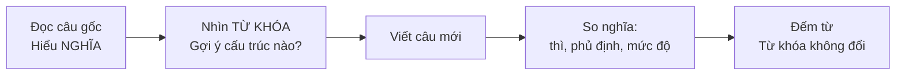

# B2-G029 · Advanced Sentence Transformation — Biến đổi câu nâng cao

## Mục lục

- [A. Lesson Information](#a-lesson-information)
- [B. Warm-up](#b-warm-up)
- [C. WHAT](#c-what)
- [D. WHY](#d-why)
- [E. FORM](#e-form)
- [F. HOW](#f-how)
- [G. VISUAL](#g-visual)
- [H. COMPARISON](#h-comparison)
- [I. COMMON MISTAKES](#i-common-mistakes)
- [J. MEMORY TRICKS](#j-memory-tricks)
- [K. REAL-LIFE APPLICATION](#k-real-life-application)
- [L. PRACTICE EXERCISES](#l-practice-exercises)
- [M. KNOWLEDGE CHECK](#m-knowledge-check)
- [N. ANSWER KEY](#n-answer-key)

---

## A. Lesson Information

| Mục | Nội dung |
|---|---|
| **Lesson ID** | B2-G029 |
| **Topic** | Key word transformations and sentence rewriting across B2 grammar: conditionals/inversion, passive/reporting, wish/would rather, modals, gerund/infinitive, linking/concession, comparison, cleft sentences, reported speech, phrasal verbs/collocations |
| **Tên tiếng Việt** | Biến đổi câu với từ khóa cho sẵn — tổng hợp ngữ pháp B2 |
| **CEFR Level** | B2 |
| **Prerequisites** | Toàn bộ B2-G001 → G028, đặc biệt [B2-G002](B2-G002-advanced-conditionals.md), [B2-G005](B2-G005-passive-reporting.md), [B2-G009](B2-G009-inversion.md), [B2-G016](B2-G016-unreal-past-would-rather.md), [B2-G018](B2-G018-contrast-concession.md) |
| **Estimated Time** | 120 phút (có thể chia 2 buổi) |

**Learning Objectives:**

1. Nắm **quy trình 5 bước** làm bài biến đổi câu với từ khóa (key word transformation).
2. Nhận diện **12 "cặp biến đổi"** thường gặp ở trình độ B2.
3. Giữ **nguyên nghĩa** câu gốc, kể cả thì, mức độ chắc chắn, phủ định.
4. Kiểm tra **giới hạn số từ** và không thay đổi từ khóa.
5. Dùng biến đổi câu như công cụ **paraphrase** khi viết và nói.

---

## B. Warm-up

> Câu gốc: *I regret not studying harder at school.*
> Từ khóa: **WISH**
> Viết lại (3–6 từ): *I ______ harder at school.*

🤔 **Hãy suy nghĩ:** Đáp án là *wish I had studied*. Bạn cần nhận ra điều gì để làm được? (gợi ý: *regret not doing* = tiếc về quá khứ → *wish + had V3*)

---

## C. WHAT

**Key word transformation** (biến đổi câu với từ khóa): viết lại câu thứ hai sao cho **cùng nghĩa** với câu gốc, dùng **từ khóa cho sẵn** (không được thay đổi từ đó), trong **giới hạn số từ** (thường 2–5 hoặc 3–6 từ, tính cả từ khóa).

Đây là dạng bài kinh điển trong nhiều bài thi B2 quốc tế, và là cách luyện **paraphrase** — kỹ năng quan trọng cho Reading, Writing và Speaking.

| Câu gốc | Từ khóa | Câu viết lại |
|---|---|---|
| *It's possible that she forgot.* | **MIGHT** | *She **might have forgotten**.* |
| *I didn't know, so I didn't help.* | **HAD** | *If I **had known, I would have** helped.* |
| *People say he is very rich.* | **SAID** | *He **is said to be** very rich.* |

---

## D. WHY



Bài biến đổi câu kiểm tra **cùng lúc** ngữ pháp, từ vựng và khả năng hiểu nghĩa. Người học thường mất điểm vì: (1) đổi nghĩa (*must* → *should*); (2) quên phủ định; (3) sai thì; (4) vượt số từ; (5) đổi dạng từ khóa.

---

## E. FORM

### E1. Quy trình 5 bước

| Bước | Việc làm | Ví dụ: *It was such a hard exam that nobody passed.* → **SO** |
|---|---|---|
| 1 | Hiểu nghĩa câu gốc | Kỳ thi khó → không ai đỗ |
| 2 | Từ khóa gợi ý cấu trúc gì? | *so* → *so + adj + that* |
| 3 | Viết câu mới | *The exam **was so hard that** nobody passed.* |
| 4 | Kiểm tra nghĩa, thì, phủ định | Quá khứ ✓, phủ định *nobody* ✓ |
| 5 | Đếm từ, giữ nguyên từ khóa | *was so hard that* = 4 từ ✓ |

### E2. 12 cặp biến đổi thường gặp

| # | Nhóm | Câu gốc → Câu biến đổi | Bài |
|---|---|---|---|
| 1 | Điều kiện loại 3 | *I didn't know → If I had known* | B1-G008 |
| 2 | Đảo ngữ điều kiện | *If I had known → Had I known* | B2-G002 |
| 3 | Unless | *If you don't hurry → Unless you hurry* | B2-G003 |
| 4 | Wish / regret | *I regret not going → I wish I had gone* | B1-G009 |
| 5 | Would rather / It's time | *Please don't smoke → I'd rather you didn't smoke* | B2-G016 |
| 6 | Modal perfect | *I'm sure he left → He must have left* | B1-G015 |
| 7 | Bị động tường thuật | *People believe that... → He is believed to...* | B2-G005 |
| 8 | Nhờ bảo | *Someone cut my hair → I had my hair cut* | B1-G017 |
| 9 | Tường thuật | *"I'm sorry I'm late" → He apologised for being late* | B2-G006 |
| 10 | Nhượng bộ | *Although he was tired → Despite being tired / Tired as he was* | B2-G018 |
| 11 | So/such/too/enough | *so hot that we couldn't → too hot for us to* | B1-G024 |
| 12 | Đảo ngữ / câu chẻ | *I have never seen → Never have I seen*; *Tom broke it → It was Tom who broke it* | B2-G009, G010 |

### E3. Các cặp từ vựng / collocation hay gặp

| Câu gốc | Biến đổi |
|---|---|
| *It's not necessary to...* | *There's no need to... / You don't have to... / needn't* |
| *It took me 2 hours to...* | *I spent 2 hours (doing)...* |
| *It's not worth (doing)...* | *There's no point (in) doing...* |
| *I'm not used to...* | *It's difficult for me to get used to...* |
| *He was the first to...* | *Nobody had... before him* |
| *She postponed the meeting.* | *She put off the meeting.* |
| *It's possible that...* | *may / might / could...* |
| *I prefer X to Y.* | *I'd rather X than Y.* |
| *As soon as I arrived, ...* | *No sooner had I arrived than...* / *Hardly had I arrived when...* |
| *He's too young to drive.* | *He isn't old enough to drive.* |

---

## F. HOW

| # | Câu gốc | Từ khóa | Câu biến đổi | Phân tích |
|---|---|---|---|---|
| 1 | *I'm sure she didn't see us.* | **CAN'T** | *She **can't have seen** us.* | Suy luận phủ định quá khứ |
| 2 | *It's a pity I can't speak Japanese.* | **WISH** | *I **wish I could speak** Japanese.* | Ước hiện tại |
| 3 | *We didn't go out because of the rain.* | **HAD** | *If it **hadn't rained, we would have** gone out.* | ĐK loại 3 |
| 4 | *They say the castle was built in 1500.* | **SAID** | *The castle **is said to have been built** in 1500.* | Bị động tường thuật |
| 5 | *"I didn't take the money," he said.* | **DENIED** | *He **denied taking / having taken** the money.* | Động từ tường thuật |
| 6 | *Although it was cold, we swam.* | **DESPITE** | ***Despite the cold**, we swam.* / ***Despite it being cold**...* | Nhượng bộ |
| 7 | *I'd prefer you not to call after 10.* | **RATHER** | *I'd **rather you didn't call** after 10.* | Unreal past |
| 8 | *You should have your eyes tested.* | **GET** | *You should **get your eyes tested**.* | Nhờ bảo |
| 9 | *I've never eaten such delicious food.* | **NEVER** | ***Never have I eaten** such delicious food.* | Đảo ngữ |
| 10 | *The noise annoys me most.* | **WHAT** | ***What annoys me most is** the noise.* | Câu chẻ |
| 11 | *It isn't necessary to bring food.* | **NEED** | *You **don't need to bring** / **needn't bring** food.* | Modal |
| 12 | *He started learning English five years ago.* | **BEEN** | *He **has been learning** English **for** five years.* | HTHT tiếp diễn |

---

## G. VISUAL

### "Ba cái bẫy" khi biến đổi câu

```text
🪤 1. ĐỔI NGHĨA     must (chắc chắn)   ≠  should (nên)
🪤 2. MẤT PHỦ ĐỊNH  didn't know        →  If I HAD known (khẳng định!)
🪤 3. SAI THÌ       regret not going   →  wish I HAD GONE (không phải went)
```

### Đếm từ

```text
Rút gọn tính là 2 từ:  didn't = did not (2), I'd = I would (2)
Từ có gạch nối: tính 1 từ (well-known)
Từ khóa: TÍNH vào số từ
```

> ℹ️ Quy ước đếm có thể khác nhau giữa các bài thi; luôn đọc hướng dẫn của đề. Trong giáo trình này dùng quy ước: dạng rút gọn = 2 từ.

---

## H. COMPARISON

### Biến đổi đúng nghĩa vs gần nghĩa

| Câu gốc | ✅ Đúng nghĩa | ❌ Gần nghĩa (mất điểm) |
|---|---|---|
| *I'm sure he's at home.* (MUST) | *He **must be** at home.* | *He **should be** at home.* (nên/có lẽ) |
| *It's possible she's ill.* (MIGHT) | *She **might be** ill.* | *She **must be** ill.* (chắc chắn) |
| *He didn't apologise.* (FAILED) | *He **failed to apologise**.* | *He **refused to apologise**.* (từ chối — nghĩa khác) |

---

## I. COMMON MISTAKES

| # | ❌ Sai | ✅ Đúng | Nguyên nhân | Cách tránh |
|---|---|---|---|---|
| 1 | *I didn't know.* → *If I **knew**, ...* | *If I **had known**, ...* | Sai loại điều kiện | Quá khứ → loại 3 |
| 2 | *I regret not going.* → *I wish I **went**.* | *I wish I **had gone**.* | Sai thì | Tiếc quá khứ → had V3 |
| 3 | *He is said **that** he is rich.* | *He is said **to be** rich.* | Trộn cấu trúc | |
| 4 | Thay từ khóa *SAID* thành *says* | Giữ nguyên *said* | Đổi dạng từ khóa | Không đổi từ khóa |
| 5 | *Despite **he was** tired* | *Despite **being** tired* | | despite + N/V-ing |
| 6 | Viết 8 từ khi giới hạn 3–6 | Rút gọn lại | Vượt số từ | Đếm trước khi viết |
| 7 | *I'm sure he left.* → *He **should have** left.* | *He **must have** left.* | Đổi mức độ chắc chắn | Giữ mức độ |

---

## J. MEMORY TRICKS

1. **"Nghĩa trước, Ngữ pháp sau"** 🧠: Hiểu câu gốc nói gì trước khi nghĩ cấu trúc.
2. **"Ba cái bẫy: Nghĩa – Phủ định – Thì"** 🪤🪤🪤: kiểm tra 3 thứ này sau khi viết.
3. **"Từ khóa là chìa khóa"** 🔑: từ khóa luôn gợi ý **một cấu trúc cụ thể** — hỏi "từ này thường đi với cấu trúc nào?".

---

## K. REAL-LIFE APPLICATION

### Paraphrase trong Writing

Biến đổi câu không chỉ là bài tập — đó là kỹ năng **paraphrase đề bài** ở mở bài:

> **Đề:** *Some people believe that students should be required to do community service.*
>
> **Paraphrase 1:** *It **is believed by some** that community service **should be compulsory** for students.*
> **Paraphrase 2:** *According to some people, students **ought to be made to** take part in community service.*
> **Paraphrase 3:** *There is a view that **requiring** students **to do** community service **would be** beneficial.*

### Paraphrase trong Speaking

Khi không nhớ một từ, biến đổi câu giúp bạn **nói vòng**:

> *I forgot the word "postpone" → "They decided to **put off** the meeting" / "They moved the meeting **to a later date**".*

---

## L. PRACTICE EXERCISES

> ✍️ Đáp án: [B2-G029-ANSWERS](../../12-ANSWERS-AND-EXPLANATIONS/B2/B2-G029-ANSWERS.md)
>
> **Hướng dẫn:** Hoàn thành câu thứ hai sao cho cùng nghĩa với câu thứ nhất. Dùng từ khóa in hoa, **không** thay đổi từ khóa. Dùng **3–6 từ**, tính cả từ khóa (dạng rút gọn tính 2 từ).

### Level 1 — Recognition (chọn câu biến đổi đúng)

**L1.1.** *I'm sure she has forgotten.* → A. She should have forgotten.  B. She must have forgotten.  C. She might forget.
**L1.2.** *If you don't leave now, you'll miss the bus.* → A. Unless you leave now, you'll miss the bus.  B. Unless you don't leave now, ...
**L1.3.** *People think he is a spy.* → A. He is thought that he is a spy.  B. He is thought to be a spy.
**L1.4.** *I didn't go because I was ill.* → A. If I wasn't ill, I would go.  B. If I hadn't been ill, I would have gone.
**L1.5.** *I've never seen such a beautiful place.* → A. Never I have seen...  B. Never have I seen...

### Level 2 — Controlled Practice (Key word transformations — nhóm 1)

**L2.1.** It's a pity I didn't take more photos. **WISH**
I ______ more photos.

**L2.2.** If you don't book now, there won't be any tickets left. **UNLESS**
There won't be any tickets left ______ now.

**L2.3.** People believe that the thief escaped through the window. **BELIEVED**
The thief ______ through the window.

**L2.4.** "You broke my phone!" Lan said to her brother. **ACCUSED**
Lan ______ her phone.

**L2.5.** It's possible that he didn't receive my message. **MIGHT**
He ______ my message.

**L2.6.** Although she was nervous, she gave an excellent speech. **DESPITE**
______ , she gave an excellent speech.

**L2.7.** Please don't use your phone during dinner. **RATHER**
I'd ______ your phone during dinner.

**L2.8.** The mechanic is repairing my car at the moment. **HAVING**
I ______ at the moment.

**L2.9.** As soon as I got home, it started to rain. **SOONER**
No ______ home than it started to rain.

**L2.10.** I've never been so embarrassed in my life. **NEVER**
______ so embarrassed in my life.

### Level 3 — Error Correction (sửa câu biến đổi sai)

**L3.1.** *I regret not learning to swim.* → *I wish I learned to swim.*
**L3.2.** *People say she is a great cook.* → *She is said that she is a great cook.*
**L3.3.** *I'm sure he didn't steal it.* → *He mustn't have stolen it.*
**L3.4.** *If it hadn't rained, we would have gone out.* → *Had not it rained, we would have gone out.*
**L3.5.** *She was too tired to continue.* → *She was so tired to continue.*
**L3.6.** *It's not worth repairing this old TV.* → *There's no point to repair this old TV.*

### Level 4 — Production (Key word transformations — nhóm 2)

**L4.1.** The music was so loud that we couldn't hear each other. **SUCH**
It ______ that we couldn't hear each other.

**L4.2.** It isn't necessary for you to come to the meeting. **NEED**
You ______ to the meeting.

**L4.3.** It took me three hours to finish the report. **SPENT**
I ______ the report.

**L4.4.** My grandmother taught me to cook. **WHO**
It ______ me to cook.

**L4.5.** **Explain:** Câu gốc *"I'm sure he wasn't at home"* với từ khóa **CAN'T** — viết đáp án và giải thích vì sao *"He mustn't have been at home"* sai.

### Level 5 — Real Communication

**L5.1.** **Paraphrase challenge:** Viết lại mỗi đề bài sau theo **2 cách khác nhau** (giữ nguyên nghĩa, dùng cấu trúc B2 khác nhau):
(a) *Many people think that the government should spend more money on public transport.*
(b) *It is often said that young people today are less patient than previous generations.*
(c) *Some people argue that university education should be free for everyone.*

**L5.2.** **Speaking — Say it another way:** Một người đọc 6 câu (hoặc bạn tự chọn từ L2). Bạn phải nói lại mỗi câu **ngay lập tức** bằng một cấu trúc khác, không nhìn từ khóa. Ghi âm và kiểm tra nghĩa.

---

## M. KNOWLEDGE CHECK

### 5 câu hỏi tự kiểm tra

1. Quy trình 5 bước làm bài biến đổi câu?
2. "Ba cái bẫy" là gì?
3. *regret not doing* biến đổi với *wish* thế nào?
4. *I'm sure he didn't...* với *CAN'T* viết thế nào?
5. Dạng rút gọn tính bao nhiêu từ trong quy ước của giáo trình này?

### Checklist

- [ ] Tôi kiểm tra nghĩa, phủ định, thì sau mỗi câu.
- [ ] Tôi không thay đổi từ khóa.
- [ ] Tôi đếm từ trước khi nộp.

### 3 lỗi quan trọng cần nhớ

1. ~~wish I went~~ (tiếc quá khứ) → wish I **had gone**.
2. ~~mustn't have~~ (suy luận) → **can't have**.
3. ~~Had not it~~ → **Had it not**.

### Lịch ôn tập

| Ngày | Việc cần làm |
|---|---|
| Ngày 1 | Làm lại L2 và L4 |
| Ngày 3 | Luyện [LAB-04 — Sentence Transformation](../../10-PRACTICE-LAB/LAB-04-sentence-transformation.md) |
| Ngày 7 | Làm phần biến đổi câu trong [B2 Mock Test 1](../../11-EXAMS-AND-ASSESSMENTS/B2-MOCK-TEST-1.md) |

### Liên kết

- ➡️ Bài tiếp theo: [B2-G030 — Argumentation & Critical Thinking](B2-G030-argumentation.md)

---

## N. ANSWER KEY

👉 [B2-G029-ANSWERS.md](../../12-ANSWERS-AND-EXPLANATIONS/B2/B2-G029-ANSWERS.md)
