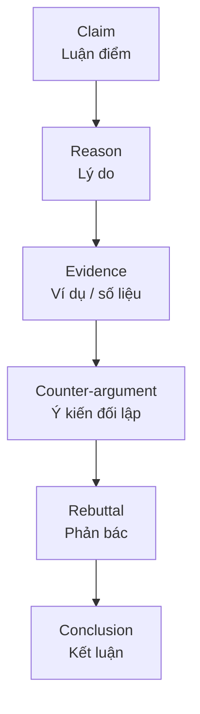

# B2-G030 · Argumentation & Critical Thinking — Lập luận và tư duy phản biện

## Mục lục

- [A. Lesson Information](#a-lesson-information)
- [B. Warm-up](#b-warm-up)
- [C. WHAT](#c-what)
- [D. WHY](#d-why)
- [E. FORM](#e-form)
- [F. HOW](#f-how)
- [G. VISUAL](#g-visual)
- [H. COMPARISON](#h-comparison)
- [I. COMMON MISTAKES](#i-common-mistakes)
- [J. MEMORY TRICKS](#j-memory-tricks)
- [K. REAL-LIFE APPLICATION](#k-real-life-application)
- [L. PRACTICE EXERCISES](#l-practice-exercises)
- [M. KNOWLEDGE CHECK](#m-knowledge-check)
- [N. ANSWER KEY](#n-answer-key)

---

## A. Lesson Information

| Mục | Nội dung |
|---|---|
| **Lesson ID** | B2-G030 |
| **Topic** | Language of argumentation: stating a position, claim–reason–evidence structure (PEEL), giving examples and evidence, acknowledging and refuting counter-arguments, evaluating arguments, recognising logical fallacies (overgeneralisation, false cause, slippery slope), concluding persuasively |
| **Tên tiếng Việt** | Ngôn ngữ lập luận: luận điểm – lý do – bằng chứng, phản bác, nhận diện lỗi ngụy biện |
| **CEFR Level** | B2 |
| **Prerequisites** | [B2-G018 — Contrast & Concession](B2-G018-contrast-concession.md), [B2-G025 — Hedging](B2-G025-hedging-academic-language.md) |
| **Estimated Time** | 90 phút |

**Learning Objectives:**

1. Xây dựng đoạn lập luận theo mô hình **PEEL**: Point – Explanation – Evidence/Example – Link.
2. Dùng ngôn ngữ **nêu lập trường, đưa lý do, dẫn chứng**.
3. **Thừa nhận và phản bác** ý kiến đối lập (counter-argument & rebuttal).
4. Nhận diện 4 **lỗi ngụy biện** phổ biến và tránh chúng trong bài viết.
5. Kết hợp ngữ pháp B2 (nhượng bộ, rào đón, câu chẻ, đảo ngữ) thành **bài nghị luận hoàn chỉnh**.

---

## B. Warm-up

Hai lập luận về việc cấm xe máy ở trung tâm:

> **A.** *Motorbikes should be banned because they are bad. Everyone hates traffic. If we don't ban them, the city will be destroyed.*
>
> **B.** *Motorbikes should be restricted in the city centre, mainly because they contribute significantly to air pollution. For example, emissions are typically highest during rush hour. Admittedly, many people depend on motorbikes for work. However, this could be addressed by improving bus services before any restrictions are introduced.*

🤔 **Hãy suy nghĩ:** Lập luận nào thuyết phục hơn? Tìm 3 điểm yếu trong lập luận A (gợi ý: *bad* là gì? *Everyone*? *destroyed*?).

---

## C. WHAT

**Lập luận** (argumentation) là trình bày **quan điểm** kèm **lý do** và **bằng chứng**, đồng thời xem xét **ý kiến khác** một cách công bằng.

| Thành phần | Câu hỏi | Ngôn ngữ |
|---|---|---|
| **Claim** (luận điểm) | Bạn nghĩ gì? | *I firmly believe that... / It is clear that...* |
| **Reason** (lý do) | Vì sao? | *This is because... / The main reason is that...* |
| **Evidence** (bằng chứng) | Dựa vào đâu? | *For example... / Research suggests... / This is shown by...* |
| **Counter-argument** (phản đề) | Người khác nghĩ gì? | *Some people argue that... / Admittedly...* |
| **Rebuttal** (phản bác) | Vì sao họ chưa đúng? | *However, this view overlooks... / Nevertheless...* |
| **Conclusion** (kết luận) | Vậy thì sao? | *Therefore... / On balance... / For these reasons...* |

---

## D. WHY



Bài luận B2 (opinion, discussion, problem–solution) được chấm theo **Task Response** — quan điểm rõ ràng, ý được **phát triển** bằng lý do và ví dụ. Tư duy phản biện giúp bạn không chỉ **nêu** ý mà còn **bảo vệ** nó.

---

## E. FORM

### E1. Mô hình PEEL cho một đoạn thân bài

| Bước | Chức năng | Ngôn ngữ mẫu |
|---|---|---|
| **P**oint | Câu chủ đề | *One major advantage of X is that...* |
| **E**xplanation | Giải thích | *This is because... / In other words...* |
| **E**vidence/Example | Dẫn chứng | *For instance, ... / A clear example of this is...* |
| **L**ink | Nối về luận điểm | *Therefore, ... / This shows that...* |

### E2. Nêu lập trường

| Mạnh | Cân bằng |
|---|---|
| *I firmly / strongly believe that...* | *On balance, I would argue that...* |
| *There is no doubt that...* | *While there are arguments on both sides, I believe...* |
| *It is clear that...* | *To a large extent, I agree that...* |

### E3. Phản đề và phản bác

| Phản đề | Phản bác |
|---|---|
| *Some people argue / claim that...* | *However, this argument overlooks the fact that...* |
| *It could be argued that...* | *Nevertheless, ...* |
| *Admittedly, ...* | *While this may be true, ...* |
| *Opponents of this view point out that...* | *This view, however, fails to take into account...* |
| *It is true that...* | *But / Even so, ...* |

### E4. Dẫn chứng

| Loại | Ngôn ngữ |
|---|---|
| Ví dụ cụ thể | *For example, ... / A case in point is ... / Take ... for example.* |
| Nghiên cứu/số liệu | *Research suggests that... / According to [source], ... / Statistics show that...* |
| Kinh nghiệm cá nhân | *In my experience, ... / From my own experience, ...* |
| Giả định | *If ..., ... would ... / Imagine a situation in which...* |

> ⚠️ Trong bài thi không có tài liệu, **không bịa số liệu** cụ thể. Dùng ví dụ hợp lý, kinh nghiệm, hoặc rào đón (*Many studies suggest...*) thay vì *"85.3% of people..."*.

### E5. Bốn lỗi ngụy biện cần tránh

| Ngụy biện | Ví dụ ❌ | Sửa ✅ |
|---|---|---|
| **Khái quát quá mức** (overgeneralisation) | *Young people are lazy.* | *Some young people may lack motivation, often because...* |
| **Nhân quả sai** (false cause) | *Since smartphones appeared, divorce rates have risen, so smartphones cause divorce.* | *Many factors may contribute to divorce; the link with smartphones is unclear.* |
| **Dốc trượt** (slippery slope) | *If we allow phones in class, students will stop learning and society will collapse.* | *Allowing phones without rules could increase distraction.* |
| **Công kích cá nhân** (ad hominem) | *His idea is wrong because he's young.* | *His idea has a weakness: it ignores the cost.* |

---

## F. HOW

| # | English | Chức năng |
|---|---|---|
| 1 | *I **firmly believe that** public transport should be free for students.* | Claim |
| 2 | ***The main reason is that** it would reduce traffic and save families money.* | Reason |
| 3 | ***A case in point is** Luxembourg, which made public transport free nationwide.* | Evidence (ví dụ có thật, nổi tiếng) |
| 4 | ***Some people argue that** free transport would be too expensive for the government.* | Counter-argument |
| 5 | ***However, this argument overlooks** the long-term savings in healthcare and road maintenance.* | Rebuttal |
| 6 | ***While this may be true** in the short term, the benefits are likely to outweigh the costs.* | Rebuttal + hedging |
| 7 | ***On balance**, I would argue that the advantages of free transport are greater.* | Conclusion |
| 8 | ***It is often claimed that** online learning is less effective. **Yet** this depends largely on how courses are designed.* | Counter + rebuttal |
| 9 | ***This shows that** education is the key to long-term change.* | Link |
| 10 | ***Admittedly**, the plan has some weaknesses. **Even so**, it is better than doing nothing.* | Concession |
| 11 | ***What is often overlooked is** the impact on small businesses.* | Câu chẻ nhấn mạnh |
| 12 | ***Not only would** this policy reduce pollution, **but it would also** improve public health.* | Đảo ngữ nhấn mạnh |

---

## G. VISUAL

### Khung bài luận nghị luận (opinion essay) 4 đoạn

```text
┌─ MỞ BÀI ──────────────────────────────────────────┐
│ Paraphrase đề + nêu quan điểm (thesis)           │
├─ THÂN BÀI 1 (PEEL) ───────────────────────────────┤
│ Point → Explanation → Example → Link             │
├─ THÂN BÀI 2 (PEEL + phản đề) ─────────────────────┤
│ Point 2 → ... → Some argue... However...         │
├─ KẾT BÀI ─────────────────────────────────────────┤
│ Tóm tắt lý do + nhắc lại quan điểm (+ khuyến nghị)│
└───────────────────────────────────────────────────┘
```

---

## H. COMPARISON

### Lập luận yếu vs mạnh

| Yếu | Mạnh |
|---|---|
| Ý kiến không có lý do | Mỗi ý kiến có lý do + ví dụ |
| Khái quát tuyệt đối (*all, always, never*) | Rào đón phù hợp (*many, often, may*) |
| Bỏ qua ý kiến đối lập | Thừa nhận và phản bác |
| Cảm xúc (*It's terrible!*) | Lý trí (*This has serious consequences for...*) |
| Bịa số liệu | Ví dụ hợp lý, kinh nghiệm, dẫn chứng có nguồn |

### *Opinion essay* vs *Discussion essay*

| Opinion (*To what extent do you agree?*) | Discussion (*Discuss both views and give your opinion.*) |
|---|---|
| Quan điểm rõ từ mở bài, xuyên suốt | Trình bày công bằng **hai** quan điểm, ý kiến riêng ở cuối (hoặc mở bài) |
| Xem [W08](../../09-FOUR-SKILLS/Writing/W08-opinion-essays.md) | Xem [W09](../../09-FOUR-SKILLS/Writing/W09-discussion-essays.md) |

---

## I. COMMON MISTAKES

| # | ❌ Sai | ✅ Đúng | Nguyên nhân | Cách tránh |
|---|---|---|---|---|
| 1 | *Everybody agrees that...* | *Many people agree that...* | Khái quát quá mức | Rào đón |
| 2 | *Studies show 92.7% of students...* (bịa số) | *Many studies suggest that a large proportion of students...* | Bịa dẫn chứng | Không có nguồn → không số cụ thể |
| 3 | Chỉ nêu lý do, không ví dụ | Thêm *For example...* | Thiếu phát triển ý | PEEL |
| 4 | *Some people think X. I think Y.* (không phản bác) | *Some people think X. However, this overlooks... Therefore, I believe Y.* | Thiếu rebuttal | Phản bác bằng lý lẽ |
| 5 | Đổi quan điểm giữa bài | Giữ nhất quán | Không lập dàn ý | Viết thesis trước |
| 6 | *In conclusion, I think social media is bad.* (ý mới) | *In conclusion, for the reasons above...* (tóm tắt) | Kết bài lạc | Kết bài không thêm ý mới |
| 7 | *He's wrong because he's rich.* | *His argument ignores the cost to ordinary families.* | Công kích cá nhân | Phản bác ý, không phản bác người |

---

## J. MEMORY TRICKS

1. **"PEEL quả chuối"** 🍌: Point – Explain – Example – Link — bóc từng lớp.
2. **"Thừa nhận rồi mới tấn công"**: *Admittedly... However...* (xem [B2-G018](B2-G018-contrast-concession.md)).
3. **"Không có nguồn — không có con số"** 🚫🔢.

---

## K. REAL-LIFE APPLICATION

### Bài luận mẫu (opinion essay, ~260 từ)

> ***Topic:** Some people believe that children should start learning a foreign language at primary school. To what extent do you agree?*
>
> *In many countries, including Vietnam, foreign languages are now introduced in primary school. **I strongly agree that** this is beneficial, **for two main reasons**.*
>
> ***Firstly**, young children **tend to** acquire pronunciation more easily than adults. **This is because** they are less afraid of making mistakes and are used to imitating sounds. **For example**, children who start English at six often develop more natural accents than those who start at sixteen. **Therefore**, early exposure gives learners a valuable foundation.*
>
> ***Secondly**, learning a language early can broaden children's understanding of other cultures. Through songs, stories and games, pupils learn that people live and think differently. **This** can encourage tolerance and curiosity from an early age.*
>
> ***Some people argue that** young children should focus on their mother tongue first, and that learning two languages may confuse them. **Admittedly**, the quality of teaching matters; poorly designed lessons **could** create stress. **However, this argument overlooks** the fact that **many** children around the world grow up bilingual without serious problems. **What matters most is** not the age, but whether lessons are engaging and well planned.*
>
> ***In conclusion**, **while** early language learning must be carefully managed, its benefits for pronunciation and cultural awareness **clearly** outweigh the risks. **Therefore**, primary schools should continue to offer foreign languages, provided that teachers are properly trained.*

**Phân tích:** Mở bài (thesis) → 2 đoạn PEEL → phản đề + phản bác → kết luận có điều kiện. Ngữ pháp B2: rào đón (*tend to, could, many*), nhượng bộ (*Admittedly, while*), câu chẻ (*What matters most is*), *provided that*.

---

## L. PRACTICE EXERCISES

> ✍️ Đáp án: [B2-G030-ANSWERS](../../12-ANSWERS-AND-EXPLANATIONS/B2/B2-G030-ANSWERS.md)

### Level 1 — Recognition

Xác định chức năng: **C** (claim), **R** (reason), **E** (evidence/example), **CA** (counter-argument), **RB** (rebuttal).

**L1.1.** *Some people claim that homework is a waste of time.*
**L1.2.** *For instance, Finland gives relatively little homework but performs well in international tests.* (ví dụ thường được dẫn — khi viết bài thật cần kiểm tra nguồn)
**L1.3.** *However, this view ignores the role of practice in learning maths.*
**L1.4.** *I believe that a moderate amount of homework is beneficial.*
**L1.5.** *This is because it helps students review what they have learned.*

**L1.6.** Câu nào là **ngụy biện khái quát quá mức**?  A. Many teenagers spend too much time online.  B. All teenagers are addicted to their phones.  C. Some teenagers use phones to study.

### Level 2 — Controlled Practice

Hoàn thành câu bằng cụm phù hợp: *I firmly believe, The main reason is that, A case in point is, Some people argue, However, this view overlooks, On balance*.

**L2.1.** ___ that working from home is better for productivity.
**L2.2.** ___ employees save time on commuting.
**L2.3.** ___ my sister, who completes more work at home than in the office.
**L2.4.** ___ that remote work makes people lonely.
**L2.5.** ___ the fact that video calls and co-working spaces can provide social contact.
**L2.6.** ___, the benefits of working from home outweigh the drawbacks.

Sửa câu ngụy biện thành lập luận hợp lý (dùng rào đón).

**L2.7.** *Everyone knows that fast food is the cause of obesity.*
**L2.8.** *If we raise taxes by 1%, the economy will collapse.*
**L2.9.** *Her argument is wrong because she's not an expert.*
**L2.10.** *Ice cream sales and drowning both increase in summer, so ice cream causes drowning.*

### Level 3 — Error Correction (sửa lỗi lập luận/ngôn ngữ)

**L3.1.** *Studies show that exactly 87.4% of people prefer online shopping.* (không có nguồn)
**L3.2.** *Some people think university should be free. I think it shouldn't.* (thiếu phản bác)
**L3.3.** *In conclusion, I also think that teachers should be paid more.* (ý mới ở kết bài về chủ đề "school uniforms")
**L3.4.** *Admittedly, cars are convenient. Moreover, they cause pollution.* (sai từ nối phản bác)
**L3.5.** *Technology always makes people lonely.*
**L3.6.** *Some people argue that tourism is good. But they are wrong.* (phản bác không có lý do)

### Level 4 — Production

**L4.1.** Viết một **câu luận điểm (thesis)** cho đề: *"Should plastic bags be banned completely?"*
**L4.2.** Viết **một đoạn PEEL** (4 câu) ủng hộ luận điểm của bạn ở L4.1.
**L4.3.** Viết **một cặp phản đề – phản bác** (2 câu) cho đề L4.1.
**L4.4.** Viết **câu kết luận** (1–2 câu) cho đề L4.1, không thêm ý mới.

**L4.5.** **Explain:** Vì sao trong bài thi viết không nên đưa số liệu cụ thể (*"73% of people..."*) nếu không có nguồn? Nên làm gì thay thế?

### Level 5 — Real Communication

**L5.1.** Viết **bài luận nghị luận hoàn chỉnh** 250–280 từ: *"Some people think that governments should invest more in public parks than in shopping centres. To what extent do you agree?"* Yêu cầu: thesis rõ; ≥ 2 đoạn PEEL; ≥ 1 cặp phản đề – phản bác; ≥ 4 phương tiện rào đón; ≥ 1 câu chẻ hoặc đảo ngữ; không ngụy biện; không bịa số liệu.
**L5.2.** **Speaking — Mini debate:** Chọn một đề (ví dụ: *"Should students be allowed to use AI tools for homework?"*). Nói 2 phút: quan điểm → 2 lý do có ví dụ → thừa nhận một ý kiến đối lập → phản bác → kết luận. Ghi âm và chấm theo rubric trong đáp án.

---

## M. KNOWLEDGE CHECK

### 5 câu hỏi tự kiểm tra

1. Mô hình PEEL gồm những bước nào?
2. Kể 3 cụm giới thiệu phản đề và 3 cụm phản bác.
3. Kể 4 lỗi ngụy biện và cho ví dụ.
4. Kết bài có nên thêm ý mới không? Vì sao?
5. Khi không có nguồn, nên dẫn chứng thế nào?

### Checklist

- [ ] Mỗi đoạn thân bài của tôi có Point, Explanation, Example, Link.
- [ ] Tôi thừa nhận và phản bác ý kiến đối lập.
- [ ] Tôi không khái quát quá mức và không bịa số liệu.

### 3 lỗi quan trọng cần nhớ

1. Ý kiến không có lý do và ví dụ.
2. Phản đề không có phản bác.
3. Số liệu bịa / khái quát tuyệt đối.

### Lịch ôn tập

| Ngày | Việc cần làm |
|---|---|
| Ngày 1 | Làm lại L2 và L4 |
| Ngày 3 | Viết dàn ý PEEL cho 3 đề luận khác nhau |
| Ngày 7 | Viết bài luận hoàn chỉnh trong [W08 — Opinion Essays](../../09-FOUR-SKILLS/Writing/W08-opinion-essays.md), rồi làm [B2 Mock Test 1](../../11-EXAMS-AND-ASSESSMENTS/B2-MOCK-TEST-1.md) |

### Liên kết

- ✅ Đây là bài cuối của B2. Tiếp theo: [B2 Skills Practice](../B2-SKILLS-PRACTICE.md) → [B2 Mock Test 1](../../11-EXAMS-AND-ASSESSMENTS/B2-MOCK-TEST-1.md) → [B2 Readiness Checklist](../../13-LEARNING-TRACKER/B2-READINESS-CHECKLIST.md)

---

## N. ANSWER KEY

👉 [B2-G030-ANSWERS.md](../../12-ANSWERS-AND-EXPLANATIONS/B2/B2-G030-ANSWERS.md)
