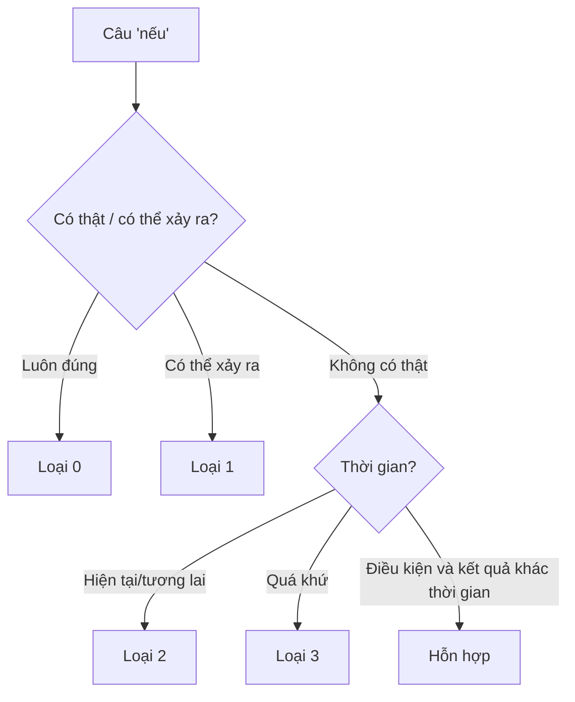

# All Conditionals — Tổng hợp câu điều kiện và giả định

## 1. Bảng tổng quan

| Loại | Thời gian & tính thật | Mệnh đề *if* | Mệnh đề chính | Ví dụ | Bài |
|---|---|---|---|---|---|
| **0** | Sự thật, quy luật chung | Hiện tại đơn | Hiện tại đơn | *If you heat ice, it **melts**.* | [A2-G016](../03-A2-ELEMENTARY/grammar/A2-G016-zero-conditional.md) |
| **1** | Có thể xảy ra (tương lai) | Hiện tại đơn | will / can / may + V | *If it **rains**, we**'ll stay** home.* | [A2-G017](../03-A2-ELEMENTARY/grammar/A2-G017-first-conditional.md) |
| **2** | Không có thật / khó xảy ra ở hiện tại–tương lai | Quá khứ đơn (were) | would / could / might + V | *If I **had** more time, I **would learn** French.* | [B1-G007](../04-B1-INTERMEDIATE/grammar/B1-G007-second-conditional.md) |
| **3** | Không có thật trong quá khứ | had + V3 | would / could / might have + V3 | *If I **had known**, I **would have helped**.* | [B1-G008](../04-B1-INTERMEDIATE/grammar/B1-G008-third-conditional.md) |
| **Mixed A** | Quá khứ → hiện tại | had + V3 | would + V | *If I **had studied** law, I **would be** a lawyer now.* | [B2-G001](../05-B2-UPPER-INTERMEDIATE/grammar/B2-G001-mixed-conditionals.md) |
| **Mixed B** | Hiện tại/luôn đúng → quá khứ | V2 / were | would have + V3 | *If I **were** braver, I **would have spoken** to her.* | [B2-G001](../05-B2-UPPER-INTERMEDIATE/grammar/B2-G001-mixed-conditionals.md) |

## 2. Quy tắc quan trọng

1. **Không dùng *will/would* trong mệnh đề *if*** (trừ trường hợp lịch sự đặc biệt như *If you would follow me...*).
2. Đổi vị trí hai mệnh đề: *if*-clause đầu câu → có **dấu phẩy**; ở cuối → thường không phẩy.
3. *If I **were** you* — văn trang trọng dùng *were* cho mọi ngôi; văn nói chấp nhận *was*.

## 3. Biến thể của *if*

| Cấu trúc | Nghĩa | Ví dụ | Bài |
|---|---|---|---|
| **unless** | = if ... not | ***Unless** you hurry, you'll be late.* | [B2-G003](../05-B2-UPPER-INTERMEDIATE/grammar/B2-G003-unless-provided-in-case.md) |
| **provided (that) / as long as** | miễn là | *You can go **as long as** you're back by 10.* | B2-G003 |
| **in case** | phòng khi (đề phòng) | *Take a coat **in case** it gets cold.* | B2-G003 |
| **even if** | ngay cả khi | ***Even if** it rains, we'll go.* | [B1-G023](../04-B1-INTERMEDIATE/grammar/B1-G023-adverbial-clauses.md) |
| **otherwise** | nếu không thì | *Hurry, **otherwise** you'll miss it.* | [B2-G002](../05-B2-UPPER-INTERMEDIATE/grammar/B2-G002-advanced-conditionals.md) |
| **but for / without** + N | nếu không có | ***But for** your help, I'd have failed.* | B2-G002 |
| **supposing / what if** | giả sử | ***Supposing** you lost your job, what would you do?* | B2-G002 |

## 4. Đảo ngữ điều kiện (trang trọng)

| Loại | Câu thường | Đảo ngữ |
|---|---|---|
| 1 | *If you need help, ...* | ***Should** you need help, ...* |
| 2 | *If I were you, ...* / *If he knew, ...* | ***Were** I you, ...* / ***Were** he **to know**, ...* |
| 3 | *If I had known, ...* | ***Had** I known, ...* — phủ định: ***Had** I **not** known* |

## 5. Họ "giả định" (unreal past)

| Cấu trúc | Hiện tại (V2) | Quá khứ (had V3) | Bài |
|---|---|---|---|
| *wish / if only* | *I wish I **knew**.* | *I wish I **had known**.* | [B1-G009](../04-B1-INTERMEDIATE/grammar/B1-G009-wish-if-only.md) |
| *wish + would* | *I wish you **would** stop.* (phàn nàn về hành vi) | — | B1-G009 |
| *would rather + S* | *I'd rather you **stayed**.* | *I'd rather you **had stayed**.* | [B2-G016](../05-B2-UPPER-INTERMEDIATE/grammar/B2-G016-unreal-past-would-rather.md) |
| *It's (high) time + S* | *It's time we **left**.* | — | B2-G016 |
| *as if / as though* | *He talks as if he **were** rich.* | *She looked as if she **had seen** a ghost.* | B2-G016 |

## 6. Lỗi thường gặp

| ❌ | ✅ |
|---|---|
| *If it **will rain**, ...* | *If it **rains**, ...* |
| *If I **would have** known, ...* | *If I **had known**, ...* |
| *If I had studied, I **would have been** a doctor **now**.* | *... I **would be** a doctor now.* |
| ***Unless** you **don't** hurry, ...* | ***Unless** you hurry, ...* |
| ***Hadn't I** known, ...* | ***Had I not** known, ...* |
| *I wish I **can** swim.* | *I wish I **could** swim.* |

## 7. Tự kiểm tra

1. If I ___ (be) you, I'd apologise.
2. If she ___ (not miss) the bus, she wouldn't have been late.
3. If I had saved money, I ___ (own) a house now.
4. ___ you need anything, call me. (đảo ngữ)
5. I'll bring an umbrella ___ it rains. (*if* hay *in case*?)

Đáp án

1. **were** · 2. **hadn't missed** · 3. **would own** · 4. **Should** · 5. **in case** (mang ô trước để đề phòng)

