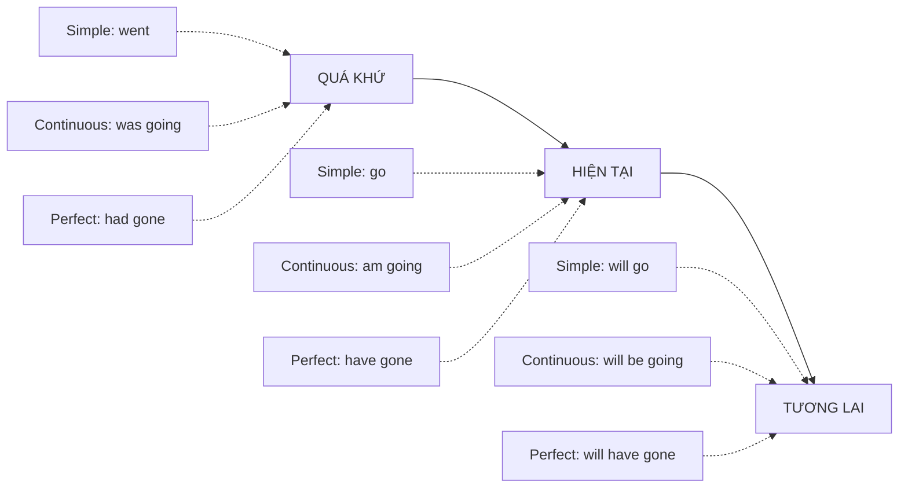

# All Tenses Comparison — So sánh toàn bộ các thì

Bảng tổng hợp 12 thì và các cách diễn đạt tương lai. Mỗi thì có: công thức, cách dùng chính, dấu hiệu thường gặp, ví dụ, và bài học gốc. Dấu hiệu thời gian chỉ là **gợi ý**, không phải quy tắc tuyệt đối — ngữ cảnh và ý người nói mới quyết định thì.

## 1. Bản đồ thời gian

| Khía cạnh | Ý nghĩa cốt lõi |
|---|---|
| **Simple** (đơn) | Sự việc nhìn **trọn vẹn**, thói quen, sự thật |
| **Continuous** (tiếp diễn) | Sự việc **đang diễn ra**, tạm thời, chưa xong |
| **Perfect** (hoàn thành) | Sự việc xảy ra **trước** một mốc và **liên quan** tới mốc đó |
| **Perfect continuous** | Quá trình **kéo dài** đến một mốc, nhấn mạnh thời lượng |

## 2. Thì hiện tại

| Thì | Công thức | Cách dùng chính | Dấu hiệu gợi ý | Ví dụ | Bài |
|---|---|---|---|---|---|
| Present simple | S + V(s/es) | Thói quen, sự thật, lịch trình | always, usually, every day | *She **works** in a bank.* | [A1-G001](../02-A1-BEGINNER/grammar/A1-G001-present-simple-affirmative.md) |
| Present continuous | S + am/is/are + V-ing | Đang xảy ra, tạm thời, kế hoạch đã sắp xếp | now, at the moment, this week | *She **is working** from home this week.* | [A1-G004](../02-A1-BEGINNER/grammar/A1-G004-present-continuous.md) |
| Present perfect | S + have/has + V3 | Trải nghiệm; kết quả còn ở hiện tại; kéo dài đến nay | ever, never, just, already, yet, since, for | *She **has worked** here since 2020.* | [A2-G003](../03-A2-ELEMENTARY/grammar/A2-G003-present-perfect-form.md) |
| Present perfect continuous | S + have/has been + V-ing | Quá trình kéo dài đến nay, nhấn mạnh thời lượng/hậu quả | for, since, all day, how long | *She **has been working** all day — she's exhausted.* | [B1-G001](../04-B1-INTERMEDIATE/grammar/B1-G001-present-perfect-continuous.md) |

## 3. Thì quá khứ

| Thì | Công thức | Cách dùng chính | Dấu hiệu gợi ý | Ví dụ | Bài |
|---|---|---|---|---|---|
| Past simple | S + V2/ed | Sự việc đã kết thúc tại thời điểm xác định | yesterday, last…, ago, in 2010 | *I **met** him in 2015.* | [A1-G017](../02-A1-BEGINNER/grammar/A1-G017-past-simple-affirmative.md) |
| Past continuous | S + was/were + V-ing | Đang diễn ra tại một thời điểm quá khứ; bối cảnh | while, when, at 8 p.m. yesterday | *I **was cooking** when he called.* | [A2-G001](../03-A2-ELEMENTARY/grammar/A2-G001-past-continuous.md) |
| Past perfect | S + had + V3 | Xảy ra trước một sự việc/mốc quá khứ khác | before, after, by the time, already | *The film **had started** when we arrived.* | [B1-G002](../04-B1-INTERMEDIATE/grammar/B1-G002-past-perfect.md) |
| Past perfect continuous | S + had been + V-ing | Quá trình kéo dài đến một mốc quá khứ | for, since, how long | *She **had been waiting** for an hour.* | [B1-G003](../04-B1-INTERMEDIATE/grammar/B1-G003-past-perfect-continuous.md) |

## 4. Tương lai

| Cấu trúc | Cách dùng chính | Ví dụ | Bài |
|---|---|---|---|
| **will + V** | Quyết định tức thời, dự đoán dựa trên ý kiến, lời hứa | *I'll help you.* / *I think it **will** rain.* | [A1-G019](../02-A1-BEGINNER/grammar/A1-G019-future-will.md) |
| **be going to + V** | Ý định đã có; dự đoán có bằng chứng | *Look at the clouds — it**'s going to** rain.* | [A1-G020](../02-A1-BEGINNER/grammar/A1-G020-be-going-to.md) |
| **Present continuous** | Kế hoạch đã sắp xếp (có thời gian, người, địa điểm) | *I**'m meeting** Lan at 6 tonight.* | [A2-G008](../03-A2-ELEMENTARY/grammar/A2-G008-present-continuous-future.md) |
| **Present simple** | Lịch trình cố định | *The train **leaves** at 7.* | [A2-G008](../03-A2-ELEMENTARY/grammar/A2-G008-present-continuous-future.md) |
| **will be + V-ing** | Đang diễn ra tại một thời điểm tương lai | *This time tomorrow I**'ll be flying** to Paris.* | [B1-G005](../04-B1-INTERMEDIATE/grammar/B1-G005-future-continuous.md) |
| **will have + V3** | Hoàn thành trước một mốc tương lai | *By June I**'ll have finished**.* | [B1-G006](../04-B1-INTERMEDIATE/grammar/B1-G006-future-perfect.md) |
| **will have been + V-ing** | Thời lượng tính đến một mốc tương lai | *By 2030 I**'ll have been working** here for 10 years.* | [B2-G012](../05-B2-UPPER-INTERMEDIATE/grammar/B2-G012-future-perfect-continuous.md) |
| **was going to / would** | Tương lai nhìn từ quá khứ | *I **was going to** call, but I forgot.* | [B2-G012](../05-B2-UPPER-INTERMEDIATE/grammar/B2-G012-future-perfect-continuous.md) |

## 5. Các cặp dễ nhầm

| Cặp | Phân biệt | Ví dụ |
|---|---|---|
| Present simple vs continuous | Thói quen / đang diễn ra, tạm thời | *I **live** in Hanoi.* vs *I**'m living** with friends this month.* |
| Past simple vs present perfect | Thời điểm kết thúc xác định / không nêu hoặc liên quan hiện tại | *I **lost** my key yesterday.* vs *I**'ve lost** my key (I can't get in).* |
| Present perfect vs perfect continuous | Kết quả, số lượng / quá trình, thời lượng | *I**'ve written** 3 emails.* vs *I**'ve been writing** emails all morning.* |
| Past simple vs past perfect | Trình tự rõ / cần nhấn mạnh việc xảy ra trước | *When I arrived, she **left**.* (sau khi tôi đến) vs *When I arrived, she **had left**.* (trước khi tôi đến) |
| will vs going to | Quyết định tức thời / ý định có trước | *The phone's ringing — I**'ll** get it.* vs *I**'m going to** study law.* |

## 6. Động từ trạng thái (thường không dùng tiếp diễn)

*know, believe, understand, like, love, hate, want, need, prefer, own, belong, seem, mean, remember*

- ✅ *I **know** the answer.* — ❌ ~~I am knowing~~.
- Một số động từ đổi nghĩa khi tiếp diễn: *I **think** it's good* (ý kiến) vs *I**'m thinking** about it* (đang suy nghĩ); *She **has** a car* (sở hữu) vs *She**'s having** lunch* (hành động).

## 7. Thì trong mệnh đề thời gian/điều kiện tương lai

Sau *when, as soon as, before, after, until, if, unless...* nói về tương lai → dùng **hiện tại**, không *will*: *I'll call you **when I arrive**.* Xem [B1-G023](../04-B1-INTERMEDIATE/grammar/B1-G023-adverbial-clauses.md).

## 8. Tự kiểm tra nhanh

Chọn thì phù hợp (đáp án ở cuối):

1. I ___ (live) here since 2018.
2. When I got to the station, the train ___ (already/leave).
3. Look out! You ___ (fall).
4. By the end of next year, she ___ (graduate).
5. What ___ you ___ (do) at 9 p.m. yesterday?

Đáp án

1. **have lived** (hoặc *have been living*) · 2. **had already left** · 3. **are going to fall** · 4. **will have graduated** · 5. **were ... doing**

