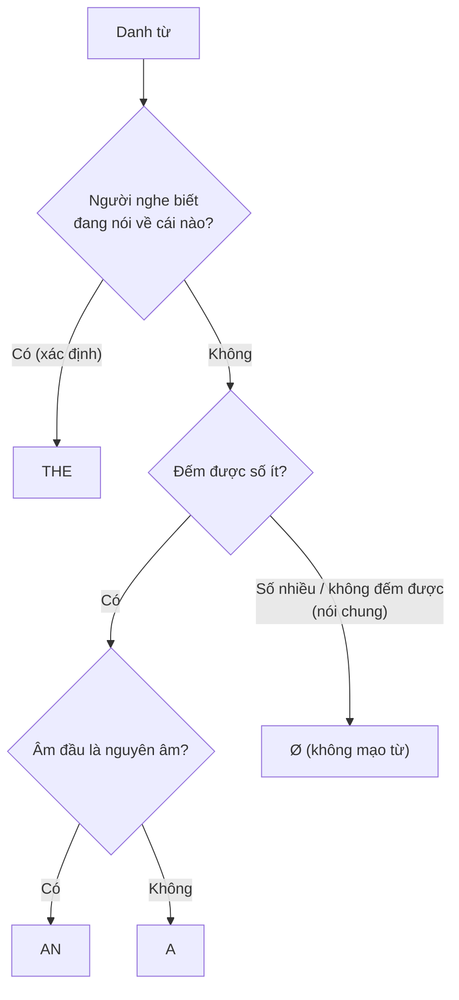

# Articles Guide — Hướng dẫn mạo từ a / an / the / Ø

Tiếng Việt không có mạo từ, nên đây là một trong những điểm khó nhất với người Việt. Hướng dẫn này tổng hợp [A0-G012](../01-A0-FOUNDATION/grammar/A0-G012-articles-basic.md) và [A2-G026](../03-A2-ELEMENTARY/grammar/A2-G026-articles-advanced.md).

> Quy tắc mạo từ có nhiều ngoại lệ và phụ thuộc vào cách người nói nhìn sự vật. Các bảng dưới đây là **xu hướng phổ biến**, không phải luật tuyệt đối.

## 1. Câu hỏi quyết định

## 2. *a* / *an*

| Quy tắc | Ví dụ |
|---|---|
| Dùng với danh từ **đếm được số ít**, lần đầu nhắc, không xác định | *I saw **a** cat.* |
| *an* trước **âm** nguyên âm (không phải chữ) | ***an** apple, **an** hour (h câm), **an** MBA (/em/)* |
| *a* trước **âm** phụ âm | ***a** university (/juː/), **a** European, **a** one-way ticket (/w/)* |
| Nghề nghiệp | *She's **a** doctor.* (không ~~She's doctor~~) |
| Nghĩa "một", "mỗi" | *twice **a** week, 50,000 dong **a** kilo* |
| Cảm thán với danh từ số ít | *What **a** beautiful day!* |

## 3. *the*

| Quy tắc | Ví dụ |
|---|---|
| Nhắc lại lần hai | *I saw a cat. **The** cat was black.* |
| Người nghe biết rõ (ngữ cảnh) | *Close **the** door, please.* |
| Duy nhất | ***the** sun, **the** moon, **the** internet* |
| So sánh nhất, số thứ tự | ***the** best, **the** first, **the** last* |
| Có cụm/mệnh đề xác định phía sau | ***the** book on the table, **the** man who called* |
| Nhạc cụ (thường) | *play **the** piano* |
| Sông, biển, đại dương, dãy núi | ***the** Mekong, **the** Pacific, **the** Alps* |
| Tên nước có *Republic/Kingdom/States* hoặc số nhiều | ***the** UK, **the** USA, **the** Philippines* |
| *the* + tính từ = nhóm người | ***the** rich, **the** elderly* |
| Khách sạn, bảo tàng, rạp, báo (thường) | ***the** Hilton, **the** British Museum* |

## 4. Không mạo từ (Ø)

| Quy tắc | Ví dụ |
|---|---|
| Danh từ số nhiều / không đếm được **nói chung** | *Ø **Cats** are independent. / Ø **Water** is essential.* |
| Tên người, hầu hết tên nước, thành phố, đường | *Ø Lan, Ø Vietnam, Ø Hanoi, Ø Le Loi Street* |
| Bữa ăn | *have Ø breakfast* |
| Môn học, ngôn ngữ, thể thao | *study Ø maths, speak Ø English, play Ø football* |
| Phương tiện với *by* | *by Ø bus, by Ø car* |
| Một số địa điểm khi nói về **chức năng chính** | *go to Ø school (đi học), go to Ø bed, be in Ø hospital (nằm viện)* |
| Ngày, tháng, mùa (thường) | *on Ø Monday, in Ø May, in Ø (the) summer* |
| Hồ, núi đơn lẻ | *Ø Hoan Kiem Lake, Ø Mount Fansipan* |

> So sánh: *She goes to **school*** (đi học) vs *She went to **the school** to meet the teacher* (đến tòa nhà trường).

## 5. Nói chung vs cụ thể

| Nói chung | Cụ thể |
|---|---|
| *Ø **Dogs** are loyal.* | ***The dogs** next door bark all night.* |
| *I love Ø **music**.* | *I love **the music** in this film.* |
| *Ø **Life** is short.* | ***The life** of a soldier is hard.* |

## 6. Lỗi thường gặp của người Việt

| ❌ | ✅ | Ghi chú |
|---|---|---|
| *She is ~~teacher~~.* | *She is **a** teacher.* | Nghề nghiệp cần *a/an* |
| *I like **the** music.* (nói chung) | *I like Ø music.* | Nói chung → Ø |
| ***The** life is beautiful.* | *Ø Life is beautiful.* | Trừu tượng, nói chung |
| *I go to **the** school by **the** bus.* | *I go to Ø school by Ø bus.* | Chức năng, *by* + phương tiện |
| ***a** hour, **an** university* | ***an** hour, **a** university* | Theo âm, không theo chữ |
| *I have ~~a~~ breakfast at 7.* | *I have Ø breakfast at 7.* | Bữa ăn (trừ khi có tính từ: *a big breakfast*) |
| *She plays **the** football.* | *She plays Ø football.* | Thể thao |
| *He's **the** best student in ~~a~~ class.* | *... in **the** class.* | Xác định |

## 7. Tự kiểm tra

Điền *a, an, the* hoặc Ø.

1. My brother is ___ engineer.
2. ___ sun rises in ___ east.
3. I usually have ___ lunch at 12.
4. She's ___ best singer in ___ group.
5. ___ honesty is important.
6. We went to ___ Philippines last year.

Đáp án

1. **an** · 2. **The / the** · 3. **Ø** · 4. **the / the** · 5. **Ø** · 6. **the**

