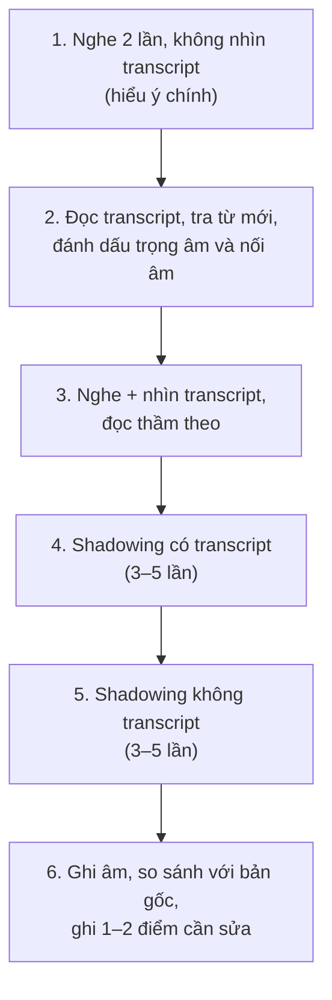

# PRON-10 · Shadowing Practice — Luyện nói đuổi (shadowing)

| Mục | Nội dung |
|---|---|
| **Cấp độ** | A2 → B2 |
| **Mục tiêu** | Cải thiện phát âm, nhịp điệu, ngữ điệu và độ trôi chảy bằng cách nói theo người mẫu |
| **Thời gian** | 10–15 phút/ngày |
| **Liên quan** | [PRON-05](PRON-05-sentence-stress.md), [PRON-07](PRON-07-linking-sounds.md), [PRON-09](PRON-09-intonation.md), [S06 Fluency](../09-FOUR-SKILLS/Speaking/S06-fluency-exercises.md) |

## 1. Shadowing là gì?

**Shadowing** = nghe một đoạn tiếng Anh và **nói theo gần như cùng lúc** (chậm hơn nửa nhịp), bắt chước **mọi thứ**: âm, trọng âm, nối âm, ngữ điệu, tốc độ. Giống như "cái bóng" đi theo người nói.

> **Về nguồn âm thanh:** Giáo trình không đính kèm audio. Dùng (1) transcript trong giáo trình đọc bằng TTS chất lượng tốt; (2) hoặc các nguồn nghe có transcript công khai (podcast học tiếng Anh, bản tin có phụ đề, video có phụ đề). Hãy chọn nguồn **có transcript** để kiểm tra. TTS hữu ích nhưng đôi khi nối âm và ngữ điệu kém tự nhiên hơn người thật — xen kẽ cả hai.

## 2. Quy trình 6 bước (một đoạn 30–60 giây)

## 3. Chọn tài liệu phù hợp

| Cấp độ | Tài liệu | Độ dài | Tốc độ |
|---|---|---|---|
| A2 | Hội thoại đơn giản, câu ngắn | 20–30 giây | Chậm (TTS 0.8×) |
| B1 | Đoạn kể chuyện, thông báo, transcript trong [B1 Skills Practice](../04-B1-INTERMEDIATE/B1-SKILLS-PRACTICE.md) | 30–45 giây | Vừa |
| B2 | Phỏng vấn, bài giảng ngắn, transcript trong [B2 Skills Practice](../05-B2-UPPER-INTERMEDIATE/B2-SKILLS-PRACTICE.md) | 45–90 giây | Tự nhiên |

**Nguyên tắc:** bạn nên hiểu khoảng **90%** nội dung. Quá khó → bạn chỉ lo theo kịp, không chú ý phát âm.

## 4. Đoạn luyện mẫu

Đánh dấu: **đậm** = trọng âm, ‿ = nối âm, | = ngắt nhóm ý, ↗↘ = ngữ điệu.

### Đoạn A2

> *Hi, I'm **Lan**. | I **live**‿in **Ha**noi ↘ | and I **work**‿as‿a **nurse**. ↘ | I **usually** get‿up‿at **six**, | have **break**fast, | and **cy**cle to **work**. ↘ | In my **free** time, | I **love** **cook**ing ↗ | and **watch**ing **mo**vies. ↘*

### Đoạn B1

> *Last **sum**mer, | I **went** to **Da** **Nang** with my **fam**ily. ↘ | We **stayed**‿in‿a **small** **ho**tel | near the **beach**. ↘ | **Ev**ery **morn**ing, | we **swam**‿in the **sea** | before‿it got too **hot**. ↘ | The **best** **part**‿of the **trip** | was **vis**iting **Hoi** **An** | at **night**, | when the **whole** **town** | was **lit**‿up with **lan**terns. ↘*

### Đoạn B2

> *A**lot**‿of **peo**ple **think** | that **learn**ing‿a **lan**guage | is‿all‿about **mem**orising **vo**cabulary. ↘ | But‿in **my** ex**pe**rience, | what **real**ly **makes**‿a **dif**ference | is **lis**tening. ↘ | The **more** you **hear** | **nat**ural **speech**, | the **eas**ier‿it **gets** | to **speak** with con**fi**dence. ↘*

> Dán từng đoạn (bỏ ký hiệu) vào công cụ TTS để có bản mẫu. Một số công cụ TTS cho chọn giọng Anh–Anh hoặc Anh–Mỹ.

## 5. Mẹo

- **Đừng dừng lại** khi vấp — tiếp tục theo bản gốc.
- **Tập trung vào một yếu tố mỗi lần**: lần 1 nhịp điệu, lần 2 nối âm, lần 3 ngữ điệu.
- **Phóng đại** lúc đầu: nhấn mạnh hơn, lên xuống nhiều hơn.
- **Ghi âm mỗi tuần một lần** cùng một đoạn để thấy tiến bộ.
- Kết hợp với chép chính tả (dictation): nghe → viết → so transcript.

## 6. Nhật ký shadowing

| Ngày | Nguồn | Độ dài | Số lần | Điểm cần sửa | Tự đánh giá (1–5) |
|---|---|---|---|---|---|
| | | | | | |

## 7. Bài tập

> ✍️ Đáp án/hướng dẫn tự chấm: [PRON-10-ANSWERS](../12-ANSWERS-AND-EXPLANATIONS/PRONUNCIATION/PRON-10-ANSWERS.md)

**1.** Lấy đoạn sau (không có ký hiệu), tự đánh dấu trọng âm, nối âm và ngắt nhóm ý:
> *I've been studying English for two years. At first it was really difficult, but now I can understand most of what I hear.*

**2.** Shadowing đoạn B1 ở mục 4 trong 7 ngày liên tiếp. Ghi âm ngày 1 và ngày 7, so sánh 3 điểm: âm cuối, nối âm, ngữ điệu cuối câu.

**3.** Chọn một transcript trong [B2 Listening Transcripts](../12-ANSWERS-AND-EXPLANATIONS/SKILLS/B2-LISTENING-TRANSCRIPTS.md), cắt một đoạn 45 giây, thực hiện quy trình 6 bước.
