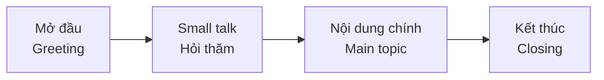

# S02 · Everyday Conversations — Hội thoại hằng ngày

| Mục | Nội dung |
|---|---|
| **Cấp độ** | A1 → B1 |
| **Mục tiêu** | Bắt đầu, duy trì, kết thúc hội thoại; xử lý tình huống thường gặp; hỏi lại khi không hiểu |
| **Mẫu trả lời** | [Speaking Chapters — Answers](../../12-ANSWERS-AND-EXPLANATIONS/SKILLS/SPEAKING-CHAPTERS-ANSWERS.md#s02) |

## 1. Cấu trúc một cuộc hội thoại

| Giai đoạn | Cụm từ |
|---|---|
| Chào hỏi | *Hi / Hello / Good morning. How are you? / How's it going? / Nice to see you!* |
| Trả lời | *I'm fine, thanks. And you? / Not bad. / Pretty good, thanks.* |
| Small talk | *How was your weekend? / Lovely weather today, isn't it? / Busy day?* |
| Chuyển chủ đề | *By the way, ... / Anyway, ... / So, ...* |
| Kết thúc | *Anyway, I should go. / It was nice talking to you. / See you later! / Take care!* |

## 2. Giữ cho cuộc trò chuyện tiếp tục

| Kỹ thuật | Ví dụ |
|---|---|
| **Hỏi ngược lại** | *I'm from Hue. **What about you?** / **And you?*** |
| **Hỏi thêm chi tiết** | *Really? **Where** did you go? **Who** with?* |
| **Phản hồi ngắn (back-channelling)** | *Really? / Oh, nice! / That's interesting. / I see. / No way!* |
| **Chia sẻ trải nghiệm liên quan** | *Oh, I went there too last year!* |

## 3. Khi không hiểu — hỏi lại lịch sự

| Tình huống | Cụm từ |
|---|---|
| Không nghe rõ | *Sorry, could you say that again? / Pardon?* |
| Nói quá nhanh | *Could you speak a bit more slowly, please?* |
| Không biết từ | *Sorry, what does "___" mean?* |
| Kiểm tra lại | *Do you mean...? / So you're saying...?* |
| Cần thời gian | *Let me think... / Just a moment...* |

> Hỏi lại **không** phải là dấu hiệu yếu kém — người bản ngữ cũng làm vậy liên tục. Im lặng hoặc đoán mò mới gây hiểu lầm.

## 4. Tình huống thường gặp

### Ở quán cà phê/nhà hàng

> *A: Hi, what can I get you?*
> *B: Could I have an iced coffee with milk, please?*
> *A: Sure. Anything else?*
> *B: No, that's all, thanks. How much is it?*
> *A: That's 35,000 dong.*

### Hỏi đường

> *A: Excuse me, is there a pharmacy near here?*
> *B: Yes, go straight on and take the second left. It's next to the bank.*
> *A: Sorry, the second left?*
> *B: That's right. It's about five minutes' walk.*
> *A: Thanks a lot!*

### Gọi điện đặt lịch

> *A: Good morning, City Dental Clinic.*
> *B: Hi, I'd like to make an appointment, please.*
> *A: Sure. When would suit you?*
> *B: Is Thursday afternoon possible?*
> *A: We have 3 p.m. or 4:30.*
> *B: 4:30 would be great.*

## 5. Bài luyện

### Task 1 — Hoàn thành hội thoại

> *A: Hi Mai! How are you?*
> *B: **1.** ___ . And you?*
> *A: Great, thanks. How was your weekend?*
> *B: Really nice. I went to the beach with my family.*
> *A: **2.** ___ ? Which beach?* (thể hiện quan tâm + hỏi thêm)
> *B: Cua Lo. Have you been there?*
> *A: No, never. **3.** ___ ?* (hỏi thêm chi tiết)
> *B: It was sunny but very crowded.*
> *A: Anyway, **4.** ___ . I have a meeting at ten.* (kết thúc)
> *B: OK, **5.** ___ !*

### Task 2 — Role-play (2 phút mỗi tình huống)

**6.** Bạn ở một cửa hàng quần áo, muốn đổi áo vì sai cỡ.
**7.** Bạn gọi đến khách sạn hỏi về phòng trống cuối tuần này và giá.
**8.** Bạn gặp đồng nghiệp mới ở thang máy — bắt chuyện trong 1 phút.

➡️ Tiếp theo: [S03 — Describing People & Places](S03-describing-people-places.md)
