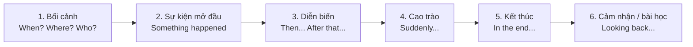

# S05 · Storytelling — Kể chuyện

| Mục | Nội dung |
|---|---|
| **Cấp độ** | A2 → B2 |
| **Mục tiêu** | Kể một trải nghiệm có cấu trúc, đúng thì, hấp dẫn người nghe |
| **Ngữ pháp liên quan** | [B1-G004 — Narrative Tenses](../../04-B1-INTERMEDIATE/grammar/B1-G004-narrative-tenses.md), [B1-G008 — Third Conditional](../../04-B1-INTERMEDIATE/grammar/B1-G008-third-conditional.md) |
| **Mẫu trả lời** | [Speaking Chapters — Answers](../../12-ANSWERS-AND-EXPLANATIONS/SKILLS/SPEAKING-CHAPTERS-ANSWERS.md#s05) |

## 1. Cấu trúc câu chuyện

## 2. Thì kể chuyện

| Chức năng | Thì | Ví dụ |
|---|---|---|
| Bối cảnh, hành động đang diễn ra | Quá khứ tiếp diễn | *It **was raining**, and I **was waiting** for the bus.* |
| Chuỗi sự kiện chính | Quá khứ đơn | *A car **stopped**, and a woman **got out**.* |
| Sự việc xảy ra trước đó | Quá khứ hoàn thành | *I realised I **had left** my wallet at home.* |
| Suy ngẫm | Câu điều kiện loại 3 | *If I **hadn't missed** the bus, I **wouldn't have met** her.* |

## 3. Từ nối kể chuyện

| Giai đoạn | Cụm từ |
|---|---|
| Mở đầu | *A few years ago... / Last summer... / I'll never forget the day when...* |
| Trình tự | *First... / Then... / After that... / Later... / Meanwhile...* |
| Bất ngờ | *Suddenly... / All of a sudden... / To my surprise...* |
| Thời gian | *As soon as... / While... / Just as... / By the time...* |
| Kết thúc | *In the end... / Finally... / Eventually...* |
| Suy ngẫm | *Looking back, ... / It taught me that... / I've never forgotten...* |

## 4. Làm câu chuyện hấp dẫn

| Kỹ thuật | Ví dụ |
|---|---|
| Câu mở đầu thu hút | *"I've never been so scared in my life."* |
| Chi tiết giác quan | *The street was dark and completely silent.* |
| Lời nói trực tiếp | *She looked at me and said, "You're not supposed to be here."* |
| Cảm xúc | *My heart was pounding.* |
| Tính từ mạnh | *exhausted, terrified, delighted, furious* thay vì *very tired, very scared* |
| Ngữ điệu | Chậm lại trước cao trào, nhấn mạnh từ cảm xúc ([PRON-09](../../08-PRONUNCIATION/PRON-09-intonation.md)) |

## 5. Bài luyện

### Task 1 — Sắp xếp câu chuyện

Sắp xếp các câu thành câu chuyện hợp lý:
a. In the end, a kind old man let me use his phone to call my friend.
b. Last year, I travelled alone to Da Lat for the first time.
c. When I got off the bus, I realised I had left my phone on it.
d. It was getting dark, and I didn't know where my hotel was.
e. Looking back, it taught me to always write down important addresses.

**1.** Thứ tự đúng: ___

### Task 2 — Kể chuyện (2 phút, chuẩn bị 1 phút)

Chọn một đề, chuẩn bị 5 từ khóa, kể và ghi âm:

**2.** *A time when something went wrong on a trip.*
**3.** *The best day of your life so far.*
**4.** *A time when you helped someone (or someone helped you).*
**5.** *A mistake that taught you something important.*

Tự kiểm tra: có đủ 6 phần? dùng ≥ 3 thì quá khứ? có ≥ 4 từ nối? có câu suy ngẫm?

➡️ Tiếp theo: [S06 — Fluency Exercises](S06-fluency-exercises.md)
