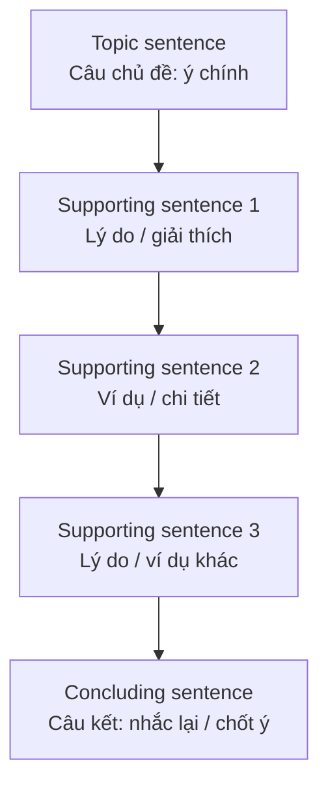

# W02 · Paragraph Writing — Viết đoạn văn

| Mục | Nội dung |
|---|---|
| **Cấp độ** | A2 → B1 |
| **Mục tiêu** | Viết đoạn văn có câu chủ đề, câu hỗ trợ, câu kết; một đoạn – một ý |
| **Đáp án** | [Writing Chapters — Answers](../../12-ANSWERS-AND-EXPLANATIONS/SKILLS/WRITING-CHAPTERS-ANSWERS.md#w02) |

## 1. Cấu trúc đoạn văn tiếng Anh

Đoạn văn tiếng Anh thường **trực tiếp**: nêu ý chính **ngay đầu** rồi chứng minh. Đây là khác biệt so với lối viết vòng vo dẫn dắt thường gặp.

## 2. Đoạn văn mẫu

> ***My hometown, Hoi An, is a wonderful place to live.*** *(topic sentence)* First of all, it is very peaceful compared with big cities like Hanoi or Ho Chi Minh City. There is little traffic, and you can cycle everywhere. In addition, the old town is beautiful, with yellow houses and colourful lanterns that light up the streets at night. Finally, the food is delicious and cheap; my favourite dish is cao lầu, a noodle dish you can only find in Hoi An. ***For these reasons, I feel lucky to live in such a charming town.*** *(concluding sentence)*

| Thành phần | Câu |
|---|---|
| Câu chủ đề | *My hometown, Hoi An, is a wonderful place to live.* |
| Hỗ trợ 1 (peaceful) | *First of all... cycle everywhere.* |
| Hỗ trợ 2 (beautiful) | *In addition... at night.* |
| Hỗ trợ 3 (food) | *Finally... in Hoi An.* |
| Câu kết | *For these reasons...* |

## 3. Nguyên tắc

| Nguyên tắc | Giải thích |
|---|---|
| **Một đoạn – một ý chính** | Mọi câu phải liên quan đến câu chủ đề |
| **Hỗ trợ cụ thể** | Lý do + ví dụ, không chỉ lặp lại ý |
| **Từ nối** | *First, In addition, For example, However, Finally* — xem [W05](W05-cohesion-coherence.md) |
| **Độ dài** | B1: 5–8 câu (80–150 từ) |
| **Câu kết không thêm ý mới** | Chỉ tóm tắt / chốt lại |

## 4. Lỗi thường gặp

| Lỗi | Ví dụ | Sửa |
|---|---|---|
| Câu lạc đề | Đoạn về lợi ích thể thao nhưng có câu *My brother bought a new phone.* | Bỏ câu lạc đề |
| Không có câu chủ đề | Bắt đầu ngay bằng ví dụ | Thêm câu nêu ý chính ở đầu |
| Hỗ trợ chung chung | *Sport is good. It is very good for us.* | *Sport improves heart health. For example, ...* |
| Câu kết thêm ý mới | *... In conclusion, I also like music.* | Chỉ chốt ý của đoạn |

## 5. Bài luyện

### Task 1 — Tìm câu lạc đề

> *Learning English has many benefits. (a) It can help you find a better job, as many companies need English-speaking staff. (b) It also allows you to travel more easily. (c) My English teacher is from Australia. (d) Moreover, you can enjoy films and books in their original language. (e) Therefore, learning English is a valuable investment.*

**1.** Câu nào lạc đề?

### Task 2 — Viết câu chủ đề cho đoạn sau

> **2.** ___ For example, they can study at any time that suits them. They can also save money on travel. In addition, online courses often allow students to learn at their own pace.

### Task 3 — Viết câu kết

> *Public transport has many advantages for city residents. It is cheaper than owning a car. It also reduces traffic and pollution. Moreover, passengers can read or relax during their journey.*
> **3.** ___

### Task 4 — Viết đoạn văn

**4.** Viết đoạn 100–130 từ: *"The best way to spend a weekend"*. Có câu chủ đề, 3 ý hỗ trợ (có ví dụ), câu kết.

➡️ Tiếp theo: [W03 — Topic Sentences](W03-topic-sentences.md)
