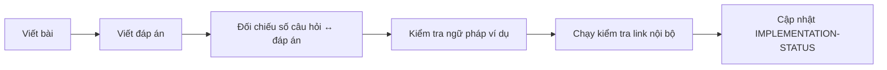

# 📐 Authoring Standards — Tiêu chuẩn biên soạn và kiểm định

Tài liệu này dành cho người biên soạn, giáo viên hoặc người học muốn bổ sung nội dung mới vào bộ giáo trình. Mọi file mới phải tuân theo các quy định dưới đây.

## 1. Quy ước tên file và ID

| Loại | Mẫu tên | Ví dụ |
|---|---|---|
| Bài ngữ pháp | `<LEVEL>-G<NNN>-<slug>.md` trong `<level-folder>/grammar/` | `02-A1-BEGINNER/grammar/A1-G001-present-simple-affirmative.md` |
| Đáp án bài ngữ pháp | `<LEVEL>-G<NNN>-ANSWERS.md` trong `12-ANSWERS-AND-EXPLANATIONS/<LEVEL>/` | `12-ANSWERS-AND-EXPLANATIONS/A1/A1-G001-ANSWERS.md` |
| Từ vựng | `VOC-<NN>-<slug>.md` | `07-VOCABULARY/VOC-04-work-careers.md` |
| Phát âm | `PRON-<NN>-<slug>.md` | `08-PRONUNCIATION/PRON-04-word-stress.md` |
| Kỹ năng | `L<NN>`, `S<NN>`, `R<NN>`, `W<NN>` + slug | `09-FOUR-SKILLS/Reading/R05-inference.md` |
| Practice Lab | `LAB-<NN>-<slug>.md` | `10-PRACTICE-LAB/LAB-03-error-correction.md` |

- Slug dùng chữ thường, nối bằng dấu gạch ngang, không dấu tiếng Việt.
- ID là **duy nhất**. Không tạo hai file có nội dung gần trùng nhau.

## 2. Cấu trúc bắt buộc của một bài ngữ pháp

| Mục | Nội dung tối thiểu |
|---|---|
| A. Lesson Information | ID, topic EN, tên VN, CEFR, prerequisites (có link), thời gian, 3–5 mục tiêu |
| B. Warm-up | Tình huống đời thường + câu hỏi dẫn dắt |
| C. WHAT | Ý nghĩa, mục đích, vai trò, khi nào dùng/không dùng |
| D. WHY | Bản chất, quan hệ ý nghĩa – thời gian; timeline/Mermaid với chủ đề phức tạp |
| E. FORM | Khẳng định, phủ định, nghi vấn, trả lời ngắn (khi áp dụng); giải thích mọi ký hiệu |
| F. HOW | Các cách dùng; **≥ 8 ví dụ** có dịch và phân tích |
| G. VISUAL | Ít nhất một: timeline, bảng, Mermaid, sentence breakdown |
| H. COMPARISON | So sánh cấu trúc dễ nhầm, quy tắc ra quyết định |
| I. COMMON MISTAKES | **≥ 5 lỗi** (khi chủ đề đủ trường hợp): sai → đúng → nguyên nhân → cách tránh |
| J. MEMORY TRICKS | Mẹo nhớ có cơ sở, ghi rõ ngoại lệ |
| K. REAL-LIFE APPLICATION | Hội thoại/bài đọc + giải thích + highlights + useful expressions |
| L. PRACTICE | **≥ 25 câu/nhiệm vụ**, 5 cấp độ: Recognition → Controlled → Error Correction → Production → Real Communication |
| M. KNOWLEDGE CHECK | 5 câu tự kiểm tra, checklist, 3 lỗi cần nhớ, lịch ôn 1–3–7 ngày, link bài tiếp theo và bài ôn |
| N. ANSWER KEY | Link tới file đáp án riêng |

## 3. Tiêu chuẩn file đáp án

Với mỗi câu có đáp án đóng: **đáp án đúng + giải thích ngữ pháp (tiếng Việt) + quy tắc liên quan + lý do loại phương án sai (khi cần)**.

Với câu mở: **đáp án mẫu + tiêu chí tự chấm**. Không giả định chỉ có một đáp án đúng.

Số thứ tự câu trong file đáp án phải **khớp chính xác** với file bài học (ví dụ: `L2.3` = Level 2, câu 3).

## 4. Quy tắc ngôn ngữ

- Giải thích bằng tiếng Việt tự nhiên, như giáo viên nói chuyện với học viên.
- Thuật ngữ ngữ pháp luôn có tên tiếng Anh và tiếng Việt ở lần xuất hiện đầu tiên trong bài.
- Không dùng thuật ngữ chưa được dạy ở bài tiên quyết; nếu buộc phải dùng, giải thích ngắn tại chỗ.
- Ví dụ tiếng Anh phải tự nhiên, đúng ngữ pháp, phù hợp trình độ.
- Mẹo nhớ không được tạo ra quy tắc sai. Ghi rõ "mẹo chỉ mang tính hỗ trợ" khi có ngoại lệ.

## 5. Quality Gates — điều kiện để đánh dấu COMPLETED

1. Có mục tiêu học tập cụ thể.
2. Giải thích bằng tiếng Việt đủ dễ hiểu.
3. Có công thức và phân tích.
4. Có đủ ví dụ minh họa.
5. Có so sánh hoặc giải thích các trường hợp dễ nhầm khi cần.
6. Có bài tập theo mức độ.
7. Có lời giải ở file riêng.
8. Có ứng dụng thực tế.
9. Có checklist tự đánh giá.
10. Có liên kết tới kiến thức liên quan.

## 6. Quy trình kiểm định

Script kiểm tra liên kết nội bộ: [`check_links.py`](check_links.py) (chạy bằng `python3 99-PROJECT/check_links.py` từ thư mục gốc `english-zero-to-b2/`).

## 7. Markdown

- Mỗi file có đúng **một H1**.
- Mermaid: dùng `flowchart`, `timeline` hoặc `graph`; nhãn chứa ký tự đặc biệt phải đặt trong ngoặc kép `["..."]`.
- Không chèn ảnh/link không tồn tại. Link nội bộ dùng đường dẫn tương đối.
- Đáp án không bao giờ nằm cạnh câu hỏi.
