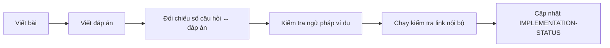

# 📐 Authoring Standards — Tiêu chuẩn biên soạn và kiểm định

Tài liệu này dành cho người biên soạn, giáo viên hoặc người học muốn bổ sung nội dung mới vào bộ giáo trình. Mọi file mới phải tuân theo các quy định dưới đây.

## 1. Quy ước tên file và ID

| Loại | Mẫu tên | Ví dụ |
|---|---|---|
| Bài ngữ pháp | `<LEVEL>-G<NNN>-<slug>.md` trong `<level-folder>/grammar/` | `02-A1-BEGINNER/grammar/A1-G001-present-simple-affirmative.md` |
| Đáp án bài ngữ pháp | `<LEVEL>-G<NNN>-ANSWERS.md` trong `12-ANSWERS-AND-EXPLANATIONS/<LEVEL>/` | `12-ANSWERS-AND-EXPLANATIONS/A1/A1-G001-ANSWERS.md` |
| Từ vựng | `VOC-<NN>-<slug>.md` | `07-VOCABULARY/VOC-04-work-careers.md` |
| Phát âm | `PRON-<NN>-<slug>.md` | `08-PRONUNCIATION/PRON-04-word-stress.md` |
| Kỹ năng | `L<NN>`, `S<NN>`, `R<NN>`, `W<NN>` + slug | `09-FOUR-SKILLS/Reading/R05-inference.md` |
| Practice Lab | `LAB-<NN>-<slug>.md` | `10-PRACTICE-LAB/LAB-03-error-correction.md` |

- Slug dùng chữ thường, nối bằng dấu gạch ngang, không dấu tiếng Việt.
- ID là **duy nhất**. Không tạo hai file có nội dung gần trùng nhau.

## 2. Cấu trúc bắt buộc của một bài ngữ pháp

| Mục | Nội dung tối thiểu |
|---|---|
| A. Lesson Information | ID, topic EN, tên VN, CEFR, prerequisites (có link), thời gian, 3–5 mục tiêu |
| B. Warm-up | Tình huống đời thường + câu hỏi dẫn dắt |
| C. WHAT | Ý nghĩa, mục đích, vai trò, khi nào dùng/không dùng |
| D. WHY | Bản chất, quan hệ ý nghĩa – thời gian; timeline/Mermaid với chủ đề phức tạp |
| E. FORM | Khẳng định, phủ định, nghi vấn, trả lời ngắn (khi áp dụng); giải thích mọi ký hiệu |
| F. HOW | Các cách dùng; **≥ 8 ví dụ** có dịch và phân tích |
| G. VISUAL | Ít nhất một: timeline, bảng, Mermaid, sentence breakdown |
| H. COMPARISON | So sánh cấu trúc dễ nhầm, quy tắc ra quyết định |
| I. COMMON MISTAKES | **≥ 5 lỗi** (khi chủ đề đủ trường hợp): sai → đúng → nguyên nhân → cách tránh |
| J. MEMORY TRICKS | Mẹo nhớ có cơ sở, ghi rõ ngoại lệ |
| K. REAL-LIFE APPLICATION | Hội thoại/bài đọc + giải thích + highlights + useful expressions |
| L. PRACTICE | **≥ 25 câu/nhiệm vụ**, 5 cấp độ: Recognition → Controlled → Error Correction → Production → Real Communication |
| M. KNOWLEDGE CHECK | 5 câu tự kiểm tra, checklist, 3 lỗi cần nhớ, lịch ôn 1–3–7 ngày, link bài tiếp theo và bài ôn |
| N. ANSWER KEY | Link tới file đáp án riêng |

## 3. Tiêu chuẩn file đáp án

Với mỗi câu có đáp án đóng: **đáp án đúng + giải thích ngữ pháp (tiếng Việt) + quy tắc liên quan + lý do loại phương án sai (khi cần)**.

Với câu mở: **đáp án mẫu + tiêu chí tự chấm**. Không giả định chỉ có một đáp án đúng.

Số thứ tự câu trong file đáp án phải **khớp chính xác** với file bài học (ví dụ: `L2.3` = Level 2, câu 3).

## 4. Quy tắc ngôn ngữ

- Giải thích bằng tiếng Việt tự nhiên, như giáo viên nói chuyện với học viên.
- Thuật ngữ ngữ pháp luôn có tên tiếng Anh và tiếng Việt ở lần xuất hiện đầu tiên trong bài.
- Không dùng thuật ngữ chưa được dạy ở bài tiên quyết; nếu buộc phải dùng, giải thích ngắn tại chỗ.
- Ví dụ tiếng Anh phải tự nhiên, đúng ngữ pháp, phù hợp trình độ.
- Mẹo nhớ không được tạo ra quy tắc sai. Ghi rõ "mẹo chỉ mang tính hỗ trợ" khi có ngoại lệ.

## 5. Quality Gates — điều kiện để đánh dấu COMPLETED

### Trình tự giải thích một kiến thức

1. Nêu tình huống và điều người học muốn nói bằng một hoặc hai câu.
2. Giải thích ý nghĩa bằng từ thông dụng, rồi mới giới thiệu tên cấu trúc và dạng câu.
3. Cho một ví dụ tự nhiên có từ vựng vừa cấp độ, kèm nghĩa tiếng Việt đầy đủ khi cần.
4. Chỉ ra cấu trúc đang giúp diễn đạt điều gì trong ví dụ, và khi nào nên dùng.
5. So sánh một lỗi hoặc điểm dễ lẫn. Phân biệt lỗi ngữ pháp với câu đúng nhưng khác nghĩa hoặc khác văn phong.
6. Chỉ thêm mẹo khi mẹo giúp nhớ đúng. Nêu giới hạn ngay cạnh mẹo; không dùng lời hứa “luôn đúng” thay cho giải thích.

Đây là trình tự triển khai trong các mục A–N hiện có, không phải yêu cầu thêm sáu mục lặp lại ở mỗi phần.

### Ngôn ngữ, bản dịch và lời thuyết minh

- Mỗi câu phát triển một ý. Tách câu nếu cần gánh cùng lúc định nghĩa, điều kiện và ngoại lệ. Đọc thành tiếng để thử xem người nghe có theo được mà không nhìn công thức không.
- Dùng lời dẫn theo việc sắp làm: “So sánh hai câu”, “Giờ thêm phần phủ định”. Không dùng mở bài sáo rỗng như “Hãy cùng khám phá”, không lặp lại định nghĩa chỉ để kéo dài bài.
- Thuật ngữ cần được giải thích khi xuất hiện lần đầu. Giữ tên tiếng Anh để tra cứu, nhưng không bắt người mới học hiểu sẵn các chữ viết tắt.
- Ví dụ cần đúng và tự nhiên trong tình huống. Không gọi một biến thể đúng là lỗi; không thêm thông tin vào bản dịch mà câu gốc không có. Không dùng dấu ba chấm thay cho phần bản dịch người học cần hiểu.
- Không dùng số liệu về dân số, xác suất hoặc mức độ phổ biến nếu không cần cho mục tiêu học. Nếu dùng dữ kiện thực tế có thể đổi, ghi nguồn và thời điểm; nếu chỉ cần ngữ cảnh, chọn tình huống giả định rõ ràng.
- Câu hỏi phải đủ ngữ cảnh để đáp án đóng có thể xác định. Với câu mở, giữ tiêu chí và chấp nhận các cách đúng. Không sửa cách diễn đạt của đề mà vô tình đổi cấu trúc hoặc ý cần kiểm tra.
- Giữ mã bài, mã câu, thứ tự đáp án, nhãn bảng và heading dùng để nhập nội dung. Sau khi sửa, kiểm tra lại liên kết, mã câu hỏi, đáp án và các loại bài tương tác. Sửa nội dung nguồn; không thay logic chấm hoặc giao diện để che một lỗi biên soạn.

### Prompt dùng khi tạo hoặc viết lại nội dung

> Viết cho người học ở cấp [cấp độ], đã biết [kiến thức tiên quyết]. Mục tiêu là [việc người học làm được]. Giải thích bằng tiếng Việt tự nhiên như khi giảng trực tiếp: tình huống → ý nghĩa → dạng câu → ví dụ có nghĩa tiếng Việt → cách dùng → điểm dễ nhầm. Mỗi câu một ý, thuật ngữ được giải thích tại chỗ. Ví dụ dùng từ vừa trình độ; không thêm kiến thức khó chỉ để làm câu có vẻ hay hơn. Giữ mọi phân biệt quan trọng, giới hạn của mẹo và biến thể đúng. Với bài tập, giữ mã, đáp án và yêu cầu gốc; nếu phát hiện câu thiếu ngữ cảnh hoặc đáp án sai, nêu rõ điểm cần sửa và đối chiếu lại cặp đề–đáp án. Tránh lời dẫn sáo rỗng, khẳng định tuyệt đối không có căn cứ và bản dịch bỏ lửng. Cuối lượt, tự đọc thành tiếng và bỏ những câu lặp ý không cần thiết.

### Điều kiện nghiệm thu

1. Có mục tiêu học tập cụ thể.
2. Giải thích bằng tiếng Việt đủ dễ hiểu.
3. Có công thức và phân tích.
4. Có đủ ví dụ minh họa.
5. Có so sánh hoặc giải thích các trường hợp dễ nhầm khi cần.
6. Có bài tập theo mức độ.
7. Có lời giải ở file riêng.
8. Có ứng dụng thực tế.
9. Có checklist tự đánh giá.
10. Có liên kết tới kiến thức liên quan.

## 6. Quy trình kiểm định

Script kiểm tra liên kết nội bộ: [`check_links.py`](check_links.py) (chạy bằng `python3 99-PROJECT/check_links.py` từ thư mục gốc `english-zero-to-b2/`).

## 7. Markdown

- Mỗi file có đúng **một H1**.
- Mermaid: dùng `flowchart`, `timeline` hoặc `graph`; nhãn chứa ký tự đặc biệt phải đặt trong ngoặc kép `["..."]`.
- Không chèn ảnh/link không tồn tại. Link nội bộ dùng đường dẫn tương đối.
- Đáp án không bao giờ nằm cạnh câu hỏi.
